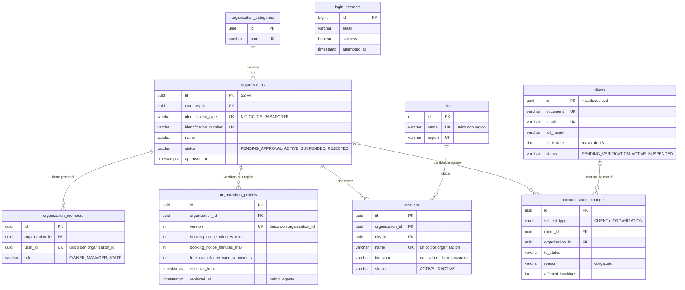
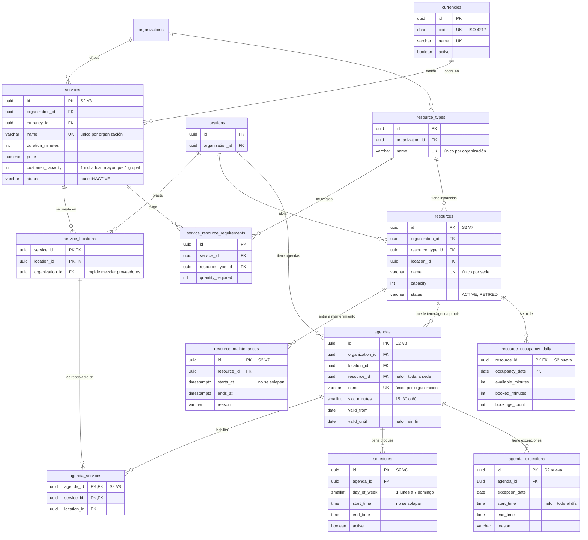
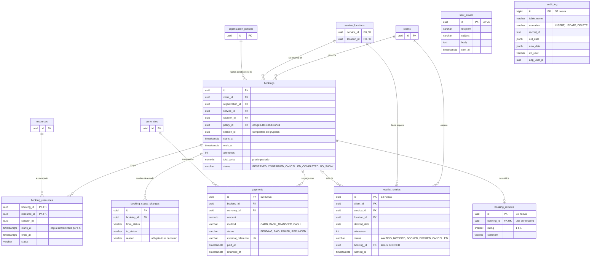

# Plataforma de Reservas de Servicios — Modelo de datos

Sprint 2 · Bases de Datos · CodeF@ctory 2026-II
Anderson Herrera Guzmán · Facultad de Ingeniería, Universidad de Antioquia

Este repositorio tiene el modelo de datos del caso *Plataforma de Reservas de Servicios*. El backend
del equipo está en [`CodeFactoryBookingApp/bookingplatform`](https://github.com/CodeFactoryBookingApp/bookingplatform).

La entrega del Sprint 1 está intacta en [`sprint-1/`](sprint-1/) y en la etiqueta
[`sprint-1`](https://github.com/andersonhg19/bookingplatform-BDs/tree/sprint-1) del repositorio.

| Archivo | Qué es |
|---|---|
| [`schema.sql`](schema.sql) | Modelo físico completo: 29 tablas, restricciones, índices, triggers, roles y RLS |
| [`seed.sql`](seed.sql) | Datos de prueba, pensados para que todas las consultas devuelvan filas |
| [`consultas.sql`](consultas.sql) | Las 24 preguntas clave: 14 del Sprint 1 y 10 del Sprint 2 |
| [`pruebas-integridad.sql`](pruebas-integridad.sql) | 25 violaciones de datos y de permisos que la base rechaza |
| [`docs/analisis-almacenamiento.md`](docs/analisis-almacenamiento.md) | Almacenamiento, índices, costo de una consulta y su optimización |
| [`docs/generar-volumen.sql`](docs/generar-volumen.sql) | Carga 1,58 millones de reservas para comprobar el análisis |
| [`docker-compose.yml`](docker-compose.yml) | PostgreSQL 16 y pgAdmin con todo cargado |

**Contenido:** [Qué cambió](#qué-cambió-frente-al-sprint-1) ·
[MER](#1-mer-refinado) · [Modelo físico](#2-modelo-físico) · [schema.sql](#3-schemasql) ·
[Consultas](#4-consultas) · [Volumen](#5-estimación-de-volumen) · [Seguridad](#6-roles-y-seguridad) ·
[Análisis](#7-análisis-de-almacenamiento-costo-y-optimización) · [Rúbrica](#dónde-está-cada-criterio-de-la-rúbrica)

## Cómo probarlo

```bash
docker compose up -d
```

Levanta PostgreSQL 16 en `localhost:5432` con `schema.sql` y `seed.sql` ya cargados, y pgAdmin en
<http://localhost:8080>. Las credenciales del `docker-compose.yml` son de desarrollo local. El
contenedor sólo queda `healthy` si existen las 29 tablas.

```bash
docker compose cp consultas.sql postgres:/tmp/
docker compose cp pruebas-integridad.sql postgres:/tmp/
docker compose exec postgres psql -U postgres -d reservas -f /tmp/consultas.sql
docker compose exec postgres psql -U postgres -d reservas -f /tmp/pruebas-integridad.sql
```

Para empezar de cero: `docker compose down -v && docker compose up -d`.

## Qué cambió frente al Sprint 1

En el Sprint 1 entregué 19 tablas. Después el equipo adoptó Flyway y, con las historias del Sprint 2,
hizo cambios al esquema en las migraciones V3 a V9 del backend. Yo sumé seis tablas para cubrir
partes del caso que todavía no tenían dónde guardarse. El resultado son 29 tablas.

**Lo que hizo el equipo** (está en `src/main/resources/db/migration`; aquí está consolidado en un solo
archivo):

| Migración | Cambio | HU |
|---|---|---|
| V3 | Un servicio nace `INACTIVE`. `fn_bookings_reglas` sólo valida lo que compromete agenda nueva y resiste reservas simultáneas por el último cupo | 004, 009, 010 |
| V4 | `organizations.nit` pasa a `identification_type` + `identification_number`, porque una persona natural también presta servicios | 002 |
| V6 | Nueva `sent_emails`: Render bloquea SMTP y el correo se guarda en una bandeja | — |
| V7 | `resources` gana `capacity` y `organization_id`, y su estado pasa a `ACTIVE`/`RETIRED`. Nueva `resource_maintenances` | 009 |
| V8 | Nuevas `agendas` y `agenda_services`. `schedules` deja de colgar de la sede y pasa a ser un bloque de una agenda | 006 |
| V9 | Función `f_sin_tildes` para buscar sin distinguir tildes | 005 |

**Lo que agregué yo en este sprint:**

| Tabla nueva | Para qué | Por qué hacía falta |
|---|---|---|
| `agenda_exceptions` | Festivos, cierres y jornadas recortadas | `schedules` sólo sabe de días de la semana. En el Sprint 1 lo dejé anotado en "lo que no garantiza" |
| `booking_reviews` | Calificación de 1 a 5 de una reserva atendida | El caso pide reportes de uso, y la calidad del servicio es parte del uso |
| `waitlist_entries` | Lista de espera cuando no hay cupo | Completa el control de disponibilidad: hoy, si no hay cupo, el cliente simplemente se pierde |
| `payments` | Pagos, intentos fallidos y reembolsos | `bookings.total_price` dice cuánto se pactó, pero nada decía si se pagó o se devolvió |
| `resource_occupancy_daily` | Ocupación diaria por recurso | Los "reportes sobre ocupación y uso" del caso, sin recorrer todas las reservas cada vez |
| `audit_log` | Quién cambió qué y cuándo | Seguridad: los cambios a clientes, proveedores, políticas, servicios, pagos y reseñas quedan registrados por trigger |

Además: un índice que faltaba en `schedules(agenda_id)`, los triggers de auditoría, y los roles,
permisos y políticas de la sección 6.

**Lo que no toqué.** Yo no renombré ni eliminé nada; los cambios de nombre de la tabla de arriba los
hizo el equipo en sus migraciones. Comparé el catálogo de las
23 tablas del equipo después de aplicar sus migraciones V1 a V9 con el que crea este `schema.sql`:
columnas, tipos, nulos, defaults, restricciones, índices y el cuerpo de sus funciones son idénticos.
Lo único distinto es lo que agregué.

## 1. MER refinado

Son 29 tablas, así que las parto en tres vistas. Las tablas nuevas de este sprint dicen **S2 nueva**
en su clave primaria; las que el equipo cambió dicen **S2 V*n***. Algunas tablas aparecen en dos vistas
para que se vea con qué se conectan.

`auth.users` la gestiona Supabase Auth y no se crea aquí. Por eso `clients.id`,
`organization_members.user_id` y los `changed_by` no tienen clave foránea declarada.

### Identidad y organización



### Servicios, recursos y agendas



### Reservas, pagos y auditoría



En `bookings` dibujé la relación con `service_locations`, que es la que fija servicio y sede. Sus
otras FK, hacia `services`, `locations` y `organization_policies`, son compuestas con
`organization_id` y existen para que una reserva no mezcle datos de dos proveedores. Van en el modelo
físico.

`sent_emails` y `audit_log` no tienen claves foráneas a propósito. Un correo puede ir a una dirección
que no es de ningún cliente, y una fila de auditoría tiene que sobrevivir al registro que describe.

## 2. Modelo físico

Esta sección la generé desde el catálogo de PostgreSQL después de correr `schema.sql`, así que
corresponde a lo que crea el script. Sólo le quité los casts que PostgreSQL agrega al reescribir las
restricciones (`::text`, `= ANY (ARRAY[...])`) para que se lean como en el `schema.sql`. Cada tabla trae sus columnas con tipo, nulo, default y clave, y
debajo las restricciones que abarcan varias columnas, los `CHECK` y los `EXCLUDE`.

Convención de nombres: `pk_`, `fk_`, `uk_`, `ck_`, `ex_`, `ix_` y `ux_` (índice único), seguidos del
nombre de la tabla y de lo que controlan. Las seis tablas nuevas la siguen completa. En las del equipo
la conservé como estaba: algunas PK tienen el nombre automático `<tabla>_pkey` y dos prefijos están
abreviados (`ck_bsc_`, `ix_asc_`). No los cambio porque esas tablas ya están en producción y la regla
del equipo es no renombrar.

<details>
<summary><b>Catálogos</b> · cities, organization_categories, currencies</summary>


#### `cities`

Catálogo de ciudades, con departamento.

| Columna | Tipo | Nulo | Default | Clave |
|---|---|---|---|---|
| `id` | `uuid` | no | `gen_random_uuid()` | PK |
| `name` | `varchar(120)` | no |  |  |
| `region` | `varchar(120)` | no |  |  |

- UNIQUE `uk_cities_name_region`: `UNIQUE (name, region)`
- CHECK `ck_cities_name`: `CHECK ((length(btrim(name)) > 0))`


#### `organization_categories`

Catálogo de categorías de negocio.

| Columna | Tipo | Nulo | Default | Clave |
|---|---|---|---|---|
| `id` | `uuid` | no | `gen_random_uuid()` | PK |
| `name` | `varchar(80)` | no |  | UNIQUE |

- CHECK `ck_organization_categories_name`: `CHECK ((length(btrim(name)) > 0))`


#### `currencies`

Monedas ISO 4217. La baja es lógica (active).

| Columna | Tipo | Nulo | Default | Clave |
|---|---|---|---|---|
| `id` | `uuid` | no | `gen_random_uuid()` | PK |
| `code` | `char(3)` | no |  | UNIQUE |
| `name` | `varchar(60)` | no |  | UNIQUE |
| `active` | `boolean` | no | `true` |  |

- CHECK `ck_currencies_code`: `CHECK ((code ~ '^[A-Z]{3}$'))`

</details>

<details>
<summary><b>Identidad</b> · clients, login_attempts</summary>


#### `clients`

Perfil del cliente (HU-001); id = auth.users.id de Supabase. Implementada por el equipo.

| Columna | Tipo | Nulo | Default | Clave |
|---|---|---|---|---|
| `id` | `uuid` | no |  | PK |
| `full_name` | `varchar(120)` | no |  |  |
| `document` | `varchar(30)` | no |  | UNIQUE |
| `birth_date` | `date` | no |  |  |
| `email` | `varchar(160)` | no |  | UNIQUE |
| `phone` | `varchar(20)` | no |  |  |
| `city` | `varchar(80)` | no |  |  |
| `notification_channel` | `varchar(20)` | no |  |  |
| `status` | `varchar(30)` | no |  |  |
| `created_at` | `timestamp(6)` | no |  |  |
| `updated_at` | `timestamp(6)` | no |  |  |

- CHECK `ck_clients_adult`: `CHECK ((birth_date <= (CURRENT_DATE - '18 years')))`
- CHECK `ck_clients_email_formato`: `CHECK ((email ~* '^[^@[:space:]]+@[^@[:space:]]+\.[a-z]{2,}$'))`
- CHECK `ck_clients_notification_channel`: `CHECK ((notification_channel IN ('EMAIL', 'SMS', 'WHATSAPP')))`
- CHECK `ck_clients_phone_formato`: `CHECK ((phone ~ '^\+?[0-9]{7,15}$'))`
- CHECK `ck_clients_status`: `CHECK ((status IN ('PENDING_VERIFICATION', 'ACTIVE', 'SUSPENDED')))`
- UNIQUE (índice) `ux_clients_email_lower`: `USING btree (lower(email))`


#### `login_attempts`

Intentos de ingreso para el bloqueo por cuenta (HU-021). Implementada por el equipo.

| Columna | Tipo | Nulo | Default | Clave |
|---|---|---|---|---|
| `id` | `bigint` | no | `generated by default as identity` | PK |
| `email` | `varchar(160)` | no |  |  |
| `success` | `boolean` | no |  |  |
| `attempted_at` | `timestamp(6)` | no |  |  |

</details>

<details>
<summary><b>Organización</b> · organizations, organization_members, organization_policies, locations</summary>


#### `organizations` · cambió en el Sprint 2 (V4 del equipo)

Negocio proveedor (HU-002). PENDING_APPROVAL hasta que un administrador lo apruebe.

| Columna | Tipo | Nulo | Default | Clave |
|---|---|---|---|---|
| `id` | `uuid` | no | `gen_random_uuid()` | PK |
| `category_id` | `uuid` | no |  | FK → `organization_categories` |
| `name` | `varchar(160)` | no |  |  |
| `identification_type` | `varchar(20)` | no | `'NIT'` |  |
| `identification_number` | `varchar(20)` | no |  |  |
| `contact_email` | `varchar(160)` | no |  |  |
| `contact_phone` | `varchar(20)` | no |  |  |
| `timezone` | `varchar(60)` | no | `'America/Bogota'` |  |
| `status` | `varchar(30)` | no | `'PENDING_APPROVAL'` |  |
| `approved_at` | `timestamptz` | sí |  |  |
| `created_at` | `timestamptz` | no | `now()` |  |
| `updated_at` | `timestamptz` | no | `now()` |  |

- UNIQUE `uk_organizations_identification`: `UNIQUE (identification_type, identification_number)`
- CHECK `ck_organizations_approved`: `CHECK ((((status = 'ACTIVE') AND (approved_at IS NOT NULL)) OR ((status IN ('PENDING_APPROVAL', 'REJECTED')) AND (approved_at IS NULL)) OR (status = 'SUSPENDED')))`
- CHECK `ck_organizations_email`: `CHECK ((contact_email ~* '^[^@[:space:]]+@[^@[:space:]]+\.[a-z]{2,}$'))`
- CHECK `ck_organizations_identification_number`: `CHECK ((length(btrim(identification_number)) > 0))`
- CHECK `ck_organizations_identification_type`: `CHECK ((identification_type IN ('NIT', 'CC', 'CE', 'PASAPORTE')))`
- CHECK `ck_organizations_name`: `CHECK ((length(btrim(name)) > 0))`
- CHECK `ck_organizations_status`: `CHECK ((status IN ('PENDING_APPROVAL', 'ACTIVE', 'SUSPENDED', 'REJECTED')))`


#### `organization_members`

Quién trabaja en qué proveedor y con qué rol (ADR-0008).

| Columna | Tipo | Nulo | Default | Clave |
|---|---|---|---|---|
| `id` | `uuid` | no | `gen_random_uuid()` | PK |
| `organization_id` | `uuid` | no |  | FK → `organizations` |
| `user_id` | `uuid` | no |  |  |
| `role` | `varchar(30)` | no |  |  |
| `created_at` | `timestamptz` | no | `now()` |  |

- UNIQUE `uk_organization_members`: `UNIQUE (organization_id, user_id)`
- CHECK `ck_organization_members_role`: `CHECK ((role IN ('OWNER', 'MANAGER', 'STAFF')))`


#### `organization_policies`

Reglas de anticipación y cancelación, versionadas (HU-002).

| Columna | Tipo | Nulo | Default | Clave |
|---|---|---|---|---|
| `id` | `uuid` | no | `gen_random_uuid()` | PK |
| `organization_id` | `uuid` | no |  | FK → `organizations` |
| `version` | `integer` | no |  |  |
| `booking_notice_minutes_min` | `integer` | no |  |  |
| `booking_notice_minutes_max` | `integer` | no |  |  |
| `free_cancellation_window_minutes` | `integer` | no |  |  |
| `effective_from` | `timestamptz` | no | `now()` |  |
| `replaced_at` | `timestamptz` | sí |  |  |

- EXCLUDE `ex_organization_policies_solape`: `EXCLUDE USING gist (organization_id WITH =, tstzrange(effective_from, replaced_at) WITH &&)`
- UNIQUE `uk_organization_policies_id_org`: `UNIQUE (id, organization_id)`
- UNIQUE `uk_organization_policies_version`: `UNIQUE (organization_id, version)`
- CHECK `ck_organization_policies_cancel`: `CHECK ((free_cancellation_window_minutes >= 0))`
- CHECK `ck_organization_policies_notice`: `CHECK (((booking_notice_minutes_min >= 0) AND (booking_notice_minutes_max >= 0) AND (booking_notice_minutes_min <= booking_notice_minutes_max)))`
- CHECK `ck_organization_policies_version`: `CHECK ((version > 0))`
- CHECK `ck_organization_policies_vigencia`: `CHECK (((replaced_at IS NULL) OR (replaced_at > effective_from)))`
- UNIQUE (índice) `ux_organization_policies_vigente`: `USING btree (organization_id) WHERE (replaced_at IS NULL)`


#### `locations`

Sedes de un proveedor.

| Columna | Tipo | Nulo | Default | Clave |
|---|---|---|---|---|
| `id` | `uuid` | no | `gen_random_uuid()` | PK |
| `organization_id` | `uuid` | no |  | FK → `organizations` |
| `name` | `varchar(120)` | no |  |  |
| `address` | `varchar(200)` | no |  |  |
| `city_id` | `uuid` | no |  | FK → `cities` |
| `timezone` | `varchar(60)` | sí |  |  |
| `status` | `varchar(20)` | no | `'ACTIVE'` |  |
| `created_at` | `timestamptz` | no | `now()` |  |
| `updated_at` | `timestamptz` | no | `now()` |  |

- UNIQUE `uk_locations_id_org`: `UNIQUE (id, organization_id)`
- UNIQUE `uk_locations_org_name`: `UNIQUE (organization_id, name)`
- CHECK `ck_locations_name`: `CHECK ((length(btrim(name)) > 0))`
- CHECK `ck_locations_status`: `CHECK ((status IN ('ACTIVE', 'INACTIVE')))`

</details>

<details>
<summary><b>Servicios y recursos</b> · services, service_locations, resource_types, service_resource_requirements, resources, resource_maintenances</summary>


#### `services` · cambió en el Sprint 2 (V3 del equipo)

Servicios ofertados (HU-004). customer_capacity 1 = individual, > 1 = grupal.

| Columna | Tipo | Nulo | Default | Clave |
|---|---|---|---|---|
| `id` | `uuid` | no | `gen_random_uuid()` | PK |
| `organization_id` | `uuid` | no |  | FK → `organizations` |
| `name` | `varchar(120)` | no |  |  |
| `description` | `varchar(500)` | sí |  |  |
| `duration_minutes` | `integer` | no |  |  |
| `preparation_minutes` | `integer` | no | `0` |  |
| `cleanup_minutes` | `integer` | no | `0` |  |
| `price` | `numeric(12,2)` | no |  |  |
| `currency_id` | `uuid` | no |  | FK → `currencies` |
| `customer_capacity` | `integer` | no | `1` |  |
| `status` | `varchar(20)` | no | `'INACTIVE'` |  |
| `created_at` | `timestamptz` | no | `now()` |  |
| `updated_at` | `timestamptz` | no | `now()` |  |

- UNIQUE `uk_services_id_org`: `UNIQUE (id, organization_id)`
- UNIQUE `uk_services_org_name`: `UNIQUE (organization_id, name)`
- CHECK `ck_services_capacity`: `CHECK ((customer_capacity >= 1))`
- CHECK `ck_services_duration`: `CHECK ((duration_minutes > 0))`
- CHECK `ck_services_name`: `CHECK ((length(btrim(name)) > 0))`
- CHECK `ck_services_prep`: `CHECK (((preparation_minutes >= 0) AND (cleanup_minutes >= 0)))`
- CHECK `ck_services_price`: `CHECK ((price >= (0)))`
- CHECK `ck_services_status`: `CHECK ((status IN ('ACTIVE', 'INACTIVE')))`


#### `service_locations`

En qué sedes se presta cada servicio (HU-004).

| Columna | Tipo | Nulo | Default | Clave |
|---|---|---|---|---|
| `service_id` | `uuid` | no |  | PK |
| `location_id` | `uuid` | no |  | PK |
| `organization_id` | `uuid` | no |  |  |

- PK `pk_service_locations`: `PRIMARY KEY (service_id, location_id)`
- FK `fk_service_locations_loc`: `FOREIGN KEY (location_id, organization_id) REFERENCES locations(id, organization_id) ON DELETE CASCADE`
- FK `fk_service_locations_svc`: `FOREIGN KEY (service_id, organization_id) REFERENCES services(id, organization_id) ON DELETE CASCADE`


#### `resource_types`

Tipos de recurso no consumible: sala, silla, especialista.

| Columna | Tipo | Nulo | Default | Clave |
|---|---|---|---|---|
| `id` | `uuid` | no | `gen_random_uuid()` | PK |
| `organization_id` | `uuid` | no |  | FK → `organizations` |
| `name` | `varchar(80)` | no |  |  |
| `description` | `varchar(300)` | sí |  |  |
| `created_at` | `timestamptz` | no | `now()` |  |

- UNIQUE `uk_resource_types_id_org`: `UNIQUE (id, organization_id)`
- UNIQUE `uk_resource_types_org_name`: `UNIQUE (organization_id, name)`


#### `service_resource_requirements`

Cuántos recursos de cada tipo exige un servicio.

| Columna | Tipo | Nulo | Default | Clave |
|---|---|---|---|---|
| `id` | `uuid` | no | `gen_random_uuid()` | PK |
| `service_id` | `uuid` | no |  |  |
| `resource_type_id` | `uuid` | no |  |  |
| `organization_id` | `uuid` | no |  |  |
| `quantity_required` | `integer` | no | `1` |  |

- UNIQUE `uk_service_resource_req`: `UNIQUE (service_id, resource_type_id)`
- FK `fk_service_resource_req_svc`: `FOREIGN KEY (service_id, organization_id) REFERENCES services(id, organization_id) ON DELETE CASCADE`
- FK `fk_service_resource_req_type`: `FOREIGN KEY (resource_type_id, organization_id) REFERENCES resource_types(id, organization_id) ON DELETE RESTRICT`
- CHECK `ck_service_resource_req_qty`: `CHECK ((quantity_required > 0))`


#### `resources` · cambió en el Sprint 2 (V7 del equipo)

Recurso concreto en una sede, con capacidad y estado (HU-009).

| Columna | Tipo | Nulo | Default | Clave |
|---|---|---|---|---|
| `id` | `uuid` | no | `gen_random_uuid()` | PK |
| `organization_id` | `uuid` | no |  |  |
| `resource_type_id` | `uuid` | no |  | FK → `resource_types` |
| `location_id` | `uuid` | no |  | FK → `locations` |
| `name` | `varchar(120)` | no |  |  |
| `capacity` | `integer` | no | `1` |  |
| `status` | `varchar(20)` | no | `'ACTIVE'` |  |
| `created_at` | `timestamptz` | no | `now()` |  |
| `updated_at` | `timestamptz` | no | `now()` |  |

- UNIQUE `uk_resources_id_location`: `UNIQUE (id, location_id)`
- UNIQUE `uk_resources_location_name`: `UNIQUE (location_id, name)`
- FK `fk_resources_location_org`: `FOREIGN KEY (location_id, organization_id) REFERENCES locations(id, organization_id) ON DELETE RESTRICT`
- FK `fk_resources_type_org`: `FOREIGN KEY (resource_type_id, organization_id) REFERENCES resource_types(id, organization_id) ON DELETE RESTRICT`
- CHECK `ck_resources_capacity`: `CHECK ((capacity >= 1))`
- CHECK `ck_resources_status`: `CHECK ((status IN ('ACTIVE', 'RETIRED')))`


#### `resource_maintenances` · cambió en el Sprint 2 (V7 del equipo)

Periodos de mantenimiento: el recurso no genera disponibilidad (HU-009).

| Columna | Tipo | Nulo | Default | Clave |
|---|---|---|---|---|
| `id` | `uuid` | no | `gen_random_uuid()` | PK |
| `resource_id` | `uuid` | no |  | FK → `resources` |
| `starts_at` | `timestamptz` | no |  |  |
| `ends_at` | `timestamptz` | no |  |  |
| `reason` | `varchar(300)` | sí |  |  |
| `created_at` | `timestamptz` | no | `now()` |  |

- EXCLUDE `ex_resource_maintenances_solape`: `EXCLUDE USING gist (resource_id WITH =, tstzrange(starts_at, ends_at) WITH &&)`
- CHECK `ck_resource_maintenances_rango`: `CHECK ((ends_at > starts_at))`

</details>

<details>
<summary><b>Agendas</b> · agendas, agenda_services, schedules, agenda_exceptions</summary>


#### `agendas` · cambió en el Sprint 2 (V8 del equipo)

Agenda de una sede o de un recurso: granularidad, vigencia y servicios (HU-006).

| Columna | Tipo | Nulo | Default | Clave |
|---|---|---|---|---|
| `id` | `uuid` | no | `gen_random_uuid()` | PK |
| `organization_id` | `uuid` | no |  |  |
| `location_id` | `uuid` | no |  |  |
| `resource_id` | `uuid` | sí |  |  |
| `name` | `varchar(120)` | no |  |  |
| `slot_minutes` | `smallint` | no |  |  |
| `valid_from` | `date` | no |  |  |
| `valid_until` | `date` | sí |  |  |
| `created_at` | `timestamptz` | no | `now()` |  |
| `updated_at` | `timestamptz` | no | `now()` |  |

- EXCLUDE `ex_agendas_solape`: `EXCLUDE USING gist (location_id WITH =, COALESCE(resource_id, '00000000-0000-0000-0000-000000000000') WITH =, daterange(valid_from, valid_until, '[]') WITH &&)`
- UNIQUE `uk_agendas_id_location`: `UNIQUE (id, location_id)`
- UNIQUE `uk_agendas_org_name`: `UNIQUE (organization_id, name)`
- FK `fk_agendas_location_org`: `FOREIGN KEY (location_id, organization_id) REFERENCES locations(id, organization_id) ON DELETE RESTRICT`
- FK `fk_agendas_resource`: `FOREIGN KEY (resource_id, location_id) REFERENCES resources(id, location_id) ON DELETE RESTRICT`
- CHECK `ck_agendas_name`: `CHECK ((length(btrim(name)) > 0))`
- CHECK `ck_agendas_slot`: `CHECK ((slot_minutes IN (15, 30, 60)))`
- CHECK `ck_agendas_vigencia`: `CHECK (((valid_until IS NULL) OR (valid_until >= valid_from)))`


#### `agenda_services` · cambió en el Sprint 2 (V8 del equipo)

Servicios reservables en una agenda (HU-006).

| Columna | Tipo | Nulo | Default | Clave |
|---|---|---|---|---|
| `agenda_id` | `uuid` | no |  | PK |
| `service_id` | `uuid` | no |  | PK |
| `location_id` | `uuid` | no |  |  |

- PK `pk_agenda_services`: `PRIMARY KEY (agenda_id, service_id)`
- FK `fk_agenda_services_agenda`: `FOREIGN KEY (agenda_id, location_id) REFERENCES agendas(id, location_id) ON DELETE CASCADE`
- FK `fk_agenda_services_service`: `FOREIGN KEY (service_id, location_id) REFERENCES service_locations(service_id, location_id) ON DELETE CASCADE`


#### `schedules` · cambió en el Sprint 2 (V8 del equipo)

Bloques horarios semanales de una agenda (HU-006).

| Columna | Tipo | Nulo | Default | Clave |
|---|---|---|---|---|
| `id` | `uuid` | no | `gen_random_uuid()` | PK |
| `agenda_id` | `uuid` | no |  | FK → `agendas` |
| `day_of_week` | `smallint` | no |  |  |
| `start_time` | `time` | no |  |  |
| `end_time` | `time` | no |  |  |
| `active` | `boolean` | no | `true` |  |
| `created_at` | `timestamptz` | no | `now()` |  |

- EXCLUDE `ex_schedules_solape`: `EXCLUDE USING gist (agenda_id WITH =, day_of_week WITH =, timerange(start_time, end_time) WITH &&) WHERE (active)`
- CHECK `ck_schedules_dow`: `CHECK (((day_of_week >= 1) AND (day_of_week <= 7)))`
- CHECK `ck_schedules_rango`: `CHECK ((end_time > start_time))`


#### `agenda_exceptions` · **[S2 nueva]**

Festivos, cierres y jornadas recortadas de una agenda.

| Columna | Tipo | Nulo | Default | Clave |
|---|---|---|---|---|
| `id` | `uuid` | no | `gen_random_uuid()` | PK |
| `agenda_id` | `uuid` | no |  | FK → `agendas` |
| `exception_date` | `date` | no |  |  |
| `start_time` | `time` | sí |  |  |
| `end_time` | `time` | sí |  |  |
| `reason` | `varchar(300)` | no |  |  |
| `created_at` | `timestamptz` | no | `now()` |  |

- EXCLUDE `ex_agenda_exceptions_solape`: `EXCLUDE USING gist (agenda_id WITH =, exception_date WITH =, timerange(COALESCE(start_time, '00:00:00'), COALESCE(end_time, '24:00:00')) WITH &&)`
- CHECK `ck_agenda_exceptions_franja`: `CHECK ((((start_time IS NULL) AND (end_time IS NULL)) OR ((start_time IS NOT NULL) AND (end_time IS NOT NULL) AND (end_time > start_time))))`
- CHECK `ck_agenda_exceptions_reason`: `CHECK ((length(btrim(reason)) > 0))`

</details>

<details>
<summary><b>Reservas</b> · bookings, booking_resources, booking_status_changes, account_status_changes, booking_reviews, waitlist_entries, payments</summary>


#### `bookings`

Reserva. policy_id congela las condiciones vigentes al crearla (HU-002).

| Columna | Tipo | Nulo | Default | Clave |
|---|---|---|---|---|
| `id` | `uuid` | no | `gen_random_uuid()` | PK |
| `client_id` | `uuid` | no |  | FK → `clients` |
| `organization_id` | `uuid` | no |  |  |
| `service_id` | `uuid` | no |  |  |
| `location_id` | `uuid` | no |  |  |
| `policy_id` | `uuid` | no |  |  |
| `session_id` | `uuid` | no |  |  |
| `starts_at` | `timestamptz` | no |  |  |
| `ends_at` | `timestamptz` | no |  |  |
| `attendees` | `integer` | no | `1` |  |
| `total_price` | `numeric(12,2)` | no |  |  |
| `status` | `varchar(20)` | no | `'RESERVED'` |  |
| `cancelled_at` | `timestamptz` | sí |  |  |
| `created_at` | `timestamptz` | no | `now()` |  |
| `updated_at` | `timestamptz` | no | `now()` |  |

- UNIQUE `uk_bookings_snapshot`: `UNIQUE (id, starts_at, ends_at, status)`
- FK `fk_bookings_location_org`: `FOREIGN KEY (location_id, organization_id) REFERENCES locations(id, organization_id) ON DELETE RESTRICT`
- FK `fk_bookings_policy_org`: `FOREIGN KEY (policy_id, organization_id) REFERENCES organization_policies(id, organization_id) ON DELETE RESTRICT`
- FK `fk_bookings_service_location`: `FOREIGN KEY (service_id, location_id) REFERENCES service_locations(service_id, location_id) ON DELETE RESTRICT`
- FK `fk_bookings_service_org`: `FOREIGN KEY (service_id, organization_id) REFERENCES services(id, organization_id) ON DELETE RESTRICT`
- CHECK `ck_bookings_attendees`: `CHECK ((attendees > 0))`
- CHECK `ck_bookings_cancel`: `CHECK (((status <> 'CANCELLED') OR (cancelled_at IS NOT NULL)))`
- CHECK `ck_bookings_price`: `CHECK ((total_price >= (0)))`
- CHECK `ck_bookings_rango`: `CHECK ((ends_at > starts_at))`
- CHECK `ck_bookings_status`: `CHECK ((status IN ('RESERVED', 'CONFIRMED', 'CANCELLED', 'COMPLETED', 'NO_SHOW')))`


#### `booking_resources`

Recursos ocupados por una reserva; el EXCLUDE impide la sobreocupación.

| Columna | Tipo | Nulo | Default | Clave |
|---|---|---|---|---|
| `booking_id` | `uuid` | no |  | PK |
| `resource_id` | `uuid` | no |  | PK |
| `location_id` | `uuid` | no |  |  |
| `session_id` | `uuid` | no |  |  |
| `starts_at` | `timestamptz` | no |  |  |
| `ends_at` | `timestamptz` | no |  |  |
| `status` | `varchar(20)` | no |  |  |

- EXCLUDE `ex_booking_resources_solape`: `EXCLUDE USING gist (resource_id WITH =, session_id WITH <>, tstzrange(starts_at, ends_at) WITH &&) WHERE ((status IN ('RESERVED', 'CONFIRMED')))`
- PK `pk_booking_resources`: `PRIMARY KEY (booking_id, resource_id)`
- FK `fk_booking_resources_bkg`: `FOREIGN KEY (booking_id, starts_at, ends_at, status) REFERENCES bookings(id, starts_at, ends_at, status) ON UPDATE CASCADE ON DELETE CASCADE`
- FK `fk_booking_resources_res`: `FOREIGN KEY (resource_id, location_id) REFERENCES resources(id, location_id) ON DELETE RESTRICT`
- CHECK `ck_booking_resources_rango`: `CHECK ((ends_at > starts_at))`
- CHECK `ck_booking_resources_status`: `CHECK ((status IN ('RESERVED', 'CONFIRMED', 'CANCELLED', 'COMPLETED', 'NO_SHOW')))`


#### `booking_status_changes`

Historia de estados de una reserva.

| Columna | Tipo | Nulo | Default | Clave |
|---|---|---|---|---|
| `id` | `uuid` | no | `gen_random_uuid()` | PK |
| `booking_id` | `uuid` | no |  | FK → `bookings` |
| `from_status` | `varchar(20)` | sí |  |  |
| `to_status` | `varchar(20)` | no |  |  |
| `reason` | `varchar(300)` | sí |  |  |
| `changed_by` | `uuid` | sí |  |  |
| `changed_at` | `timestamptz` | no | `now()` |  |

- CHECK `ck_bsc_from`: `CHECK (((from_status IS NULL) OR (from_status IN ('RESERVED', 'CONFIRMED', 'CANCELLED', 'COMPLETED', 'NO_SHOW'))))`
- CHECK `ck_bsc_reason`: `CHECK (((to_status <> 'CANCELLED') OR (length(btrim((COALESCE(reason, '')))) > 0)))`
- CHECK `ck_bsc_to`: `CHECK ((to_status IN ('RESERVED', 'CONFIRMED', 'CANCELLED', 'COMPLETED', 'NO_SHOW')))`


#### `account_status_changes`

Historia de estados de cuentas, con motivo obligatorio (HU-003).

| Columna | Tipo | Nulo | Default | Clave |
|---|---|---|---|---|
| `id` | `uuid` | no | `gen_random_uuid()` | PK |
| `subject_type` | `varchar(20)` | no |  |  |
| `client_id` | `uuid` | sí |  | FK → `clients` |
| `organization_id` | `uuid` | sí |  | FK → `organizations` |
| `from_status` | `varchar(30)` | sí |  |  |
| `to_status` | `varchar(30)` | no |  |  |
| `reason` | `varchar(500)` | no |  |  |
| `affected_bookings` | `integer` | no | `0` |  |
| `changed_by` | `uuid` | sí |  |  |
| `changed_at` | `timestamptz` | no | `now()` |  |

- CHECK `ck_account_status_changes_count`: `CHECK ((affected_bookings >= 0))`
- CHECK `ck_account_status_changes_reason`: `CHECK ((length(btrim(reason)) > 0))`
- CHECK `ck_account_status_changes_subject`: `CHECK ((((subject_type = 'CLIENT') AND (client_id IS NOT NULL) AND (organization_id IS NULL)) OR ((subject_type = 'ORGANIZATION') AND (organization_id IS NOT NULL) AND (client_id IS NULL))))`


#### `booking_reviews` · **[S2 nueva]**

Calificación de 1 a 5 de una reserva completada.

| Columna | Tipo | Nulo | Default | Clave |
|---|---|---|---|---|
| `id` | `uuid` | no | `gen_random_uuid()` | PK |
| `booking_id` | `uuid` | no |  | FK → `bookings`, UNIQUE |
| `rating` | `smallint` | no |  |  |
| `comment` | `varchar(1000)` | sí |  |  |
| `created_at` | `timestamptz` | no | `now()` |  |
| `updated_at` | `timestamptz` | no | `now()` |  |

- CHECK `ck_booking_reviews_comment`: `CHECK (((comment IS NULL) OR (length(btrim(comment)) > 0)))`
- CHECK `ck_booking_reviews_rating`: `CHECK (((rating >= 1) AND (rating <= 5)))`


#### `waitlist_entries` · **[S2 nueva]**

Lista de espera por servicio, sede y día.

| Columna | Tipo | Nulo | Default | Clave |
|---|---|---|---|---|
| `id` | `uuid` | no | `gen_random_uuid()` | PK |
| `client_id` | `uuid` | no |  | FK → `clients` |
| `service_id` | `uuid` | no |  |  |
| `location_id` | `uuid` | no |  |  |
| `desired_date` | `date` | no |  |  |
| `attendees` | `integer` | no | `1` |  |
| `status` | `varchar(20)` | no | `'WAITING'` |  |
| `booking_id` | `uuid` | sí |  | FK → `bookings` |
| `notified_at` | `timestamptz` | sí |  |  |
| `created_at` | `timestamptz` | no | `now()` |  |
| `updated_at` | `timestamptz` | no | `now()` |  |

- FK `fk_waitlist_entries_service_location`: `FOREIGN KEY (service_id, location_id) REFERENCES service_locations(service_id, location_id) ON DELETE CASCADE`
- CHECK `ck_waitlist_entries_attendees`: `CHECK ((attendees > 0))`
- CHECK `ck_waitlist_entries_booked`: `CHECK (((status = 'BOOKED') = (booking_id IS NOT NULL)))`
- CHECK `ck_waitlist_entries_notified`: `CHECK (((status <> ALL ((ARRAY['NOTIFIED', 'BOOKED', 'EXPIRED']))) OR (notified_at IS NOT NULL)))`
- CHECK `ck_waitlist_entries_status`: `CHECK ((status IN ('WAITING', 'NOTIFIED', 'BOOKED', 'EXPIRED', 'CANCELLED')))`
- UNIQUE (índice) `ux_waitlist_entries_activa`: `USING btree (client_id, service_id, location_id, desired_date) WHERE (status IN ('WAITING', 'NOTIFIED'))`


#### `payments` · **[S2 nueva]**

Pagos y reembolsos de una reserva.

| Columna | Tipo | Nulo | Default | Clave |
|---|---|---|---|---|
| `id` | `uuid` | no | `gen_random_uuid()` | PK |
| `booking_id` | `uuid` | no |  | FK → `bookings` |
| `amount` | `numeric(12,2)` | no |  |  |
| `currency_id` | `uuid` | no |  | FK → `currencies` |
| `method` | `varchar(20)` | no |  |  |
| `status` | `varchar(20)` | no | `'PENDING'` |  |
| `external_reference` | `varchar(100)` | sí |  | UNIQUE |
| `paid_at` | `timestamptz` | sí |  |  |
| `refunded_at` | `timestamptz` | sí |  |  |
| `created_at` | `timestamptz` | no | `now()` |  |
| `updated_at` | `timestamptz` | no | `now()` |  |

- CHECK `ck_payments_amount`: `CHECK ((amount > (0)))`
- CHECK `ck_payments_external_reference`: `CHECK (((external_reference IS NULL) OR (length(btrim(external_reference)) > 0)))`
- CHECK `ck_payments_fechas`: `CHECK ((((status IN ('PENDING', 'FAILED')) AND (paid_at IS NULL) AND (refunded_at IS NULL)) OR ((status = 'PAID') AND (paid_at IS NOT NULL) AND (refunded_at IS NULL)) OR ((status = 'REFUNDED') AND (paid_at IS NOT NULL) AND (refunded_at IS NOT NULL) AND (refunded_at >= paid_at))))`
- CHECK `ck_payments_method`: `CHECK ((method IN ('CARD', 'BANK_TRANSFER', 'CASH')))`
- CHECK `ck_payments_status`: `CHECK ((status IN ('PENDING', 'PAID', 'FAILED', 'REFUNDED')))`
- UNIQUE (índice) `ux_payments_vigente`: `USING btree (booking_id) WHERE (status IN ('PENDING', 'PAID'))`

</details>

<details>
<summary><b>Notificaciones, reportes y auditoría</b> · sent_emails, resource_occupancy_daily, audit_log</summary>


#### `sent_emails` · cambió en el Sprint 2 (V6 del equipo)

Correos guardados en vez de enviados por SMTP (ADR-0007).

| Columna | Tipo | Nulo | Default | Clave |
|---|---|---|---|---|
| `id` | `uuid` | no | `gen_random_uuid()` | PK |
| `recipient` | `varchar(160)` | no |  |  |
| `subject` | `varchar(200)` | no |  |  |
| `body` | `text` | no |  |  |
| `sent_at` | `timestamptz` | no | `now()` |  |

- CHECK `ck_sent_emails_recipient`: `CHECK ((length(btrim(recipient)) > 0))`
- CHECK `ck_sent_emails_subject`: `CHECK ((length(btrim(subject)) > 0))`


#### `resource_occupancy_daily` · **[S2 nueva]**

Ocupación diaria por recurso, calculada por fn_calcular_ocupacion.

| Columna | Tipo | Nulo | Default | Clave |
|---|---|---|---|---|
| `resource_id` | `uuid` | no |  | PK, FK → `resources` |
| `occupancy_date` | `date` | no |  | PK |
| `available_minutes` | `integer` | no |  |  |
| `booked_minutes` | `integer` | no |  |  |
| `bookings_count` | `integer` | no |  |  |
| `calculated_at` | `timestamptz` | no | `now()` |  |

- PK `pk_resource_occupancy_daily`: `PRIMARY KEY (resource_id, occupancy_date)`
- CHECK `ck_resource_occupancy_daily_minutos`: `CHECK (((available_minutes >= 0) AND (booked_minutes >= 0) AND (bookings_count >= 0)))`


#### `audit_log` · **[S2 nueva]**

Auditoría de cambios en tablas sensibles, escrita por trigger.

| Columna | Tipo | Nulo | Default | Clave |
|---|---|---|---|---|
| `id` | `bigint` | no | `generated always as identity` | PK |
| `table_name` | `varchar(63)` | no |  |  |
| `operation` | `varchar(6)` | no |  |  |
| `record_id` | `text` | sí |  |  |
| `old_data` | `jsonb` | sí |  |  |
| `new_data` | `jsonb` | sí |  |  |
| `db_user` | `varchar(63)` | no | `SESSION_USER` |  |
| `app_user_id` | `uuid` | sí |  |  |
| `changed_at` | `timestamptz` | no | `now()` |  |

- CHECK `ck_audit_log_datos`: `CHECK ((((operation = 'INSERT') AND (old_data IS NULL) AND (new_data IS NOT NULL)) OR ((operation = 'UPDATE') AND (old_data IS NOT NULL) AND (new_data IS NOT NULL)) OR ((operation = 'DELETE') AND (old_data IS NOT NULL) AND (new_data IS NULL))))`
- CHECK `ck_audit_log_operation`: `CHECK ((operation IN ('INSERT', 'UPDATE', 'DELETE')))`
- CHECK `ck_audit_log_table`: `CHECK ((length(btrim(table_name)) > 0))`

</details>

### Normalización

Las seis tablas nuevas están en BCNF, salvo `audit_log`, que explico abajo:

| Tabla | Dependencias funcionales | Forma | Por qué |
|---|---|---|---|
| `agenda_exceptions` | `id → agenda_id, exception_date, start_time, end_time, reason` | BCNF | El único determinante es la clave |
| `booking_reviews` | `id → todo`; `booking_id → todo` | BCNF | Las dos son claves candidatas. No guarda cliente ni servicio: saldrían de `booking_id` y serían transitivas |
| `waitlist_entries` | `id → todo` | BCNF | No guarda `organization_id`: `service_id → organization_id` la haría transitiva |
| `payments` | `id → todo`; `external_reference → todo` | BCNF | `amount` y `currency_id` no se derivan de la reserva: son lo que cobró la pasarela, y una tarjeta internacional se cobra en otra moneda |
| `resource_occupancy_daily` | `(resource_id, occupancy_date) → minutos, reservas` | BCNF | Dentro de la tabla todo depende de la clave completa |
| `audit_log` | `id → todo` | no está en 1FN, a propósito | Ver abajo |

Las 23 tablas del equipo están en 3FN salvo cinco redundancias que vienen del Sprint 1 y que el motor
mantiene consistentes:

| Tabla | Dependencia que rompe la forma normal | Por qué se deja |
|---|---|---|
| `booking_resources` | `booking_id → starts_at, ends_at, status, session_id` y `resource_id → location_id`: parciales, rompe 2FN | Un `EXCLUDE` no ve a través de un join; la copia la sincroniza una FK compuesta con `on update cascade` |
| `service_locations` | `service_id → organization_id`: parcial, rompe 2FN | Las FK compuestas `(service_id, organization_id)` y `(location_id, organization_id)` impiden publicar un servicio en la sede de otro proveedor |
| `agenda_services` | `agenda_id → location_id`: parcial, rompe 2FN | La FK contra `service_locations` exige que el servicio se preste en la sede de la agenda |
| `bookings` | `service_id → organization_id`: transitiva, rompe 3FN | Las FK compuestas obligan a que servicio, sede y política sean del mismo proveedor |
| `resources` | `location_id → organization_id`: transitiva, rompe 3FN | Lo mismo para el tipo de recurso y la sede (V7 del equipo) |

En las cinco, la columna repetida es el destino de una FK compuesta, así que el motor no deja que se
desvíe de su original. La redundancia está, pero no puede generar una anomalía de actualización.

**Las redundancias de las tablas nuevas, y por qué.**

- `resource_occupancy_daily` es un dato derivado: se podría calcular desde las reservas y las agendas.
  La guardo igual, como en un data mart, porque el reporte de un mes por recurso pasa de recorrer
  todas las reservas a leer 30 filas. La llena `fn_calcular_ocupacion`, que reescribe el día
  completo, y rol_app sólo tiene permiso de leerla.
- `audit_log.old_data` y `new_data` son `jsonb`, que no es atómico. Es una excepción a 1FN a
  propósito: guardan la foto de una fila de cualquier tabla, y una columna por cada columna de cada
  tabla auditada no tendría sentido. Nadie consulta el negocio desde ahí, sólo quién cambió qué.

**Lo que dejo anotado para el equipo, sin tocarlo.** `clients.city` es texto libre aunque existe el
catálogo `cities`. Dos clientes de "Medellin" y "Medellín" quedan como ciudades distintas. Pasarlo a
una FK cambia la entidad JPA del equipo, así que es una propuesta para el siguiente sprint, no un
cambio de esta entrega.

## 3. schema.sql

Está ordenado por dependencias: catálogos, identidad, organización, servicios y recursos, agendas,
reservas, notificaciones, reportes y auditoría. Después vienen las funciones, los triggers, los
índices, los comentarios y, al final, la seguridad. Cada cambio del equipo dice de qué migración
viene, y cada tabla mía dice `[S2 nueva]`.

Lo probé así:

- Contra un PostgreSQL 16 vacío corre sin errores y crea 29 tablas, 40 FK, 68 CHECK, 6 EXCLUDE,
  91 índices y 20 triggers, con RLS activo en todas.
- Contra una base con los roles de Supabase (`anon`, `authenticated` y `auth.uid()`) crea además las
  políticas del Data API.
- `seed.sql`, las 24 consultas y las 25 pruebas de integridad corren encima. Las pruebas fallan cada
  una por la regla que les corresponde, y la parte de lo permitido pasa sin errores.
- El catálogo de las 23 tablas del equipo coincide con el de sus migraciones, como dije arriba.

Al final del archivo hay una lista de lo que el esquema **no** garantiza. Por ejemplo, que una reserva
caiga dentro de un bloque de agenda: eso lo valida el backend al ofrecer franjas.

## 4. Consultas

Todas están en [`consultas.sql`](consultas.sql), cada una con la pregunta que responde, y todas
devuelven filas con `seed.sql`. El archivo usa `\echo` para titular cada resultado, así que se corre
con `psql -f` y no en el editor SQL de Supabase. Las del Sprint 1 son las mismas de esa entrega: el equipo ya las había
ajustado a sus migraciones (la 5 usa el nuevo `identification_number` y la 6 lee los bloques desde la
agenda).

| # | Pregunta | Cómo | HU |
|---|---|---|---|
| **Sprint 1** | | | |
| 1 | ¿Qué servicios puede reservar un cliente en Medellín, en qué sede y a qué precio? | join de 6 tablas, filtros | 002, 004 |
| 2 | ¿Cuál es la ocupación por sede y semana: reservas, asistentes e ingresos? | agregación, `date_trunc` | caso |
| 3 | ¿Qué servicios no puede prestar una sede por falta de recursos? | `left join`, `having` | 004 |
| 4 | ¿Cuáles son los servicios más reservados de cada organización, con empates? | `rank()` | caso |
| 5 | Si se suspende un proveedor, ¿qué reservas futuras quedan afectadas? | join, subconsulta | 003 |
| 6 | ¿Qué agenda tiene cada recurso pasado mañana y cuánta carga lleva? | `left join`, agregación | 006 |
| 7 | ¿Qué proveedores llevan más tiempo esperando aprobación? | filtro, antigüedad | 003 |
| 8 | ¿Está bloqueada una cuenta por intentos fallidos? | agregación con ventana de tiempo | 021 |
| 9 | ¿Qué clientes llevan más de 24 h sin verificar el correo? | filtro de tiempo | 001 |
| 10 | ¿Qué condiciones de cancelación rigen para cada reserva? | join, `case` | 002 |
| 11 | ¿El correo, el documento o el NIT ya están registrados? | `exists` | 001, 002 |
| 12 | ¿Qué clientes se registraron y nunca han reservado? | `not exists` correlacionado | 001 |
| 13 | ¿Qué servicios se prestan en una sede y no en otra? | diferencia, `except` | 004 |
| 14 | ¿Qué sedes ofrecen todos los servicios activos de su organización? | división, doble negación | 004 |
| **Sprint 2** | | | |
| 15 | ¿Qué porcentaje de su horario estuvo ocupado cada recurso en los últimos 30 días? | join, agregación, `having` | caso |
| 16 | ¿Qué servicios tienen mejor calificación y con cuántas reseñas? | join de 4 tablas, `avg` | caso |
| 17 | ¿Quién sigue en lista de espera para cada servicio y día, y en qué turno? | join, `row_number()` | — |
| 18 | ¿Cuánto cobró, cuánto devolvió y cuánto le quedó a cada proveedor por mes? | `with`, `union all`, agregación | — |
| 19 | ¿Qué agendas cierran o recortan su horario en las próximas dos semanas? | `left join`, filtro de fechas | 006 |
| 20 | ¿Qué reservas vivas chocan con un mantenimiento programado? | join por solapamiento de rangos `&&` | 009 |
| 21 | ¿Qué servicios encuentra quien busca "clasico", sin tilde? | `f_sin_tildes`, `like` | 005 |
| 22 | ¿Qué reservas atendidas en los últimos 30 días no tienen reseña? | antijoin, `not exists` | — |
| 23 | ¿Quién cambió datos sensibles en la última semana y qué cambió? | `jsonb_each`, `lateral` | — |
| 24 | ¿Cuántas reservas e ingresos dejó cada servicio de un proveedor en el mes? | join, agregación | caso |

La 24 es la que analizo en el documento de almacenamiento. La 20 muestra para qué sirve tener los
mantenimientos en su propia tabla: cruza rangos de tiempo con `&&` y encuentra la reserva que hay que
mover antes de que llegue el cliente.

```sql
select r.name       as recurso,
       m.starts_at  as mantenimiento_desde,
       m.ends_at    as mantenimiento_hasta,
       m.reason     as motivo,
       c.full_name  as cliente,
       br.starts_at as reserva
from resource_maintenances m
    inner join resources         r  on r.id = m.resource_id
    inner join booking_resources br on br.resource_id = m.resource_id
                                   and tstzrange(br.starts_at, br.ends_at) && tstzrange(m.starts_at, m.ends_at)
                                   and br.status in ('RESERVED', 'CONFIRMED')
    inner join bookings          b  on b.id = br.booking_id
    inner join clients           c  on c.id = b.client_id
order by br.starts_at;
```

La 15 lee el resumen diario en vez de las reservas:

```sql
select l.name                    as sede,
       r.name                    as recurso,
       sum(o.available_minutes)  as minutos_disponibles,
       sum(o.booked_minutes)     as minutos_ocupados,
       round(100.0 * sum(o.booked_minutes) / nullif(sum(o.available_minutes), 0), 1) as porcentaje
from resource_occupancy_daily o
    inner join resources r on r.id = o.resource_id
    inner join locations l on l.id = r.location_id
where o.occupancy_date between current_date - 30 and current_date - 1
group by l.name, r.name
having sum(o.available_minutes) > 0
order by porcentaje desc, sede, recurso;
```

## 5. Estimación de volumen

**Supuestos.** La plataforma arranca en el Valle de Aburrá con 200 proveedores y suma 40 por mes, así
que termina el primer año con 680. En el año hay en promedio (200 + 680) / 2 = **440 proveedores
activos**. Cada proveedor tiene en promedio 1,5 sedes, 8 servicios y 6 recursos por sede, y atiende
10 reservas por día (300 al mes). Los clientes arrancan en 20 000 y suman 3 000 por mes.

| Tabla | Al lanzar | Crece por mes (mes 12) | Fin del año 1 | De dónde sale |
|---|---|---|---|---|
| `organizations` | 200 | 40 | 680 | supuesto de adopción |
| `locations` | 300 | 60 | 1 020 | 1,5 por proveedor |
| `services` | 1 600 | 320 | 5 440 | 8 por proveedor |
| `resources` | 1 800 | 360 | 6 120 | 6 por sede |
| `agendas` | 1 800 | 360 | 6 120 | una agenda por recurso |
| `schedules` | 10 800 | 2 160 | 36 720 | 6 bloques por semana en cada agenda |
| `agenda_exceptions` | — | 9 180 | 71 280 | 18 festivos al año: 1,5 por agenda al mes; en el año, 18 × 3 960 agendas en promedio |
| `clients` | 20 000 | 3 000 | 56 000 | supuesto de adopción |
| **`bookings`** | — | 204 000 | **1 584 000** | 440 proveedores × 300 reservas × 12 meses |
| `booking_resources` | — | 244 800 | 1 900 800 | 1,2 recursos por reserva |
| `booking_status_changes` | — | 408 000 | 3 168 000 | 2 cambios por reserva: confirmar y cerrar |
| `payments` | — | 214 200 | 1 663 200 | 1 por reserva y un 5 % de reintentos |
| `booking_reviews` | — | 30 600 | 237 600 | califica 1 de cada 4 reservas completadas (60 %) |
| `waitlist_entries` | — | 6 120 | 47 520 | 3 % de las reservas |
| `resource_occupancy_daily` | — | 183 600 | 1 445 400 | una fila por recurso por día: 3 960 recursos en promedio × 365 |
| `login_attempts` | — | 224 000 | 1 824 000 | 4 ingresos por cliente al mes, 38 000 clientes en promedio |
| `sent_emails` | — | 408 000 | 3 168 000 | 2 correos por reserva: confirmación y recordatorio |
| `audit_log` | — | 465 920 | 3 691 640 | ver el desglose abajo |

`audit_log` suma los eventos de las tablas auditadas. En el año: pagos 2 × 1 663 200 = 3 326 400
(alta y cambio de estado), clientes 2 × 56 000 = 112 000 (alta y verificación), servicios
2 × 5 440 = 10 880 (alta y activación), miembros 3 × 680 = 2 040, proveedores 2 × 680 = 1 360
(alta y aprobación), políticas 2 × 680 = 1 360 (versión inicial y un cambio) y reseñas 237 600 (una
alta cada una). En total 3 691 640. En el mes 12: 2 × 214 200 + 2 × 3 000 + 2 × 320 + 3 × 40 +
2 × 40 + 2 × 40 + 30 600 = 465 920.

Los catálogos (`cities`, `organization_categories`, `currencies`) quedan por debajo de 100 filas y
casi no crecen.

`bookings` termina el año con 1,58 millones de filas y unos 288 MB según la fórmula del curso. Medido
en PostgreSQL son 309 MB. Lo crucé generando ese volumen con
[`docs/generar-volumen.sql`](docs/generar-volumen.sql); el detalle está en el
[análisis de almacenamiento](docs/analisis-almacenamiento.md).

## 6. Roles y seguridad

### Los roles

Separo tres funciones del sistema. Cada una es un rol de grupo sin login: las personas y los servicios
entran con un usuario propio que hereda de uno de ellos. Así ninguna contraseña queda en el
repositorio.

| Rol | Quién lo usa | Qué necesita |
|---|---|---|
| `rol_admin` | administración de la base y soporte | todo |
| `rol_app` | el backend Spring Boot | sólo lo que el código hace |
| `rol_lectura` | reportes, analítica, BI | leer, pero no datos personales, de contacto ni de seguridad |

Además, en Supabase existen `anon` y `authenticated`, los roles del Data API. Ahí todo está cerrado
salvo lo que abren las políticas RLS.

### Matriz de permisos

S = select, I = insert, U = update, D = delete.

| Tablas | rol_admin | rol_app | rol_lectura | authenticated | anon |
|---|---|---|---|---|---|
| Catálogos: `cities`, `organization_categories`, `currencies` | todo | S | S | S | S |
| `clients` | todo | S I U | — | — | — |
| `organizations` | todo | S I U | S, sin documento ni contacto | — | — |
| Operación: `organization_members`, `organization_policies`, `locations`, `service_locations`, `resource_types`, `service_resource_requirements`, `resources`, `resource_maintenances`, `agendas`, `agenda_services` | todo | S I U | S | — | — |
| `services`, `schedules`, `agenda_exceptions` | todo | S I U **D** | S | — | — |
| `bookings`, `waitlist_entries` | todo | S I U | S | S, sólo las propias | — |
| `booking_reviews` | todo | S I U | S, sin el comentario | S, sólo las propias | — |
| `booking_resources`, `payments` | todo | S I U | S | — | — |
| Historiales: `booking_status_changes`, `account_status_changes` | todo | S I | S | — | — |
| `login_attempts`, `sent_emails` | todo | S I | — | — | — |
| `resource_occupancy_daily` | todo | S | S | — | — |
| `audit_log` | todo | — | — | — | — |

Por qué está así:

- **rol_app no borra**, salvo en tres tablas. Revisé el código del backend: `ManageServiceUseCase`
  borra un servicio que nunca se reservó y `AgendaRepositoryAdapter` reescribe los bloques de una
  agenda con `delete` + `insert`. Una excepción de agenda mal puesta también tiene que poder quitarse.
  Fuera de eso, nada se borra: una reserva se cancela, un recurso se retira y un servicio se
  desactiva.
- **Los historiales sólo crecen.** rol_app les agrega filas pero no las edita. Si los pudiera editar,
  dejarían de servir como evidencia de lo que pasó.
- **Los catálogos se cargan por migración** (V5 del equipo). La aplicación sólo los lee.
- **audit_log no la toca nadie más que el administrador.** La escribe el trigger `fn_auditar`, que es
  `security definer`. Así rol_app deja rastro de sus cambios sin poder leer ni borrar ese rastro.
- **rol_lectura no ve datos personales.** No lee `clients`, `sent_emails` ni `login_attempts`. De
  `organizations` no ve el documento, el correo ni el teléfono, porque desde V4 un proveedor puede ser
  una persona natural con cédula. De `booking_reviews` no ve el comentario, que es texto libre del
  cliente. Eso se hace con permisos por columna. Para un reporte basta con contar
  `bookings.client_id`.
- **Nadie crea objetos en `public`** salvo rol_admin.

### RLS

Activo RLS en las 29 tablas, siguiendo el ADR-0002 del equipo. Con RLS activo y sin políticas nadie
distinto del dueño ve filas, así que cada rol propio recibe su política. Las políticas abren filas y lo
que cada rol puede *hacer* lo siguen limitando los `GRANT`. El control de qué proveedor ve qué datos
lo hace el backend con `OrganizationAccess` (ADR-0008); la base no lo repite.

En Supabase las políticas son estas:

```sql
-- Cualquiera puede leer los catálogos
create policy cities_publico on cities for select to anon, authenticated using (true);

-- Cada cliente autenticado ve sólo sus reservas, su lista de espera y sus reseñas
create policy reservas_propias on bookings for select to authenticated
    using (client_id = (select auth.uid()));
create policy espera_propia on waitlist_entries for select to authenticated
    using (client_id = (select auth.uid()));
create policy resenas_propias on booking_reviews for select to authenticated
    using (exists (select 1 from bookings b where b.id = booking_id and b.client_id = (select auth.uid())));
```

El bloque que las crea sólo corre si existen los roles de Supabase, así que el mismo `schema.sql`
funciona en un PostgreSQL local.

### Qué rol usa la aplicación

**Hoy el backend se conecta como `postgres`**, el dueño de las tablas. Lo dice el propio V2 del equipo:
así la aplicación ignora RLS. Eso le da al backend mucho más de lo que necesita: una inyección SQL
tendría permiso de borrar cualquier tabla.

Lo que propongo, y que este esquema ya deja listo:

```sql
create role app_bookingplatform login password '...' in role rol_app;   -- el backend
create role reportes login password '...' in role rol_lectura;           -- BI
```

Flyway seguiría migrando con el usuario dueño (`spring.flyway.user`) y la aplicación usaría
`app_bookingplatform`. Es un cambio de configuración del equipo, no de código, y queda como propuesta.

### Comprobado

Las pruebas 18 a 25 de [`pruebas-integridad.sql`](pruebas-integridad.sql) intentan lo que cada rol
*no* debe poder hacer, y todas terminan en `permission denied`. La parte 3 hace con rol_app lo que hace
el backend (reservar, pagar, editar un servicio y reescribir una agenda) y todo pasa, triggers
incluidos. También corre con rol_lectura un reporte de calificaciones. Las políticas de Supabase las probé con un `auth.uid()` simulado: un cliente ve sus 4
reservas de 11 y no puede leer `clients` ni crear pagos.

## 7. Análisis de almacenamiento, costo y optimización

Está en [`docs/analisis-almacenamiento.md`](docs/analisis-almacenamiento.md). En resumen:

- **Tabla analizada:** `bookings`. L = 183 bytes, FR = 43, BR = 36 838 páginas (288 MB). El índice
  `bookings_pkey` tiene orden d = 186, altura 3 y como máximo 8 564 nodos (67 MB). PostgreSQL mide
  39 600 páginas y un índice de altura 3 con 8 307 páginas.
- **Costo:** para la consulta 24, el ciclo anidado con índice cuesta 2 370 páginas frente a 36 848 del
  hash join y 184 589 del ordenamiento y mezcla. El plan real lee 2 366.
- **Optimización:** de E₀, con un producto de 8 600 millones de tuplas, a E₁, que filtra y proyecta
  antes de la reunión con las leyes 2, 4/5, 9, 3, 8 y 11, y sólo combina 8 servicios con 99 000
  reservas para quedarse con 146.

## Dónde está cada criterio de la rúbrica

| # | Criterio | Dónde |
|---|---|---|
| 1 | MER refinado | [Sección 1](#1-mer-refinado) y [qué cambió](#qué-cambió-frente-al-sprint-1) |
| 2 | Modelo físico completo | [Sección 2](#2-modelo-físico), con normalización |
| 3 | schema.sql | [`schema.sql`](schema.sql) y [sección 3](#3-schemasql) |
| 4 | Consultas de los dos sprints | [Sección 4](#4-consultas) y [`consultas.sql`](consultas.sql) |
| 5 | Estimación de volumen | [Sección 5](#5-estimación-de-volumen) |
| 6 | Roles y seguridad | [Sección 6](#6-roles-y-seguridad) y el final de `schema.sql` |
| 7 | Almacenamiento e índices | [Análisis, secciones 2 y 3](docs/analisis-almacenamiento.md#2-organización-del-archivo-e-índices) |
| 8 | Costo de una consulta | [Análisis, sección 4](docs/analisis-almacenamiento.md#4-costo-de-una-consulta-con-reunión) |
| 9 | Optimización algebraica | [Análisis, sección 5](docs/analisis-almacenamiento.md#5-optimización-algebraica) |
