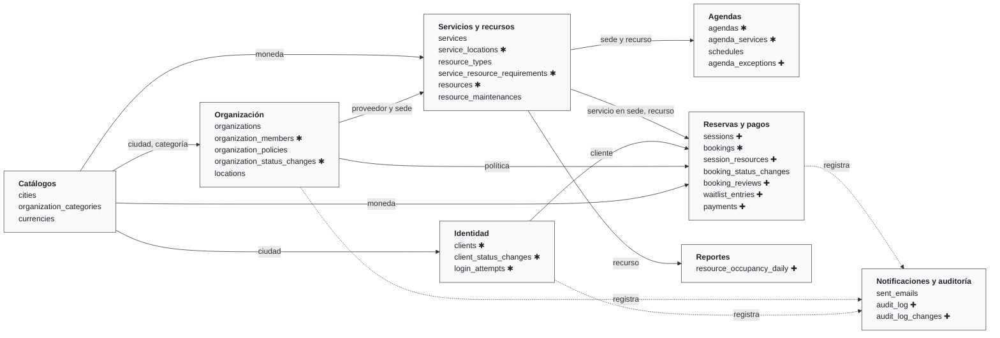
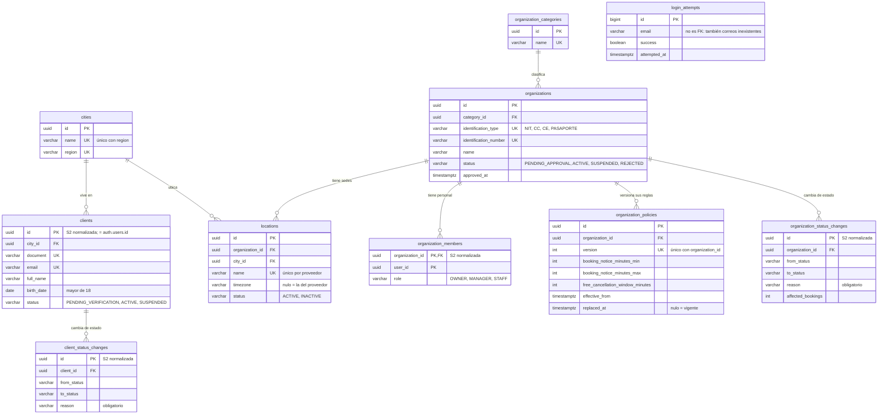
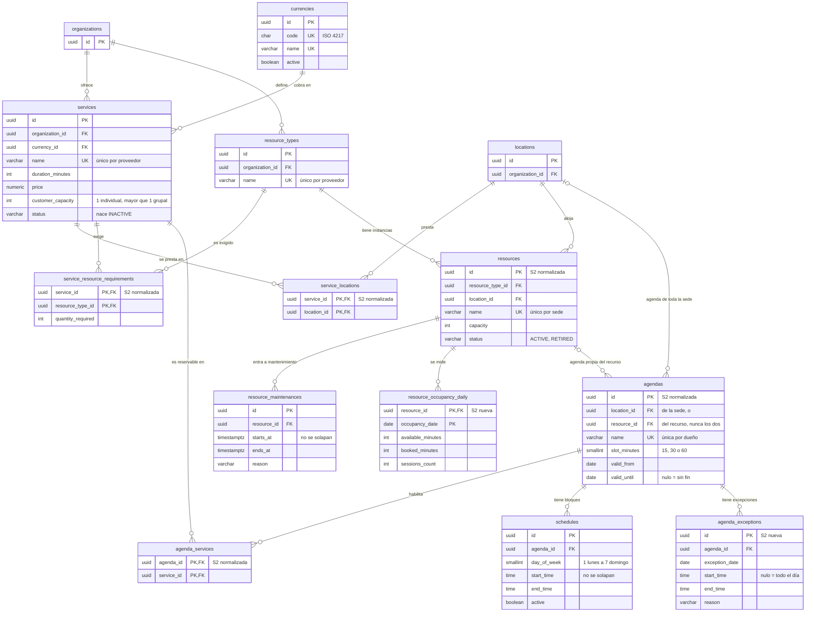
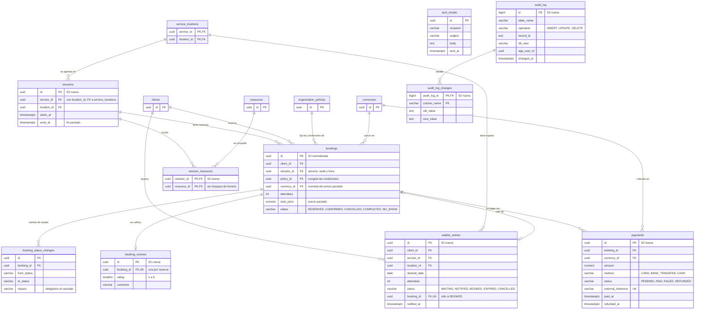

# Plataforma de Reservas de Servicios — Modelo de datos

Sprint 2 · Bases de Datos · CodeF@ctory 2026-II<br>
Anderson Herrera Guzmán · Facultad de Ingeniería, Universidad de Antioquia

Este repositorio tiene el modelo de datos del caso *Plataforma de Reservas de Servicios*. El backend
del equipo está en [`CodeFactoryBookingApp/bookingplatform`](https://github.com/CodeFactoryBookingApp/bookingplatform).

La entrega del Sprint 1 está intacta en [`sprint-1/`](sprint-1/) y en la etiqueta
[`sprint-1`](https://github.com/andersonhg19/bookingplatform-BDs/tree/sprint-1) del repositorio.

| Archivo | Qué es |
|---|---|
| [`schema.sql`](schema.sql) | Modelo físico completo: 32 tablas en BCNF, restricciones, índices, triggers, roles y RLS |
| [`seed.sql`](seed.sql) | Datos de prueba, pensados para que todas las consultas devuelvan filas |
| [`consultas.sql`](consultas.sql) | Las 24 preguntas clave: 14 del Sprint 1 y 10 del Sprint 2 |
| [`pruebas-integridad.sql`](pruebas-integridad.sql) | 51 violaciones de datos y de permisos que la base rechaza |
| [`docs/analisis-almacenamiento.md`](docs/analisis-almacenamiento.md) | Almacenamiento, índices, costo de una consulta y su optimización |
| [`docs/generar-volumen.sql`](docs/generar-volumen.sql) | Carga 1,58 millones de reservas para comprobar el análisis |
| [`docker-compose.yml`](docker-compose.yml) | PostgreSQL 16 y pgAdmin con todo cargado |

**Contenido:** [Qué cambió](#qué-cambió-frente-al-sprint-1) ·
[MER](#1-mer-refinado) · [Modelo físico](#2-modelo-físico) · [Normalización](#normalización) ·
[schema.sql](#3-schemasql) · [Consultas](#4-consultas) · [Volumen](#5-estimación-de-volumen) ·
[Seguridad](#6-roles-y-seguridad) · [Análisis](#7-análisis-de-almacenamiento-costo-y-optimización) ·
[Rúbrica](#dónde-está-cada-criterio-de-la-rúbrica)

## Cómo probarlo

```bash
docker compose up -d
```

Levanta PostgreSQL 16 en `localhost:5432` con `schema.sql` y `seed.sql` ya cargados, y pgAdmin en
<http://localhost:8080>. Las credenciales del `docker-compose.yml` son de desarrollo local. El
contenedor sólo queda `healthy` si existen las 32 tablas.

```bash
docker compose cp consultas.sql postgres:/tmp/
docker compose cp pruebas-integridad.sql postgres:/tmp/
docker compose exec postgres psql -U postgres -d reservas -f /tmp/consultas.sql
docker compose exec postgres psql -U postgres -d reservas -f /tmp/pruebas-integridad.sql
```

Para empezar de cero: `docker compose down -v && docker compose up -d`.

## Qué cambió frente al Sprint 1

En el Sprint 1 entregué 19 tablas. En el Sprint 2 pasaron tres cosas: el equipo cambió el esquema con
sus migraciones, yo llevé todo a BCNF y agregué tablas nuevas. El resultado son 32 tablas.

**1. Lo que hizo el equipo.** Adoptó Flyway y, con las historias del Sprint 2, cambió el esquema en
las migraciones V3 a V9 del backend. Todo eso está incorporado aquí.

| Migración | Cambio | HU |
|---|---|---|
| V3 | Un servicio nace `INACTIVE`. La regla de reservas sólo valida lo que compromete agenda nueva y resiste reservas simultáneas por el último cupo | 004, 009, 010 |
| V4 | `organizations.nit` pasa a `identification_type` + `identification_number`, porque una persona natural también presta servicios | 002 |
| V6 | Nueva `sent_emails`: Render bloquea SMTP y el correo se guarda en una bandeja | — |
| V7 | `resources` gana capacidad y su estado pasa a `ACTIVE`/`RETIRED`. Nueva `resource_maintenances` | 009 |
| V8 | Nuevas `agendas` y `agenda_services`. `schedules` pasa a ser un bloque de una agenda | 006 |
| V9 | Función `f_sin_tildes` para buscar sin distinguir tildes | 005 |

**2. Lo que normalicé.** El esquema del Sprint 1, y lo que el equipo construyó encima, repetía
`organization_id` y `location_id` en varias tablas para poder declarar claves foráneas compuestas que
impidieran mezclar datos de dos proveedores. Funcionaba, pero esas columnas dependían de otra columna
que no era la clave y rompían 2FN o 3FN. En esta entrega las quité, y lo que garantizaban pasó a
triggers cortos. La reserva, además, repetía el servicio, la sede y el horario de su sesión, y eso
pasó a una tabla propia. Detalle en [Normalización](#normalización).

| Tabla | Antes | Ahora |
|---|---|---|
| `service_locations`, `resources`, `service_resource_requirements`, `agendas`, `bookings` | guardaban `organization_id` | sale del servicio, la sede o el tipo de recurso |
| `agenda_services` | guardaba `location_id` | sale de la agenda |
| `bookings` | cada reserva de un taller repetía el servicio, la sede y el horario de la sesión | nueva tabla `sessions`; la reserva sólo guarda `session_id` |
| `booking_resources` | copiaba sesión, horario y estado de la reserva para su `EXCLUDE` | `session_resources`: el recurso es de la sesión y no se copia nada |
| `agendas` | una agenda de recurso guardaba también la sede, que ya sale del recurso | es de una sede o de un recurso, nunca de los dos |
| `account_status_changes` | una tabla para clientes y proveedores, con un tipo y dos FK de las que siempre una era nula | `organization_status_changes` y `client_status_changes` |
| `clients` | `city` como texto libre: "Medellin" y "Medellín" eran dos ciudades | `city_id`, FK al catálogo `cities` |
| `clients`, `login_attempts` | fechas `timestamp` sin zona horaria | `timestamptz`, como el resto del esquema |
| `clients` | la mayoría de edad en un `CHECK` con `current_date`: PostgreSQL da por hecho que un `CHECK` es inmutable, y ese no lo es | un trigger que la revisa al registrar |
| `bookings` | el precio pactado sin moneda | `currency_id`: el precio se congela con su moneda |
| `bookings` | una reserva podía nacer ya atendida, o cancelarse después de atendida | sólo avanza: nace `RESERVED` o `CONFIRMED`, y `CANCELLED`, `COMPLETED` y `NO_SHOW` son finales |
| `bookings` | índice sólo sobre `service_id` | `(service_id, starts_at)` en `sessions`: el reporte por servicio y mes lee tres veces menos páginas |
| `organization_members`, `service_resource_requirements` | `id` sustituto más una `UNIQUE` con la clave real | la clave real es la PK |
| Todas | nombres de restricción mezclados (`ck_bsc_`, `<tabla>_pkey`) | un solo patrón: `pk_`, `fk_`, `uk_`, `ck_`, `ex_`, `ix_`, `ux_` + tabla |

Esto cambia el modelo frente a lo que el backend tiene en producción. **No toqué el repositorio del
equipo:** esta entrega es la propuesta de cómo debería quedar la base, y llevarla al backend sería una
migración nueva de ellos (V10 en adelante) junto con el ajuste de sus entidades JPA.

**3. Las tablas nuevas:**

| Tabla nueva | Para qué | Por qué hacía falta |
|---|---|---|
| `sessions` | Un servicio, en una sede, a una hora | Lo compartían las reservas de un taller y se repetía en cada una |
| `session_resources` | Recursos que ocupa una sesión; reemplaza a `booking_resources` | El salón de un taller se ocupa una vez por sesión, no una por reserva |
| `agenda_exceptions` | Festivos, cierres y jornadas recortadas | `schedules` sólo sabe de días de la semana |
| `booking_reviews` | Calificación de 1 a 5 de una reserva atendida | El caso pide reportes de uso, y la calidad del servicio es parte del uso |
| `waitlist_entries` | Lista de espera cuando no hay cupo | Completa el control de disponibilidad: si no había cupo, el cliente se perdía |
| `payments` | Pagos, intentos fallidos y reembolsos | `bookings.total_price` dice cuánto se pactó, pero nada decía si se pagó |
| `resource_occupancy_daily` | Ocupación diaria por recurso | Los "reportes sobre ocupación y uso" del caso, sin recorrer todas las reservas |
| `audit_log` y `audit_log_changes` | Quién cambió qué fila y cuándo, y cada columna con su valor de antes y de después | Seguridad: los cambios a clientes, proveedores, políticas, servicios, pagos y reseñas quedan registrados por trigger |

## 1. MER refinado

Son 32 tablas, así que primero va un mapa por dominios y después tres vistas de entidad-relación con
las claves, los atributos principales y las cardinalidades. En las vistas de detalle, las tablas nuevas del sprint dicen
**S2 nueva** en su clave primaria y las que normalicé dicen **S2 normalizada**.

`auth.users` la gestiona Supabase Auth y no se crea aquí. Por eso `clients.id`,
`organization_members.user_id` y los `changed_by` no tienen clave foránea declarada.

### Vista general

Los ocho dominios del modelo y de qué depende cada uno. **✚** marca una tabla nueva del Sprint 2 y **✱** una tabla que normalicé en este sprint. Las relaciones tabla por tabla, con sus cardinalidades, están en las tres vistas de abajo.



### Identidad y organización



### Servicios, recursos y agendas



### Reservas, pagos y auditoría



`sent_emails` y `audit_log` no tienen claves foráneas hacia el negocio a propósito. Un correo puede ir
a una dirección que no es de ningún cliente, y una fila de auditoría tiene que sobrevivir al registro
que describe.

## 2. Modelo físico

Esta sección la generé desde el catálogo de PostgreSQL después de correr `schema.sql`, así que
corresponde a lo que crea el script. Sólo le quité los casts que PostgreSQL agrega al reescribir las
restricciones (`::text`, `= ANY (ARRAY[...])`) para que se lean como en el `schema.sql`. Cada tabla
trae sus columnas con tipo, nulo, default y clave, con la acción `on delete` de cada FK cuando no
es la de omisión (`no action`). Debajo van las restricciones que abarcan varias columnas, los
`CHECK`, los `EXCLUDE` y los índices `ix_` que no salen de una restricción.

Debajo de cada tabla también van los triggers que aplican sus reglas, porque varias de ellas
reemplazan a restricciones declarativas (ver [Normalización](#normalización)). No repito en cada
tabla los dos triggers genéricos: `fn_set_updated_at`, que mantiene `updated_at`, y `fn_auditar`, que
escribe en `audit_log` los cambios de `clients`, `organizations`, `organization_members`,
`organization_policies`, `services`, `payments` y `booking_reviews`.

Todas las restricciones e índices siguen el mismo patrón: `pk_`, `fk_`, `uk_`, `ck_`, `ex_`
(exclusión), `ix_` y `ux_` (índice único), seguidos del nombre de la tabla y de lo que controlan. Los
triggers empiezan por `tg_` y sus funciones por `fn_`.

<details>
<summary><b>Catálogos</b> · cities, organization_categories, currencies</summary>


#### `cities`

Catálogo de ciudades, con departamento.

| Columna | Tipo | Nulo | Default | Clave |
|---|---|---|---|---|
| `id` | `uuid` | no | `gen_random_uuid()` | PK |
| `name` | `varchar(120)` | no |  |  |
| `region` | `varchar(120)` | no |  |  |

- UNIQUE `uk_cities_name_region`: `UNIQUE (name, region)`
- CHECK `ck_cities_name`: `CHECK ((length(btrim(name)) > 0))`
- CHECK `ck_cities_region`: `CHECK ((length(btrim(region)) > 0))`


#### `organization_categories`

Catálogo de categorías de negocio.

| Columna | Tipo | Nulo | Default | Clave |
|---|---|---|---|---|
| `id` | `uuid` | no | `gen_random_uuid()` | PK |
| `name` | `varchar(80)` | no |  | UNIQUE |

- CHECK `ck_organization_categories_name`: `CHECK ((length(btrim(name)) > 0))`


#### `currencies`

Monedas ISO 4217. La baja es lógica (active).

| Columna | Tipo | Nulo | Default | Clave |
|---|---|---|---|---|
| `id` | `uuid` | no | `gen_random_uuid()` | PK |
| `code` | `char(3)` | no |  | UNIQUE |
| `name` | `varchar(60)` | no |  | UNIQUE |
| `active` | `boolean` | no | `true` |  |

- CHECK `ck_currencies_code`: `CHECK ((code ~ '^[A-Z]{3}$'))`

</details>

<details>
<summary><b>Identidad</b> · clients, client_status_changes, login_attempts</summary>


#### `clients`

Perfil del cliente (HU-001); id = auth.users.id de Supabase.

*Sprint 2: normalizada: `city` pasa a `city_id`, fechas con zona, mayoría de edad por trigger.*

| Columna | Tipo | Nulo | Default | Clave |
|---|---|---|---|---|
| `id` | `uuid` | no |  | PK |
| `full_name` | `varchar(120)` | no |  |  |
| `document` | `varchar(30)` | no |  | UNIQUE |
| `birth_date` | `date` | no |  |  |
| `email` | `varchar(160)` | no |  | UNIQUE |
| `phone` | `varchar(20)` | no |  |  |
| `city_id` | `uuid` | no |  | FK → `cities` (restrict) |
| `notification_channel` | `varchar(20)` | no |  |  |
| `status` | `varchar(30)` | no | `'PENDING_VERIFICATION'` |  |
| `created_at` | `timestamptz` | no | `now()` |  |
| `updated_at` | `timestamptz` | no | `now()` |  |

- CHECK `ck_clients_document`: `CHECK ((length(btrim(document)) > 0))`
- CHECK `ck_clients_email`: `CHECK ((email ~* '^[^@[:space:]]+@[^@[:space:]]+\.[a-z]{2,}$'))`
- CHECK `ck_clients_full_name`: `CHECK ((length(btrim(full_name)) > 0))`
- CHECK `ck_clients_notification_channel`: `CHECK ((notification_channel IN ('EMAIL', 'SMS', 'WHATSAPP')))`
- CHECK `ck_clients_phone`: `CHECK ((phone ~ '^\+?[0-9]{7,15}$'))`
- CHECK `ck_clients_status`: `CHECK ((status IN ('PENDING_VERIFICATION', 'ACTIVE', 'SUSPENDED')))`
- UNIQUE (índice) `ux_clients_email_lower`: `USING btree (lower(email))`
- Índice `ix_clients_city`: `USING btree (city_id)`
- Trigger `tg_clients_mayor_de_edad`: HU-001: el cliente tiene al menos 18 años al registrarse


#### `client_status_changes`

Historia de estados de un cliente, con motivo obligatorio (HU-003).

*Sprint 2: normalizada: sale de `account_status_changes`.*

| Columna | Tipo | Nulo | Default | Clave |
|---|---|---|---|---|
| `id` | `uuid` | no | `gen_random_uuid()` | PK |
| `client_id` | `uuid` | no |  | FK → `clients` (restrict) |
| `from_status` | `varchar(30)` | sí |  |  |
| `to_status` | `varchar(30)` | no |  |  |
| `reason` | `varchar(500)` | no |  |  |
| `changed_by` | `uuid` | sí |  |  |
| `changed_at` | `timestamptz` | no | `now()` |  |

- CHECK `ck_client_status_changes_from`: `CHECK (((from_status IS NULL) OR (from_status IN ('PENDING_VERIFICATION', 'ACTIVE', 'SUSPENDED'))))`
- CHECK `ck_client_status_changes_reason`: `CHECK ((length(btrim(reason)) > 0))`
- CHECK `ck_client_status_changes_to`: `CHECK ((to_status IN ('PENDING_VERIFICATION', 'ACTIVE', 'SUSPENDED')))`
- Índice `ix_client_status_changes_client`: `USING btree (client_id, changed_at DESC)`


#### `login_attempts`

Intentos de ingreso para el bloqueo por cuenta (HU-021).

*Sprint 2: fecha con zona horaria.*

| Columna | Tipo | Nulo | Default | Clave |
|---|---|---|---|---|
| `id` | `bigint` | no | `generated by default as identity` | PK |
| `email` | `varchar(160)` | no |  |  |
| `success` | `boolean` | no |  |  |
| `attempted_at` | `timestamptz` | no | `now()` |  |

- CHECK `ck_login_attempts_email`: `CHECK ((length(btrim(email)) > 0))`
- Índice `ix_login_attempts_email_lower`: `USING btree (lower(email), attempted_at)`

</details>

<details>
<summary><b>Organización</b> · organizations, organization_members, organization_policies, locations, organization_status_changes</summary>


#### `organizations`

Negocio proveedor (HU-002). PENDING_APPROVAL hasta que un administrador lo apruebe.

*Sprint 2: V4 del equipo: tipo y número de identificación.*

| Columna | Tipo | Nulo | Default | Clave |
|---|---|---|---|---|
| `id` | `uuid` | no | `gen_random_uuid()` | PK |
| `category_id` | `uuid` | no |  | FK → `organization_categories` (restrict) |
| `name` | `varchar(160)` | no |  |  |
| `identification_type` | `varchar(20)` | no | `'NIT'` |  |
| `identification_number` | `varchar(20)` | no |  |  |
| `contact_email` | `varchar(160)` | no |  |  |
| `contact_phone` | `varchar(20)` | no |  |  |
| `timezone` | `varchar(60)` | no | `'America/Bogota'` |  |
| `status` | `varchar(30)` | no | `'PENDING_APPROVAL'` |  |
| `approved_at` | `timestamptz` | sí |  |  |
| `created_at` | `timestamptz` | no | `now()` |  |
| `updated_at` | `timestamptz` | no | `now()` |  |

- UNIQUE `uk_organizations_identification`: `UNIQUE (identification_type, identification_number)`
- CHECK `ck_organizations_approved`: `CHECK ((((status = 'ACTIVE') AND (approved_at IS NOT NULL)) OR ((status IN ('PENDING_APPROVAL', 'REJECTED')) AND (approved_at IS NULL)) OR (status = 'SUSPENDED')))`
- CHECK `ck_organizations_email`: `CHECK ((contact_email ~* '^[^@[:space:]]+@[^@[:space:]]+\.[a-z]{2,}$'))`
- CHECK `ck_organizations_identification_number`: `CHECK ((length(btrim(identification_number)) > 0))`
- CHECK `ck_organizations_identification_type`: `CHECK ((identification_type IN ('NIT', 'CC', 'CE', 'PASAPORTE')))`
- CHECK `ck_organizations_name`: `CHECK ((length(btrim(name)) > 0))`
- CHECK `ck_organizations_phone`: `CHECK ((contact_phone ~ '^\+?[0-9]{7,15}$'))`
- CHECK `ck_organizations_status`: `CHECK ((status IN ('PENDING_APPROVAL', 'ACTIVE', 'SUSPENDED', 'REJECTED')))`
- Índice `ix_organizations_status`: `USING btree (status)`
- Trigger `tg_organizations_motivo`: HU-003: cambiar el estado de un proveedor exige el motivo en organization_status_changes


#### `organization_members`

Quién trabaja en qué proveedor y con qué rol (ADR-0008).

*Sprint 2: normalizada: PK natural `(organization_id, user_id)`.*

| Columna | Tipo | Nulo | Default | Clave |
|---|---|---|---|---|
| `organization_id` | `uuid` | no |  | PK, FK → `organizations` (cascade) |
| `user_id` | `uuid` | no |  | PK |
| `role` | `varchar(30)` | no |  |  |
| `created_at` | `timestamptz` | no | `now()` |  |

- PK `pk_organization_members`: `PRIMARY KEY (organization_id, user_id)`
- CHECK `ck_organization_members_role`: `CHECK ((role IN ('OWNER', 'MANAGER', 'STAFF')))`
- Índice `ix_organization_members_user`: `USING btree (user_id)`


#### `organization_policies`

Reglas de anticipación y cancelación, versionadas (HU-002).

| Columna | Tipo | Nulo | Default | Clave |
|---|---|---|---|---|
| `id` | `uuid` | no | `gen_random_uuid()` | PK |
| `organization_id` | `uuid` | no |  | FK → `organizations` (restrict) |
| `version` | `integer` | no |  |  |
| `booking_notice_minutes_min` | `integer` | no |  |  |
| `booking_notice_minutes_max` | `integer` | no |  |  |
| `free_cancellation_window_minutes` | `integer` | no |  |  |
| `effective_from` | `timestamptz` | no | `now()` |  |
| `replaced_at` | `timestamptz` | sí |  |  |

- EXCLUDE `ex_organization_policies_solape`: `EXCLUDE USING gist (organization_id WITH =, tstzrange(effective_from, replaced_at) WITH &&)`
- UNIQUE `uk_organization_policies_version`: `UNIQUE (organization_id, version)`
- CHECK `ck_organization_policies_cancel`: `CHECK ((free_cancellation_window_minutes >= 0))`
- CHECK `ck_organization_policies_notice`: `CHECK (((booking_notice_minutes_min >= 0) AND (booking_notice_minutes_min <= booking_notice_minutes_max)))`
- CHECK `ck_organization_policies_version`: `CHECK ((version > 0))`
- CHECK `ck_organization_policies_vigencia`: `CHECK (((replaced_at IS NULL) OR (replaced_at > effective_from)))`
- UNIQUE (índice) `ux_organization_policies_vigente`: `USING btree (organization_id) WHERE (replaced_at IS NULL)`
- Índice `ex_organization_policies_solape`: `USING gist (organization_id, tstzrange(effective_from, replaced_at))`


#### `locations`

Sedes de un proveedor.

| Columna | Tipo | Nulo | Default | Clave |
|---|---|---|---|---|
| `id` | `uuid` | no | `gen_random_uuid()` | PK |
| `organization_id` | `uuid` | no |  | FK → `organizations` (restrict) |
| `name` | `varchar(120)` | no |  |  |
| `address` | `varchar(200)` | no |  |  |
| `city_id` | `uuid` | no |  | FK → `cities` (restrict) |
| `timezone` | `varchar(60)` | sí |  |  |
| `status` | `varchar(20)` | no | `'ACTIVE'` |  |
| `created_at` | `timestamptz` | no | `now()` |  |
| `updated_at` | `timestamptz` | no | `now()` |  |

- UNIQUE `uk_locations_org_name`: `UNIQUE (organization_id, name)`
- CHECK `ck_locations_address`: `CHECK ((length(btrim(address)) > 0))`
- CHECK `ck_locations_name`: `CHECK ((length(btrim(name)) > 0))`
- CHECK `ck_locations_status`: `CHECK ((status IN ('ACTIVE', 'INACTIVE')))`
- Índice `ix_locations_city`: `USING btree (city_id)`
- Trigger `tg_locations_proveedor_inmutable`: El proveedor de una sede, un servicio o un tipo de recurso no cambia


#### `organization_status_changes`

Historia de estados de un proveedor, con motivo obligatorio (HU-003).

*Sprint 2: normalizada: sale de `account_status_changes`.*

| Columna | Tipo | Nulo | Default | Clave |
|---|---|---|---|---|
| `id` | `uuid` | no | `gen_random_uuid()` | PK |
| `organization_id` | `uuid` | no |  | FK → `organizations` (restrict) |
| `from_status` | `varchar(30)` | sí |  |  |
| `to_status` | `varchar(30)` | no |  |  |
| `reason` | `varchar(500)` | no |  |  |
| `affected_bookings` | `integer` | no | `0` |  |
| `changed_by` | `uuid` | sí |  |  |
| `changed_at` | `timestamptz` | no | `now()` |  |

- CHECK `ck_organization_status_changes_count`: `CHECK ((affected_bookings >= 0))`
- CHECK `ck_organization_status_changes_from`: `CHECK (((from_status IS NULL) OR (from_status IN ('PENDING_APPROVAL', 'ACTIVE', 'SUSPENDED', 'REJECTED'))))`
- CHECK `ck_organization_status_changes_reason`: `CHECK ((length(btrim(reason)) > 0))`
- CHECK `ck_organization_status_changes_to`: `CHECK ((to_status IN ('PENDING_APPROVAL', 'ACTIVE', 'SUSPENDED', 'REJECTED')))`
- Índice `ix_organization_status_changes_org`: `USING btree (organization_id, changed_at DESC)`

</details>

<details>
<summary><b>Servicios y recursos</b> · services, service_locations, resource_types, service_resource_requirements, resources, resource_maintenances</summary>


#### `services`

Servicios ofertados (HU-004). customer_capacity 1 = individual, > 1 = grupal.

*Sprint 2: V3 del equipo: nace `INACTIVE`.*

| Columna | Tipo | Nulo | Default | Clave |
|---|---|---|---|---|
| `id` | `uuid` | no | `gen_random_uuid()` | PK |
| `organization_id` | `uuid` | no |  | FK → `organizations` (restrict) |
| `name` | `varchar(120)` | no |  |  |
| `description` | `varchar(500)` | sí |  |  |
| `duration_minutes` | `integer` | no |  |  |
| `preparation_minutes` | `integer` | no | `0` |  |
| `cleanup_minutes` | `integer` | no | `0` |  |
| `price` | `numeric(12,2)` | no |  |  |
| `currency_id` | `uuid` | no |  | FK → `currencies` (restrict) |
| `customer_capacity` | `integer` | no | `1` |  |
| `status` | `varchar(20)` | no | `'INACTIVE'` |  |
| `created_at` | `timestamptz` | no | `now()` |  |
| `updated_at` | `timestamptz` | no | `now()` |  |

- UNIQUE `uk_services_org_name`: `UNIQUE (organization_id, name)`
- CHECK `ck_services_capacity`: `CHECK ((customer_capacity >= 1))`
- CHECK `ck_services_duration`: `CHECK ((duration_minutes > 0))`
- CHECK `ck_services_name`: `CHECK ((length(btrim(name)) > 0))`
- CHECK `ck_services_prep`: `CHECK (((preparation_minutes >= 0) AND (cleanup_minutes >= 0)))`
- CHECK `ck_services_price`: `CHECK ((price >= (0)))`
- CHECK `ck_services_status`: `CHECK ((status IN ('ACTIVE', 'INACTIVE')))`
- Índice `ix_services_currency`: `USING btree (currency_id)`
- Trigger `tg_services_proveedor_inmutable`: El proveedor de una sede, un servicio o un tipo de recurso no cambia


#### `service_locations`

En qué sedes se presta cada servicio (HU-004).

*Sprint 2: normalizada: sin `organization_id`.*

| Columna | Tipo | Nulo | Default | Clave |
|---|---|---|---|---|
| `service_id` | `uuid` | no |  | PK, FK → `services` (cascade) |
| `location_id` | `uuid` | no |  | PK, FK → `locations` (cascade) |

- PK `pk_service_locations`: `PRIMARY KEY (service_id, location_id)`
- Índice `ix_service_locations_location`: `USING btree (location_id)`
- Trigger `tg_service_locations_mismo_proveedor`: El servicio y la sede son del mismo proveedor
- Trigger `tg_service_locations_quita_de_agendas`: Si un servicio deja de prestarse en una sede, por borrado o edición, sale de las agendas de esa sede


#### `resource_types`

Tipos de recurso no consumible: sala, silla, especialista.

| Columna | Tipo | Nulo | Default | Clave |
|---|---|---|---|---|
| `id` | `uuid` | no | `gen_random_uuid()` | PK |
| `organization_id` | `uuid` | no |  | FK → `organizations` (restrict) |
| `name` | `varchar(80)` | no |  |  |
| `description` | `varchar(300)` | sí |  |  |
| `created_at` | `timestamptz` | no | `now()` |  |

- UNIQUE `uk_resource_types_org_name`: `UNIQUE (organization_id, name)`
- CHECK `ck_resource_types_name`: `CHECK ((length(btrim(name)) > 0))`
- Trigger `tg_resource_types_proveedor_inmutable`: El proveedor de una sede, un servicio o un tipo de recurso no cambia


#### `service_resource_requirements`

Cuántos recursos de cada tipo exige un servicio.

*Sprint 2: normalizada: sin `id` ni `organization_id`, PK natural.*

| Columna | Tipo | Nulo | Default | Clave |
|---|---|---|---|---|
| `service_id` | `uuid` | no |  | PK, FK → `services` (cascade) |
| `resource_type_id` | `uuid` | no |  | PK, FK → `resource_types` (restrict) |
| `quantity_required` | `integer` | no | `1` |  |

- PK `pk_service_resource_requirements`: `PRIMARY KEY (service_id, resource_type_id)`
- CHECK `ck_service_resource_requirements_qty`: `CHECK ((quantity_required > 0))`
- Índice `ix_service_resource_requirements_type`: `USING btree (resource_type_id)`
- Trigger `tg_service_resource_requirements_mismo_proveedor`: El servicio y el tipo de recurso son del mismo proveedor


#### `resources`

Recurso concreto en una sede, con capacidad y estado (HU-009).

*Sprint 2: V7 del equipo: capacidad y estado; normalizada: sin `organization_id`.*

| Columna | Tipo | Nulo | Default | Clave |
|---|---|---|---|---|
| `id` | `uuid` | no | `gen_random_uuid()` | PK |
| `resource_type_id` | `uuid` | no |  | FK → `resource_types` (restrict) |
| `location_id` | `uuid` | no |  | FK → `locations` (restrict) |
| `name` | `varchar(120)` | no |  |  |
| `capacity` | `integer` | no | `1` |  |
| `status` | `varchar(20)` | no | `'ACTIVE'` |  |
| `created_at` | `timestamptz` | no | `now()` |  |
| `updated_at` | `timestamptz` | no | `now()` |  |

- UNIQUE `uk_resources_location_name`: `UNIQUE (location_id, name)`
- CHECK `ck_resources_capacity`: `CHECK ((capacity >= 1))`
- CHECK `ck_resources_name`: `CHECK ((length(btrim(name)) > 0))`
- CHECK `ck_resources_status`: `CHECK ((status IN ('ACTIVE', 'RETIRED')))`
- Índice `ix_resources_type`: `USING btree (resource_type_id)`
- Trigger `tg_resources_coherencia`: Tipo y sede del mismo proveedor; un recurso con sesiones o agenda no cambia de sede


#### `resource_maintenances`

Periodos de mantenimiento: el recurso no genera disponibilidad (HU-009).

*Sprint 2: V7 del equipo.*

| Columna | Tipo | Nulo | Default | Clave |
|---|---|---|---|---|
| `id` | `uuid` | no | `gen_random_uuid()` | PK |
| `resource_id` | `uuid` | no |  | FK → `resources` (cascade) |
| `starts_at` | `timestamptz` | no |  |  |
| `ends_at` | `timestamptz` | no |  |  |
| `reason` | `varchar(300)` | sí |  |  |
| `created_at` | `timestamptz` | no | `now()` |  |

- EXCLUDE `ex_resource_maintenances_solape`: `EXCLUDE USING gist (resource_id WITH =, tstzrange(starts_at, ends_at) WITH &&)`
- CHECK `ck_resource_maintenances_rango`: `CHECK ((ends_at > starts_at))`
- Índice `ex_resource_maintenances_solape`: `USING gist (resource_id, tstzrange(starts_at, ends_at))`

</details>

<details>
<summary><b>Agendas</b> · agendas, agenda_services, schedules, agenda_exceptions</summary>


#### `agendas`

Agenda de una sede o de un recurso, nunca de los dos: granularidad, vigencia y servicios (HU-006).

*Sprint 2: V8 del equipo; normalizada: sin `organization_id`, y es de una sede o de un recurso, no de los dos.*

| Columna | Tipo | Nulo | Default | Clave |
|---|---|---|---|---|
| `id` | `uuid` | no | `gen_random_uuid()` | PK |
| `location_id` | `uuid` | sí |  | FK → `locations` (restrict) |
| `resource_id` | `uuid` | sí |  | FK → `resources` (restrict) |
| `name` | `varchar(120)` | no |  |  |
| `slot_minutes` | `smallint` | no |  |  |
| `valid_from` | `date` | no |  |  |
| `valid_until` | `date` | sí |  |  |
| `created_at` | `timestamptz` | no | `now()` |  |
| `updated_at` | `timestamptz` | no | `now()` |  |

- EXCLUDE `ex_agendas_recurso_solape`: `EXCLUDE USING gist (resource_id WITH =, daterange(valid_from, valid_until, '[]') WITH &&) WHERE ((resource_id IS NOT NULL))`
- EXCLUDE `ex_agendas_sede_solape`: `EXCLUDE USING gist (location_id WITH =, daterange(valid_from, valid_until, '[]') WITH &&) WHERE ((location_id IS NOT NULL))`
- UNIQUE `uk_agendas_location_name`: `UNIQUE (location_id, name)`
- UNIQUE `uk_agendas_resource_name`: `UNIQUE (resource_id, name)`
- CHECK `ck_agendas_duenio`: `CHECK (((location_id IS NULL) <> (resource_id IS NULL)))`
- CHECK `ck_agendas_name`: `CHECK ((length(btrim(name)) > 0))`
- CHECK `ck_agendas_slot`: `CHECK ((slot_minutes IN (15, 30, 60)))`
- CHECK `ck_agendas_vigencia`: `CHECK (((valid_until IS NULL) OR (valid_until >= valid_from)))`
- Índice `ex_agendas_recurso_solape`: `USING gist (resource_id, daterange(valid_from, valid_until, '[]')) WHERE (resource_id IS NOT NULL)`
- Índice `ex_agendas_sede_solape`: `USING gist (location_id, daterange(valid_from, valid_until, '[]')) WHERE (location_id IS NOT NULL)`
- Trigger `tg_agendas_servicios_en_sede`: Si la agenda cambia de sede o de recurso, sus servicios se prestan en la sede nueva


#### `agenda_services`

Servicios reservables en una agenda (HU-006).

*Sprint 2: V8 del equipo; normalizada: sin `location_id`.*

| Columna | Tipo | Nulo | Default | Clave |
|---|---|---|---|---|
| `agenda_id` | `uuid` | no |  | PK, FK → `agendas` (cascade) |
| `service_id` | `uuid` | no |  | PK, FK → `services` (cascade) |

- PK `pk_agenda_services`: `PRIMARY KEY (agenda_id, service_id)`
- Índice `ix_agenda_services_service`: `USING btree (service_id)`
- Trigger `tg_agenda_services_en_sede`: El servicio se presta en la sede de la agenda (HU-006)


#### `schedules`

Bloques horarios semanales de una agenda (HU-006).

*Sprint 2: V8 del equipo: bloques de una agenda.*

| Columna | Tipo | Nulo | Default | Clave |
|---|---|---|---|---|
| `id` | `uuid` | no | `gen_random_uuid()` | PK |
| `agenda_id` | `uuid` | no |  | FK → `agendas` (cascade) |
| `day_of_week` | `smallint` | no |  |  |
| `start_time` | `time` | no |  |  |
| `end_time` | `time` | no |  |  |
| `active` | `boolean` | no | `true` |  |
| `created_at` | `timestamptz` | no | `now()` |  |

- EXCLUDE `ex_schedules_solape`: `EXCLUDE USING gist (agenda_id WITH =, day_of_week WITH =, timerange(start_time, end_time) WITH &&) WHERE (active)`
- CHECK `ck_schedules_dow`: `CHECK (((day_of_week >= 1) AND (day_of_week <= 7)))`
- CHECK `ck_schedules_rango`: `CHECK ((end_time > start_time))`
- Índice `ex_schedules_solape`: `USING gist (agenda_id, day_of_week, timerange(start_time, end_time)) WHERE active`
- Índice `ix_schedules_agenda`: `USING btree (agenda_id)`


#### `agenda_exceptions` · **[S2 nueva]**

Festivos, cierres y jornadas recortadas de una agenda.

| Columna | Tipo | Nulo | Default | Clave |
|---|---|---|---|---|
| `id` | `uuid` | no | `gen_random_uuid()` | PK |
| `agenda_id` | `uuid` | no |  | FK → `agendas` (cascade) |
| `exception_date` | `date` | no |  |  |
| `start_time` | `time` | sí |  |  |
| `end_time` | `time` | sí |  |  |
| `reason` | `varchar(300)` | no |  |  |
| `created_at` | `timestamptz` | no | `now()` |  |

- EXCLUDE `ex_agenda_exceptions_solape`: `EXCLUDE USING gist (agenda_id WITH =, exception_date WITH =, timerange(COALESCE(start_time, '00:00:00'), COALESCE(end_time, '24:00:00')) WITH &&)`
- CHECK `ck_agenda_exceptions_franja`: `CHECK ((((start_time IS NULL) AND (end_time IS NULL)) OR ((start_time IS NOT NULL) AND (end_time IS NOT NULL) AND (end_time > start_time))))`
- CHECK `ck_agenda_exceptions_reason`: `CHECK ((length(btrim(reason)) > 0))`
- Índice `ex_agenda_exceptions_solape`: `USING gist (agenda_id, exception_date, timerange(COALESCE(start_time, '00:00:00'), COALESCE(end_time, '24:00:00')))`

</details>

<details>
<summary><b>Reservas y pagos</b> · sessions, bookings, session_resources, booking_status_changes, booking_reviews, waitlist_entries, payments</summary>


#### `sessions` · **[S2 nueva]**

Un servicio en una sede y a una hora. Individual: una reserva; grupal: varias, hasta el cupo.

| Columna | Tipo | Nulo | Default | Clave |
|---|---|---|---|---|
| `id` | `uuid` | no | `gen_random_uuid()` | PK |
| `service_id` | `uuid` | no |  | FK compuesta → `service_locations` |
| `location_id` | `uuid` | no |  | FK compuesta → `service_locations` |
| `starts_at` | `timestamptz` | no |  |  |
| `ends_at` | `timestamptz` | no |  |  |
| `created_at` | `timestamptz` | no | `now()` |  |
| `updated_at` | `timestamptz` | no | `now()` |  |

- FK `fk_sessions_service_location`: `FOREIGN KEY (service_id, location_id) REFERENCES service_locations(service_id, location_id) ON DELETE RESTRICT`
- CHECK `ck_sessions_rango`: `CHECK ((ends_at > starts_at))`
- Índice `ix_sessions_location_starts`: `USING btree (location_id, starts_at)`
- Índice `ix_sessions_service_starts`: `USING btree (service_id, starts_at)`
- Trigger `tg_sessions_coherencia`: La sesión no cambia de servicio; si se mueve, sus recursos siguen en la sede y libres


#### `bookings`

Reserva de un cliente en una sesión. policy_id y currency_id congelan las condiciones y la moneda al crearla.

*Sprint 2: normalizada: el servicio, la sede y el horario pasan a `sessions`; sin `organization_id`; con `currency_id`.*

| Columna | Tipo | Nulo | Default | Clave |
|---|---|---|---|---|
| `id` | `uuid` | no | `gen_random_uuid()` | PK |
| `client_id` | `uuid` | no |  | FK → `clients` (restrict) |
| `session_id` | `uuid` | no |  | FK → `sessions` (restrict) |
| `policy_id` | `uuid` | no |  | FK → `organization_policies` (restrict) |
| `attendees` | `integer` | no | `1` |  |
| `total_price` | `numeric(12,2)` | no |  |  |
| `currency_id` | `uuid` | no |  | FK → `currencies` (restrict) |
| `status` | `varchar(20)` | no | `'RESERVED'` |  |
| `cancelled_at` | `timestamptz` | sí |  |  |
| `created_at` | `timestamptz` | no | `now()` |  |
| `updated_at` | `timestamptz` | no | `now()` |  |

- CHECK `ck_bookings_attendees`: `CHECK ((attendees > 0))`
- CHECK `ck_bookings_cancel`: `CHECK (((status = 'CANCELLED') = (cancelled_at IS NOT NULL)))`
- CHECK `ck_bookings_price`: `CHECK ((total_price >= (0)))`
- CHECK `ck_bookings_status`: `CHECK ((status IN ('RESERVED', 'CONFIRMED', 'CANCELLED', 'COMPLETED', 'NO_SHOW')))`
- Índice `ix_bookings_client`: `USING btree (client_id)`
- Índice `ix_bookings_policy`: `USING btree (policy_id)`
- Índice `ix_bookings_session`: `USING btree (session_id)`
- Trigger `tg_bookings_coherencia`: Política del proveedor y vigente al reservar, que ya no cambia; precio en la moneda del servicio; otra sesión sólo del mismo servicio
- Trigger `tg_bookings_reglas`: HU-001 a 004: estados válidos, proveedor, servicio y sede activos, cliente no suspendido, verificado para confirmar, y cupo de la sesión
- Trigger `tg_sessions_libera_recursos`: Una sesión sin reservas vivas suelta sus recursos


#### `session_resources` · **[S2 nueva]**

Recursos que ocupa una sesión; un trigger impide que un recurso quede en dos sesiones a la vez.

*Sprint 2: reemplaza a `booking_resources`: el recurso es de la sesión, sin copias del horario.*

| Columna | Tipo | Nulo | Default | Clave |
|---|---|---|---|---|
| `session_id` | `uuid` | no |  | PK, FK → `sessions` (cascade) |
| `resource_id` | `uuid` | no |  | PK, FK → `resources` (restrict) |

- PK `pk_session_resources`: `PRIMARY KEY (session_id, resource_id)`
- Índice `ix_session_resources_resource`: `USING btree (resource_id)`
- Trigger `tg_session_resources_reglas`: El recurso está activo, en la sede de la sesión y no está ocupado por otra sesión que se cruce


#### `booking_status_changes`

Historia de estados de una reserva.

| Columna | Tipo | Nulo | Default | Clave |
|---|---|---|---|---|
| `id` | `uuid` | no | `gen_random_uuid()` | PK |
| `booking_id` | `uuid` | no |  | FK → `bookings` (restrict) |
| `from_status` | `varchar(20)` | sí |  |  |
| `to_status` | `varchar(20)` | no |  |  |
| `reason` | `varchar(300)` | sí |  |  |
| `changed_by` | `uuid` | sí |  |  |
| `changed_at` | `timestamptz` | no | `now()` |  |

- CHECK `ck_booking_status_changes_cambio`: `CHECK ((from_status IS DISTINCT FROM (to_status)))`
- CHECK `ck_booking_status_changes_from`: `CHECK (((from_status IS NULL) OR (from_status IN ('RESERVED', 'CONFIRMED', 'CANCELLED', 'COMPLETED', 'NO_SHOW'))))`
- CHECK `ck_booking_status_changes_reason`: `CHECK (((to_status <> 'CANCELLED') OR (length(btrim((COALESCE(reason, '')))) > 0)))`
- CHECK `ck_booking_status_changes_to`: `CHECK ((to_status IN ('RESERVED', 'CONFIRMED', 'CANCELLED', 'COMPLETED', 'NO_SHOW')))`
- Índice `ix_booking_status_changes_booking`: `USING btree (booking_id)`


#### `booking_reviews` · **[S2 nueva]**

Calificación de 1 a 5 de una reserva completada.

| Columna | Tipo | Nulo | Default | Clave |
|---|---|---|---|---|
| `id` | `uuid` | no | `gen_random_uuid()` | PK |
| `booking_id` | `uuid` | no |  | FK → `bookings` (restrict), UNIQUE |
| `rating` | `smallint` | no |  |  |
| `comment` | `varchar(1000)` | sí |  |  |
| `created_at` | `timestamptz` | no | `now()` |  |
| `updated_at` | `timestamptz` | no | `now()` |  |

- CHECK `ck_booking_reviews_comment`: `CHECK (((comment IS NULL) OR (length(btrim(comment)) > 0)))`
- CHECK `ck_booking_reviews_rating`: `CHECK (((rating >= 1) AND (rating <= 5)))`
- Trigger `tg_booking_reviews_completada`: Sólo se califica una reserva completada


#### `waitlist_entries` · **[S2 nueva]**

Lista de espera por servicio, sede y día.

| Columna | Tipo | Nulo | Default | Clave |
|---|---|---|---|---|
| `id` | `uuid` | no | `gen_random_uuid()` | PK |
| `client_id` | `uuid` | no |  | FK → `clients` (cascade) |
| `service_id` | `uuid` | no |  | FK compuesta → `service_locations` |
| `location_id` | `uuid` | no |  | FK compuesta → `service_locations` |
| `desired_date` | `date` | no |  |  |
| `attendees` | `integer` | no | `1` |  |
| `status` | `varchar(20)` | no | `'WAITING'` |  |
| `booking_id` | `uuid` | sí |  | FK → `bookings` (restrict), UNIQUE |
| `notified_at` | `timestamptz` | sí |  |  |
| `created_at` | `timestamptz` | no | `now()` |  |
| `updated_at` | `timestamptz` | no | `now()` |  |

- FK `fk_waitlist_entries_service_location`: `FOREIGN KEY (service_id, location_id) REFERENCES service_locations(service_id, location_id) ON DELETE CASCADE`
- CHECK `ck_waitlist_entries_attendees`: `CHECK ((attendees > 0))`
- CHECK `ck_waitlist_entries_booked`: `CHECK (((status = 'BOOKED') = (booking_id IS NOT NULL)))`
- CHECK `ck_waitlist_entries_notified`: `CHECK ((((status) NOT IN ('NOTIFIED', 'BOOKED', 'EXPIRED')) OR (notified_at IS NOT NULL)))`
- CHECK `ck_waitlist_entries_status`: `CHECK ((status IN ('WAITING', 'NOTIFIED', 'BOOKED', 'EXPIRED', 'CANCELLED')))`
- UNIQUE (índice) `ux_waitlist_entries_activa`: `USING btree (client_id, service_id, location_id, desired_date) WHERE (status IN ('WAITING', 'NOTIFIED'))`
- Índice `ix_waitlist_entries_client`: `USING btree (client_id)`
- Índice `ix_waitlist_entries_service_location`: `USING btree (service_id, location_id, desired_date)`
- Trigger `tg_waitlist_entries_reserva`: La reserva en que terminó la espera es del mismo cliente, servicio y sede


#### `payments` · **[S2 nueva]**

Pagos y reembolsos de una reserva.

| Columna | Tipo | Nulo | Default | Clave |
|---|---|---|---|---|
| `id` | `uuid` | no | `gen_random_uuid()` | PK |
| `booking_id` | `uuid` | no |  | FK → `bookings` (restrict) |
| `amount` | `numeric(12,2)` | no |  |  |
| `currency_id` | `uuid` | no |  | FK → `currencies` (restrict) |
| `method` | `varchar(20)` | no |  |  |
| `status` | `varchar(20)` | no | `'PENDING'` |  |
| `external_reference` | `varchar(100)` | sí |  | UNIQUE |
| `paid_at` | `timestamptz` | sí |  |  |
| `refunded_at` | `timestamptz` | sí |  |  |
| `created_at` | `timestamptz` | no | `now()` |  |
| `updated_at` | `timestamptz` | no | `now()` |  |

- CHECK `ck_payments_amount`: `CHECK ((amount > (0)))`
- CHECK `ck_payments_external_reference`: `CHECK (((external_reference IS NULL) OR (length(btrim(external_reference)) > 0)))`
- CHECK `ck_payments_fechas`: `CHECK ((((status IN ('PENDING', 'FAILED')) AND (paid_at IS NULL) AND (refunded_at IS NULL)) OR ((status = 'PAID') AND (paid_at IS NOT NULL) AND (refunded_at IS NULL)) OR ((status = 'REFUNDED') AND (paid_at IS NOT NULL) AND (refunded_at IS NOT NULL) AND (refunded_at >= paid_at))))`
- CHECK `ck_payments_method`: `CHECK ((method IN ('CARD', 'BANK_TRANSFER', 'CASH')))`
- CHECK `ck_payments_status`: `CHECK ((status IN ('PENDING', 'PAID', 'FAILED', 'REFUNDED')))`
- UNIQUE (índice) `ux_payments_vigente`: `USING btree (booking_id) WHERE (status IN ('PENDING', 'PAID'))`
- Índice `ix_payments_booking`: `USING btree (booking_id)`

</details>

<details>
<summary><b>Notificaciones, reportes y auditoría</b> · sent_emails, resource_occupancy_daily, audit_log, audit_log_changes</summary>


#### `sent_emails`

Correos guardados en vez de enviados por SMTP (ADR-0007).

*Sprint 2: V6 del equipo.*

| Columna | Tipo | Nulo | Default | Clave |
|---|---|---|---|---|
| `id` | `uuid` | no | `gen_random_uuid()` | PK |
| `recipient` | `varchar(160)` | no |  |  |
| `subject` | `varchar(200)` | no |  |  |
| `body` | `text` | no |  |  |
| `sent_at` | `timestamptz` | no | `now()` |  |

- CHECK `ck_sent_emails_recipient`: `CHECK ((recipient ~* '^[^@[:space:]]+@[^@[:space:]]+\.[a-z]{2,}$'))`
- CHECK `ck_sent_emails_subject`: `CHECK ((length(btrim(subject)) > 0))`
- Índice `ix_sent_emails_recipient`: `USING btree (lower(recipient), sent_at DESC)`


#### `resource_occupancy_daily` · **[S2 nueva]**

Ocupación diaria por recurso, calculada por fn_calcular_ocupacion.

| Columna | Tipo | Nulo | Default | Clave |
|---|---|---|---|---|
| `resource_id` | `uuid` | no |  | PK, FK → `resources` (cascade) |
| `occupancy_date` | `date` | no |  | PK |
| `available_minutes` | `integer` | no |  |  |
| `booked_minutes` | `integer` | no |  |  |
| `sessions_count` | `integer` | no |  |  |
| `calculated_at` | `timestamptz` | no | `now()` |  |

- PK `pk_resource_occupancy_daily`: `PRIMARY KEY (resource_id, occupancy_date)`
- CHECK `ck_resource_occupancy_daily_minutos`: `CHECK (((available_minutes >= 0) AND (booked_minutes >= 0) AND (sessions_count >= 0)))`
- Índice `ix_resource_occupancy_daily_date`: `USING btree (occupancy_date)`


#### `audit_log` · **[S2 nueva]**

Auditoría de cambios en tablas sensibles, escrita por trigger: quién, cuándo y sobre qué fila.

| Columna | Tipo | Nulo | Default | Clave |
|---|---|---|---|---|
| `id` | `bigint` | no | `generated always as identity` | PK |
| `table_name` | `varchar(63)` | no |  |  |
| `operation` | `varchar(6)` | no |  |  |
| `record_id` | `text` | no |  |  |
| `db_user` | `varchar(63)` | no | `SESSION_USER` |  |
| `app_user_id` | `uuid` | sí |  |  |
| `changed_at` | `timestamptz` | no | `now()` |  |

- CHECK `ck_audit_log_operation`: `CHECK ((operation IN ('INSERT', 'UPDATE', 'DELETE')))`
- CHECK `ck_audit_log_table`: `CHECK ((length(btrim(table_name)) > 0))`
- Índice `ix_audit_log_registro`: `USING btree (table_name, record_id, changed_at DESC)`


#### `audit_log_changes` · **[S2 nueva]**

Columnas que cambió cada evento de audit_log, con el valor de antes y el de después.

| Columna | Tipo | Nulo | Default | Clave |
|---|---|---|---|---|
| `audit_log_id` | `bigint` | no |  | PK, FK → `audit_log` (cascade) |
| `column_name` | `varchar(63)` | no |  | PK |
| `old_value` | `text` | sí |  |  |
| `new_value` | `text` | sí |  |  |

- PK `pk_audit_log_changes`: `PRIMARY KEY (audit_log_id, column_name)`
- CHECK `ck_audit_log_changes_cambio`: `CHECK ((old_value IS DISTINCT FROM new_value))`

</details>

### Normalización

**Las 32 tablas están en BCNF.** Lo reviso con la regla del curso (Pres09): una tabla con una sola
clave candidata se puede revisar con 2FN y 3FN, pero una con más de una se lleva directamente a
BCNF, que exige que todo determinante sea clave candidata. Varias tablas de este modelo tienen dos
claves, por ejemplo `id` y `(location_id, name)`, así que la vara para todas es BCNF.

**Las cuatro que no llegaban.** Tres tablas que venían del equipo y el primer diseño de la auditoría
no estaban en BCNF. Así quedaron:

| Tabla | Qué rompía la forma normal | Cómo quedó |
|---|---|---|
| `bookings` | `session_id → service_id, location_id, starts_at, ends_at`. En un servicio grupal varias reservas comparten sesión, y cada una repetía el servicio, la sede y el horario. `session_id` no es clave de la reserva, así que la dependencia era transitiva: `id → session_id → starts_at` | Nueva tabla **`sessions`** con esos cuatro datos. La reserva sólo guarda `session_id`. Que las reservas de un taller tengan la misma hora ya no lo revisa un trigger: es imposible que no la tengan, porque la hora está una sola vez |
| `booking_resources` | `booking_id → session_id, starts_at, ends_at, status`, una dependencia parcial respecto a la clave `(booking_id, resource_id)`. Copiaba el horario de la reserva porque el `EXCLUDE` contra la sobreocupación necesita el rango en la misma fila | **`session_resources (session_id, resource_id)`**, sin copias. El recurso se asigna a la sesión, que es lo que de verdad lo ocupa: el salón de un taller se ocupa una vez, no una por reserva. La sobreocupación la impide `tg_session_resources_reglas` |
| `agendas` | `resource_id → location_id`. Una agenda de recurso guardaba también la sede, que ya sale del recurso, y `resource_id` no es clave | Una agenda es **de una sede o de un recurso, nunca de los dos**: `ck_agendas_duenio` exige que sólo una de las dos columnas tenga valor. La sede de una agenda de recurso sale del recurso |
| `audit_log` | `old_data` y `new_data` eran `jsonb` con la fila completa: un valor compuesto, no atómico. Ni 1FN | **`audit_log`** guarda quién cambió qué fila y cuándo, y **`audit_log_changes`** una fila por columna que cambió, con el valor de antes y el de después |

El cambio de `booking_resources` tiene un costo, y lo dejo dicho. Un `EXCLUDE` es declarativo: no
hay forma de saltárselo. El trigger que lo reemplaza es código, y además dos asignaciones
simultáneas del mismo recurso podrían verse mutuamente como libres. Por eso el trigger toma un
candado por recurso (`pg_advisory_xact_lock`) antes de revisar. Lo probé con dos transacciones al
mismo tiempo sobre la misma silla y la misma hora: sin el candado entraron las dos, y con él la
segunda esperó a la primera y fue rechazada. Mover una sesión toma los mismos candados, en orden,
para que dos movimientos simultáneos no se bloqueen entre sí. Y quien asigna un recurso lee la sesión
con `for share`: si otra transacción la está moviendo, espera y revisa contra el horario nuevo.
También lo probé con dos transacciones a la vez.

**Lo que quité de las tablas del equipo y cómo se garantiza ahora.** Había otras siete redundancias:
cuatro del Sprint 1 y tres que llegaron con V7 y V8. Todas existían para lo mismo, impedir que se
mezclaran datos de dos proveedores o de dos sedes con una FK compuesta:

| Tabla | Dependencia que rompía la forma normal | La regla ahora la cumple |
|---|---|---|
| `service_locations` | `service_id → organization_id`: parcial, 2FN | `tg_service_locations_mismo_proveedor` |
| `service_resource_requirements` | `service_id → organization_id`: parcial, 2FN | `tg_service_resource_requirements_mismo_proveedor` |
| `agenda_services` | `agenda_id → location_id`: parcial, 2FN | `tg_agenda_services_en_sede` y `tg_agendas_servicios_en_sede` |
| `resources` | `location_id → organization_id`: transitiva, 3FN | `tg_resources_coherencia` |
| `agendas` | `location_id → organization_id`: transitiva, 3FN | sale de la sede; no hace falta regla |
| `bookings` | `service_id → organization_id`: transitiva, 3FN | `tg_bookings_coherencia` (la política es del proveedor del servicio) |
| `booking_resources` | `resource_id → location_id`: parcial, 2FN | `tg_session_resources_reglas` y `tg_sessions_coherencia` |

Es el mismo intercambio de arriba: una FK compuesta no se puede saltar, y un trigger es código. A
cambio, cada dato vive en un solo lugar y cada trigger es una sola consulta. Para que las reglas
tampoco se rompan desde la tabla padre, el proveedor de una sede, un servicio o un tipo de recurso
no cambia (`fn_proveedor_inmutable`), una sesión no cambia de servicio, un recurso con sesiones o con
agenda no cambia de sede, una sesión no se mueve a una sede donde no están sus recursos, y si se
edita una fila de `service_locations` el servicio sale de las agendas de la sede vieja. Las pruebas
20 a 43 de [`pruebas-integridad.sql`](pruebas-integridad.sql) intentan romper cada regla, de frente y
desde la tabla padre, y la base las rechaza todas.

**Las tablas nuevas:**

| Tabla | Dependencias funcionales | Forma | Por qué |
|---|---|---|---|
| `sessions` | `id → service_id, location_id, starts_at, ends_at` | BCNF | El único determinante es la clave. `ends_at` no depende de `(service_id, starts_at)`: congela la duración que tenía el servicio al reservar, y esa duración puede cambiar después |
| `session_resources` | ninguna fuera de la clave `(session_id, resource_id)` | BCNF | Sólo tiene la clave |
| `agenda_exceptions` | `id → agenda_id, exception_date, start_time, end_time, reason` | BCNF | El único determinante es la clave |
| `booking_reviews` | `id → todo`; `booking_id → todo` | BCNF | Las dos son claves candidatas. No guarda cliente ni servicio: ya se llega a ellos por `booking_id`, y guardarlos sería repetir entre tablas un dato que puede quedar distinto |
| `waitlist_entries` | `id → todo`; `booking_id → todo`, cuando no es nulo | BCNF | `booking_id` es `UNIQUE`: una reserva sale de a lo sumo una espera. Aquí cliente, servicio y sede sí se guardan, porque la espera existe antes que la reserva. Cuando termina en una, esos datos se repiten con los de la reserva: no rompe BCNF, pero es redundancia entre tablas, y la vigilan `tg_waitlist_entries_reserva` y `tg_bookings_coherencia`, que no deja llevar esa reserva a otra sede |
| `payments` | `id → todo`; `external_reference → todo` | BCNF | `amount` y `currency_id` no se derivan de la reserva: son lo que cobró la pasarela, y una tarjeta internacional se cobra en otra moneda |
| `resource_occupancy_daily` | `(resource_id, occupancy_date) → minutos, sesiones` | BCNF | Todo depende de la clave completa |
| `audit_log` | `id → table_name, operation, record_id, db_user, app_user_id, changed_at` | BCNF | El único determinante es la clave. Sobre `record_id`, ver abajo |
| `audit_log_changes` | `(audit_log_id, column_name) → old_value, new_value` | BCNF | Todo depende de la clave completa |

**`audit_log.record_id`.** Es la clave de la fila auditada, escrita como texto. En seis de las siete
tablas auditadas es un `uuid`, un valor atómico. La excepción es `organization_members`, cuya clave es
`(organization_id, user_id)`: ahí `record_id` guarda los dos valores separados por `/`. Lo dejo así a
conciencia. Es un identificador que sólo se compara entero contra otro, nunca se consulta por partes,
y la alternativa, una columna por cada parte posible de clave de cada tabla auditada, ataría la
auditoría al diseño de todas las demás. Es distinto del `jsonb` que quité: ese guardaba la fila entera
y la consulta de auditoría sí lo abría columna por columna.

`resource_occupancy_daily` además es un dato derivado: se podría calcular desde las sesiones y las
agendas. La guardo igual, como en un data mart, porque el reporte de un mes por recurso pasa de
recorrer todas las sesiones a leer 30 filas. La llena `fn_calcular_ocupacion`, que reescribe el día
completo, y rol_app sólo tiene permiso de leerla.

Los estados (`status`, `role`, `method`) son `varchar` con `CHECK` y no tablas de catálogo. Son listas
cerradas que cambian con el código y no con los datos, así que una tabla aparte sólo agregaría un join.

## 3. schema.sql

Está ordenado por dependencias: catálogos, identidad, organización, servicios y recursos, agendas,
reservas, notificaciones, reportes y auditoría. Después vienen las funciones, los triggers, los
índices, los comentarios y, al final, la seguridad. Cada tabla nueva dice `[S2 nueva]` y cada
decisión de normalización está comentada donde se toma.

Lo probé así:

- Contra un PostgreSQL 16 vacío corre sin errores y crea 32 tablas, 40 FK, 79 CHECK, 17 UNIQUE,
  6 EXCLUDE, 85 índices y 36 triggers, con RLS activo en todas.
- Ninguna restricción, índice ni trigger se sale de la convención de nombres. Lo verifiqué contra el
  catálogo.
- Contra una base con los roles de Supabase (`anon`, `authenticated` y `auth.uid()`) crea además las
  políticas del Data API.
- `seed.sql`, las 24 consultas y las 51 pruebas de integridad corren encima. Cada prueba falla por la
  regla que le corresponde, y la parte de lo permitido pasa sin errores.
- `docker compose up` deja el contenedor `healthy` con todo cargado.

Al final del archivo hay una lista de lo que el esquema **no** garantiza. Por ejemplo, que una sesión
caiga dentro de un bloque de agenda: eso lo valida el backend al ofrecer franjas.

## 4. Consultas

Las 24 están en [`consultas.sql`](consultas.sql) y, completas, en los dos desplegables de abajo. Cada
una dice la pregunta que responde, y todas devuelven filas con `seed.sql`. El archivo usa `\echo` para
titular cada resultado, así que se corre con `psql -f` y no en el editor SQL de Supabase. Empieza
con `set timezone = 'America/Bogota'`, porque los negocios son de Medellín y sin eso las fechas se
agruparían en UTC, que es la zona del servidor en Supabase. Las del Sprint 1 son las mismas de esa
entrega, ajustadas al modelo actual.

| # | Pregunta | Cómo | HU |
|---|---|---|---|
| **Sprint 1** | | | |
| 1 | ¿Qué servicios puede reservar un cliente en Medellín, en qué sede y a qué precio? | join de 6 tablas, filtros | 002, 004 |
| 2 | ¿Cuál es la ocupación por sede y semana: reservas, asistentes e ingresos? | agregación, `date_trunc` | caso |
| 3 | ¿Qué servicios no puede prestar una sede por falta de recursos? | `left join`, `having` | 004 |
| 4 | ¿Cuáles son los servicios más reservados de cada organización, con empates? | `rank()` | caso |
| 5 | Si se suspende un proveedor, ¿qué reservas futuras quedan afectadas? | join, subconsulta | 003 |
| 6 | ¿Qué agenda tiene cada recurso pasado mañana y cuánta carga lleva? | `left join`, agregación | 006 |
| 7 | ¿Qué proveedores llevan más tiempo esperando aprobación? | filtro, antigüedad | 003 |
| 8 | ¿Está bloqueada una cuenta por intentos fallidos? | agregación con ventana de tiempo | 021 |
| 9 | ¿Qué clientes llevan más de 24 h sin verificar el correo? | join, filtro de tiempo | 001 |
| 10 | ¿Qué condiciones de cancelación rigen para cada reserva? | join, `case` | 002 |
| 11 | ¿El correo, el documento o el NIT ya están registrados? | `exists` | 001, 002 |
| 12 | ¿Qué clientes se registraron y nunca han reservado? | `not exists` correlacionado | 001 |
| 13 | ¿Qué servicios se prestan en una sede y no en otra? | diferencia, `except` | 004 |
| 14 | ¿Qué sedes ofrecen todos los servicios activos de su organización? | división, doble negación | 004 |
| **Sprint 2** | | | |
| 15 | ¿Qué porcentaje de su horario estuvo ocupado cada recurso en los últimos 30 días? | join, agregación, `having` | caso |
| 16 | ¿Qué servicios tienen mejor calificación y con cuántas reseñas? | join de 5 tablas, `avg` | caso |
| 17 | ¿Quién sigue en lista de espera para cada servicio y día, y en qué turno? | join, `row_number()` | — |
| 18 | ¿Cuánto cobró, cuánto devolvió y cuánto le quedó a cada proveedor por mes? | `with`, `union all`, agregación | — |
| 19 | ¿Qué agendas cierran o recortan su horario en las próximas dos semanas? | `left join`, filtro de fechas | 006 |
| 20 | ¿Qué reservas vivas chocan con un mantenimiento programado? | join por solapamiento de rangos `&&` | 009 |
| 21 | ¿Qué servicios encuentra quien busca "clasico", sin tilde? | `f_sin_tildes`, `like` | 005 |
| 22 | ¿Qué reservas atendidas en los últimos 30 días no tienen reseña? | antijoin, `not exists` | — |
| 23 | ¿Quién cambió datos sensibles en la última semana y qué cambió? | join con el detalle por columna | — |
| 24 | ¿Cuántas reservas e ingresos dejó cada servicio de un proveedor en el mes? | join de 3 tablas, agregación | caso |

La 24 es la que analizo en el documento de almacenamiento. La 20 muestra para qué sirve tener los
mantenimientos en su propia tabla: cruza rangos de tiempo con `&&` y encuentra la reserva que hay que
mover antes de que llegue el cliente. La 15 lee el resumen diario de ocupación en vez de recorrer las
sesiones.

<details>
<summary><b>Las 14 consultas del Sprint 1</b></summary>

**1.** ¿Qué servicios puede reservar un cliente en Medellín, en qué sede y a qué precio? Es la consulta del catálogo público, y aplica la regla de HU-002: un proveedor pendiente no es visible.

```sql
select o.name              as organizacion,
       s.name              as servicio,
       l.name              as sede,
       s.duration_minutes  as minutos,
       s.price,
       cur.code            as moneda,
       s.customer_capacity as cupo
from services s
    inner join organizations     o   on o.id   = s.organization_id
    inner join service_locations sl  on sl.service_id = s.id
    inner join locations         l   on l.id   = sl.location_id
    inner join cities            c   on c.id   = l.city_id
    inner join currencies        cur on cur.id = s.currency_id
where c.name   = 'Medellín'
  and s.status = 'ACTIVE'
  and l.status = 'ACTIVE'
  and o.status = 'ACTIVE'
order by o.name, s.name;
```

**2.** ¿Cuál es la ocupación por sede y semana? Es el reporte de uso que pide el enunciado del caso.

```sql
select l.name                                 as sede,
       date_trunc('week', se.starts_at)::date as semana,
       count(*)                               as reservas,
       sum(b.attendees)                       as asistentes,
       sum(b.total_price)                     as ingresos
from bookings b
    inner join sessions  se on se.id = b.session_id
    inner join locations l  on l.id  = se.location_id
where b.status in ('CONFIRMED', 'COMPLETED')
group by l.name, date_trunc('week', se.starts_at)
order by semana, sede;
```

**3.** ¿Qué servicios no puede prestar una sede porque no tiene recursos suficientes? Detecta servicios publicados que en la práctica no se pueden ejecutar ahí.

```sql
select o.name                as organizacion,
       s.name                as servicio,
       l.name                as sede,
       rt.name               as tipo_de_recurso,
       srr.quantity_required as requiere,
       count(r.id)           as disponibles
from services s
    inner join organizations                  o   on o.id  = s.organization_id
    inner join service_locations              sl  on sl.service_id = s.id
    inner join locations                      l   on l.id  = sl.location_id
    inner join service_resource_requirements  srr on srr.service_id = s.id
    inner join resource_types                 rt  on rt.id = srr.resource_type_id
    left  join resources                      r   on r.resource_type_id = rt.id
                                                 and r.location_id      = l.id
                                                 and r.status           = 'ACTIVE'
group by o.name, s.name, l.name, rt.name, srr.quantity_required
having count(r.id) < srr.quantity_required
order by o.name, s.name, l.name;
```

**4.** ¿Cuáles son los servicios más reservados de cada organización? Con rank() y no row_number() para que los empates compartan puesto.

```sql
select organizacion, servicio, reservas, posicion
from (
    select o.name      as organizacion,
           s.name      as servicio,
           count(b.id) as reservas,
           rank() over (partition by o.id order by count(b.id) desc) as posicion
    from services s
        inner join organizations o  on o.id = s.organization_id
        left  join sessions      se on se.service_id = s.id
        left  join bookings      b  on b.session_id = se.id
                                   and b.status in ('CONFIRMED', 'COMPLETED')
    group by o.id, o.name, s.name
) ranking
where posicion <= 3
order by organizacion, posicion, servicio;
```

**5.** Si se suspende un proveedor, ¿qué reservas futuras quedan afectadas? HU-003 pide ese informe antes de confirmar la suspensión.

```sql
select b.id        as reserva,
       c.full_name as cliente,
       c.email,
       c.phone,
       s.name      as servicio,
       l.name      as sede,
       se.starts_at,
       b.status
from bookings b
    inner join sessions  se on se.id = b.session_id
    inner join services  s  on s.id  = se.service_id
    inner join clients   c  on c.id  = b.client_id
    inner join locations l  on l.id  = se.location_id
where s.organization_id = (select id from organizations where identification_type = 'NIT' and identification_number = '900123456-1')
  and se.starts_at >= now()
  and b.status in ('RESERVED', 'CONFIRMED')
order by se.starts_at;
```

**6.** ¿Qué agenda tiene cada recurso pasado mañana y cuánta carga lleva? El left join es lo que deja ver también los recursos libres. Cuenta sesiones vivas dentro de cada bloque: el taller ocupa el salón una vez aunque tenga dos reservas, y una sesión de la mañana no se cuenta en el bloque de la tarde.

```sql
select l.name         as sede,
       r.name         as recurso,
       sch.start_time as abre,
       sch.end_time   as cierra,
       count(se.id)   as sesiones
from schedules sch
    inner join agendas   a on a.id = sch.agenda_id
                          and current_date + 2 >= a.valid_from
                          and (a.valid_until is null or current_date + 2 <= a.valid_until)
    inner join resources r on r.id = a.resource_id
    inner join locations l on l.id = r.location_id
    left  join (session_resources sr
                inner join sessions se on se.id = sr.session_id
                                      and se.starts_at::date = current_date + 2
                                      and exists (select 1 from bookings b
                                                   where b.session_id = se.id
                                                     and b.status in ('RESERVED', 'CONFIRMED')))
               on  sr.resource_id = r.id
               and se.starts_at::time >= sch.start_time
               and se.starts_at::time <  sch.end_time
where sch.day_of_week = extract(isodow from current_date + 2)
  and sch.active
group by l.name, r.name, sch.start_time, sch.end_time
order by l.name, r.name;
```

**7.** ¿Qué proveedores llevan más tiempo esperando aprobación? Es la cola de trabajo del administrador (HU-003).

```sql
select o.name                            as organizacion,
       o.identification_type,
       o.identification_number,
       oc.name                           as categoria,
       o.contact_email,
       o.created_at::date                as solicitado_el,
       current_date - o.created_at::date as dias_esperando
from organizations o
    inner join organization_categories oc on oc.id = o.category_id
where o.status = 'PENDING_APPROVAL'
order by dias_esperando desc, o.name;
```

**8.** ¿Está bloqueada una cuenta por intentos fallidos? La política es cinco fallos en quince minutos (HU-021).

```sql
select email,
       count(*)          as fallos_recientes,
       max(attempted_at) as ultimo_intento,
       count(*) >= 5     as bloqueada
from login_attempts
where success = false
  and attempted_at > now() - interval '15 minutes'
group by email
order by fallos_recientes desc;
```

**9.** ¿Qué clientes llevan más de 24 horas sin verificar el correo? Es la lista a la que hay que reenviarles el enlace (HU-001).

```sql
select c.id,
       c.full_name,
       c.email,
       ci.name               as ciudad,
       c.created_at,
       now() - c.created_at  as lleva_esperando
from clients c
    inner join cities ci on ci.id = c.city_id
where c.status = 'PENDING_VERIFICATION'
  and c.created_at < now() - interval '24 hours'
order by c.created_at;
```

**10.** ¿Qué condiciones de cancelación rigen para cada reserva? Como cada reserva apunta a la versión de política que regía al crearse, dos reservas del mismo negocio salen con ventanas distintas. Es la prueba de que la regla de HU-002 está resuelta en el modelo.

```sql
select o.name                              as organizacion,
       se.starts_at,
       b.status,
       op.version                          as version_politica,
       op.free_cancellation_window_minutes as minutos_cancelacion_gratis,
       case when op.replaced_at is null
            then 'vigente'
            else 'histórica' end           as estado_de_la_politica
from bookings b
    inner join sessions              se on se.id = b.session_id
    inner join organization_policies op on op.id = b.policy_id
    inner join organizations         o  on o.id  = op.organization_id
order by o.name, se.starts_at;
```

**11.** ¿El correo, el documento o el NIT ya están registrados? Es la validación previa al registro, en una sola ida a la base.

```sql
select exists (select 1 from clients       where lower(email) = lower('laura@example.com')) as correo_ya_registrado,
       exists (select 1 from clients       where document     = '1020334455')               as documento_ya_registrado,
       exists (select 1 from organizations where identification_type = 'NIT'
                                      and identification_number = '900123456-1')    as nit_ya_registrado;
```

**12.** ¿Qué clientes se registraron y nunca han reservado? Subconsulta correlacionada con el operador de existencia.

```sql
select c.id, c.full_name, c.email, ci.name as ciudad, c.status
from   clients c
       inner join cities ci on ci.id = c.city_id
where  not exists (select 1
                   from   bookings b
                   where  b.client_id = c.id)
order by c.full_name;
```

**13.** ¿Qué servicios se prestan en la Sede Poblado pero no en Envigado? Operador de diferencia del álgebra relacional.

```sql
select s.name as servicio
from   service_locations sl
       inner join services  s on s.id = sl.service_id
       inner join locations l on l.id = sl.location_id
where  l.name = 'Sede Poblado'
except
select s.name
from   service_locations sl
       inner join services  s on s.id = sl.service_id
       inner join locations l on l.id = sl.location_id
where  l.name = 'Sede Envigado'
order by servicio;
```

**14.** ¿Qué sedes ofrecen TODOS los servicios activos de su organización? Es el operador de división del álgebra relacional, expresado con la doble negación: no existe un servicio activo de la organización que no se preste en esa sede.

```sql
select o.name as organizacion, l.name as sede
from   locations l
       inner join organizations o on o.id = l.organization_id
where  l.status = 'ACTIVE'
  and  not exists (select 1
                   from   services s
                   where  s.organization_id = l.organization_id
                     and  s.status = 'ACTIVE'
                     and  not exists (select 1
                                      from   service_locations sl
                                      where  sl.service_id  = s.id
                                        and  sl.location_id = l.id))
order by o.name, l.name;
```

</details>

<details>
<summary><b>Las 10 consultas del Sprint 2</b></summary>

**15.** ¿Qué porcentaje de su horario estuvo ocupado cada recurso en los últimos 30 días? Es el reporte de ocupación del caso. Lee el resumen diario, no las reservas. Ordenado del más al menos usado.

```sql
select l.name                    as sede,
       r.name                    as recurso,
       sum(o.available_minutes)  as minutos_disponibles,
       sum(o.booked_minutes)     as minutos_ocupados,
       round(100.0 * sum(o.booked_minutes) / nullif(sum(o.available_minutes), 0), 1) as porcentaje
from resource_occupancy_daily o
    inner join resources r on r.id = o.resource_id
    inner join locations l on l.id = r.location_id
where o.occupancy_date between current_date - 30 and current_date - 1
group by l.name, r.name
having sum(o.available_minutes) > 0
order by porcentaje desc, sede, recurso;
```

**16.** ¿Qué servicios tienen mejor calificación y con cuántas reseñas? El promedio sale de la reserva: la reseña no copia el servicio.

```sql
select o.name                  as organizacion,
       s.name                  as servicio,
       count(*)                as resenas,
       round(avg(br.rating), 2) as promedio,
       min(br.rating)          as peor,
       max(br.rating)          as mejor
from booking_reviews br
    inner join bookings      b  on b.id  = br.booking_id
    inner join sessions      se on se.id = b.session_id
    inner join services      s  on s.id  = se.service_id
    inner join organizations o  on o.id  = s.organization_id
group by o.name, s.name
order by promedio desc, resenas desc;
```

**17.** ¿Quién sigue en lista de espera para cada servicio y día, y en qué turno? El turno es el orden de llegada.

```sql
select s.name          as servicio,
       l.name          as sede,
       w.desired_date  as dia,
       row_number() over (partition by w.service_id, w.location_id, w.desired_date
                          order by w.created_at) as turno,
       c.full_name     as cliente,
       w.attendees     as cupos_pedidos
from waitlist_entries w
    inner join clients   c on c.id = w.client_id
    inner join services  s on s.id = w.service_id
    inner join locations l on l.id = w.location_id
where w.status = 'WAITING'
  and w.desired_date >= current_date
order by servicio, sede, dia, turno;
```

**18.** ¿Cuánto cobró, cuánto devolvió y cuánto le quedó a cada proveedor por mes? Cada pago cuenta en el mes en que se cobró, y su reembolso en el mes en que se devolvió, que puede ser otro. Los fallidos y pendientes no cuentan. Une los dos movimientos con union all.

```sql
with movimientos as (
    select s.organization_id, p.currency_id,
           date_trunc('month', p.paid_at) as mes, p.amount as cobrado, 0 as devuelto
    from payments p
        inner join bookings b  on b.id  = p.booking_id
        inner join sessions se on se.id = b.session_id
        inner join services s  on s.id  = se.service_id
    where p.status in ('PAID', 'REFUNDED')
    union all
    select s.organization_id, p.currency_id,
           date_trunc('month', p.refunded_at), 0, p.amount
    from payments p
        inner join bookings b  on b.id  = p.booking_id
        inner join sessions se on se.id = b.session_id
        inner join services s  on s.id  = se.service_id
    where p.status = 'REFUNDED'
)
select o.name                          as organizacion,
       m.mes::date                     as mes,
       cur.code                        as moneda,
       sum(m.cobrado)                  as cobrado,
       sum(m.devuelto)                 as devuelto,
       sum(m.cobrado) - sum(m.devuelto) as neto
from movimientos m
    inner join organizations o   on o.id   = m.organization_id
    inner join currencies    cur on cur.id = m.currency_id
group by o.name, m.mes, cur.code
order by organizacion, mes;
```

**19.** ¿Qué agendas cierran o recortan su horario en las próximas dos semanas? Sirve para avisar a los clientes con reservas esos días. La sede es la de la agenda, si es de toda la sede, o la de su recurso.

```sql
select e.exception_date                                   as dia,
       l.name                                             as sede,
       coalesce(r.name, 'Toda la sede')                   as recurso,
       coalesce(e.start_time::text || ' - ' || e.end_time::text, 'Todo el día') as franja,
       e.reason                                           as motivo
from agenda_exceptions e
    inner join agendas   a on a.id = e.agenda_id
    left  join resources r on r.id = a.resource_id
    inner join locations l on l.id = coalesce(a.location_id, r.location_id)
where e.exception_date between current_date and current_date + 14
order by dia, sede, recurso;
```

**20.** ¿Qué reservas vivas chocan con un mantenimiento programado? Son las que hay que mover antes de que el cliente llegue (HU-009).

```sql
select r.name       as recurso,
       m.starts_at  as mantenimiento_desde,
       m.ends_at    as mantenimiento_hasta,
       m.reason     as motivo,
       c.full_name  as cliente,
       se.starts_at as reserva
from resource_maintenances m
    inner join resources         r  on r.id = m.resource_id
    inner join session_resources sr on sr.resource_id = m.resource_id
    inner join sessions          se on se.id = sr.session_id
                                   and tstzrange(se.starts_at, se.ends_at) && tstzrange(m.starts_at, m.ends_at)
    inner join bookings          b  on b.session_id = se.id
                                   and b.status in ('RESERVED', 'CONFIRMED')
    inner join clients           c  on c.id = b.client_id
order by se.starts_at;
```

**21.** ¿Qué servicios encuentra quien busca "clasico", sin tilde? Es la búsqueda pública de HU-005, que no distingue mayúsculas ni tildes.

```sql
select o.name as organizacion, s.name as servicio, s.price
from services s
    inner join organizations o on o.id = s.organization_id
where s.status = 'ACTIVE'
  and o.status = 'ACTIVE'
  and (f_sin_tildes(s.name)        like '%' || f_sin_tildes('clasico') || '%'
    or f_sin_tildes(s.description) like '%' || f_sin_tildes('clasico') || '%'
    or f_sin_tildes(o.name)        like '%' || f_sin_tildes('clasico') || '%')
order by o.name, s.name;
```

**22.** ¿Qué reservas atendidas en los últimos 30 días no tienen reseña? Es a quién pedirle que califique. Antijoin con not exists.

```sql
select c.full_name  as cliente,
       c.email,
       s.name       as servicio,
       se.starts_at as atendida
from bookings b
    inner join sessions se on se.id = b.session_id
    inner join clients  c  on c.id  = b.client_id
    inner join services s  on s.id  = se.service_id
where b.status = 'COMPLETED'
  and se.starts_at >= now() - interval '30 days'
  and not exists (select 1 from booking_reviews br where br.booking_id = b.id)
order by se.starts_at;
```

**23.** ¿Quién cambió datos sensibles en la última semana y qué cambió? Consulta del administrador sobre la auditoría: cada columna modificada, con su valor de antes y el de después.

```sql
select a.changed_at,
       a.table_name,
       a.record_id,
       a.db_user,
       a.app_user_id,
       ch.column_name as columna,
       ch.old_value   as antes,
       ch.new_value   as despues
from audit_log a
    inner join audit_log_changes ch on ch.audit_log_id = a.id
where a.operation = 'UPDATE'
  and a.changed_at >= now() - interval '7 days'
order by a.changed_at desc, ch.column_name;
```

**24.** ¿Cuántas reservas e ingresos dejó cada servicio de un proveedor en el mes? Es la consulta que se analiza en docs/analisis-almacenamiento.md (costo y optimización).

```sql
select s.name             as servicio,
       count(*)           as reservas,
       sum(b.total_price) as ingresos
from services s
    inner join sessions se on se.service_id = s.id
    inner join bookings b  on b.session_id  = se.id
where s.organization_id = '66666666-0000-0000-0000-000000000001'
  and se.starts_at >= date_trunc('month', now())
  and se.starts_at <  date_trunc('month', now()) + interval '1 month'
  and b.status in ('CONFIRMED', 'COMPLETED')
group by s.name
order by ingresos desc;
```

</details>

## 5. Estimación de volumen

**Supuestos.** La plataforma arranca en el Valle de Aburrá con 200 proveedores y suma 40 por mes, así
que termina el primer año con 680. En el año hay en promedio (200 + 680) / 2 = **440 proveedores
activos**. Cada proveedor tiene en promedio 1,5 sedes, 8 servicios y 6 recursos por sede, y atiende
10 reservas por día (300 al mes). De los 8 servicios, 1 es grupal: 1 de cada 8 reservas cae en un taller,
y un taller junta en promedio 4 reservas por sesión. Los clientes arrancan en 20 000 y suman 3 000 por
mes.

| Tabla | Al lanzar | Crece por mes (mes 12) | Fin del año 1 | De dónde sale |
|---|---|---|---|---|
| `organizations` | 200 | 40 | 680 | supuesto de adopción |
| `locations` | 300 | 60 | 1 020 | 1,5 por proveedor |
| `services` | 1 600 | 320 | 5 440 | 8 por proveedor |
| `resources` | 1 800 | 360 | 6 120 | 6 por sede |
| `agendas` | 1 800 | 360 | 6 120 | una agenda por recurso |
| `schedules` | 10 800 | 2 160 | 36 720 | 6 bloques por semana en cada agenda |
| `agenda_exceptions` | — | 9 180 | 71 280 | 18 festivos al año: 1,5 por agenda al mes; en el año, 18 × 3 960 agendas en promedio |
| `clients` | 20 000 | 3 000 | 56 000 | supuesto de adopción |
| **`bookings`** | — | 204 000 | **1 584 000** | 440 proveedores × 300 reservas × 12 meses |
| `sessions` | — | 184 875 | 1 435 500 | una por reserva individual (7/8) y una por cada 4 reservas grupales (1/8): 0,90625 por reserva |
| `session_resources` | — | 221 850 | 1 722 600 | 1,2 recursos por sesión |
| `booking_status_changes` | — | 408 000 | 3 168 000 | 2 cambios por reserva: confirmar y cerrar |
| `payments` | — | 214 200 | 1 663 200 | 1 por reserva y un 5 % de reintentos |
| `booking_reviews` | — | 30 600 | 237 600 | califica 1 de cada 4 reservas completadas (60 %) |
| `waitlist_entries` | — | 6 120 | 47 520 | 3 % de las reservas |
| `resource_occupancy_daily` | — | 183 600 | 1 445 400 | una fila por recurso por día: 3 960 recursos en promedio × 365 |
| `login_attempts` | — | 224 000 | 1 824 000 | 4 ingresos por cliente al mes, 38 000 clientes en promedio |
| `sent_emails` | — | 408 000 | 3 168 000 | 2 correos por reserva: confirmación y recordatorio |
| `audit_log` | — | 465 920 | 3 691 640 | ver el desglose abajo |
| `audit_log_changes` | — | 2 795 520 | 22 149 840 | 6 columnas por evento: un alta guarda unas 10 y un cambio 2 o 3 |

`audit_log` suma los eventos de las tablas auditadas. En el año: pagos 2 × 1 663 200 = 3 326 400
(alta y cambio de estado), clientes 2 × 56 000 = 112 000 (alta y verificación), servicios
2 × 5 440 = 10 880 (alta y activación), miembros 3 × 680 = 2 040, proveedores 2 × 680 = 1 360
(alta y aprobación), políticas 2 × 680 = 1 360 (versión inicial y un cambio) y reseñas 237 600 (una
alta cada una). En total 3 691 640. En el mes 12: 2 × 214 200 + 2 × 3 000 + 2 × 320 + 3 × 40 +
2 × 40 + 2 × 40 + 30 600 = 465 920.

`audit_log_changes` es la tabla que más crece. Es lo que cuesta guardar cada valor por separado en vez
de la fila entera en un `jsonb`, y por eso es la candidata natural a particionarse por mes y archivarse.

Las historias de estado de cuentas (`organization_status_changes`, `client_status_changes`) y los
catálogos (`cities`, `organization_categories`, `currencies`) quedan por debajo de unos pocos miles de
filas al año.

`bookings` termina el año con 1,58 millones de filas y unos 213 MB según la fórmula del curso. Medido
en PostgreSQL son 238 MB, y `sessions` otros 150 MB. Lo crucé generando ese volumen con
[`docs/generar-volumen.sql`](docs/generar-volumen.sql); el detalle está en el
[análisis de almacenamiento](docs/analisis-almacenamiento.md).

## 6. Roles y seguridad

### Los roles

Separo tres funciones del sistema. Cada una es un rol de grupo sin login: las personas y los servicios
entran con un usuario propio que hereda de uno de ellos. Así ninguna contraseña queda en el
repositorio.

| Rol | Quién lo usa | Qué necesita |
|---|---|---|
| `rol_admin` | administración de la base y soporte | todo |
| `rol_app` | el backend Spring Boot | sólo lo que el código hace |
| `rol_lectura` | reportes, analítica, BI | leer, pero no nombres, documentos, datos de contacto ni de seguridad |

Además, en Supabase existen `anon` y `authenticated`, los roles del Data API. Ahí todo está cerrado
salvo lo que abren las políticas RLS.

### Matriz de permisos

S = select, I = insert, U = update, D = delete.

| Tablas | rol_admin | rol_app | rol_lectura | authenticated | anon |
|---|---|---|---|---|---|
| Catálogos: `cities`, `organization_categories`, `currencies` | todo | S | S | S | S |
| `clients` | todo | S I U | — | — | — |
| `organizations` | todo | S I U | S, sin documento ni contacto | — | — |
| Operación: `organization_members`, `organization_policies`, `locations`, `resource_types`, `service_resource_requirements`, `resources`, `resource_maintenances`, `agendas` | todo | S I U | S | — | — |
| Tablas que son sólo una clave: `service_locations`, `agenda_services` | todo | S I | S | — | — |
| `services`, `schedules`, `agenda_exceptions` | todo | S I U **D** | S | — | — |
| `sessions`, `waitlist_entries` | todo | S I U | S | S, sólo las propias | — |
| `bookings` | todo | S I, U sólo de sesión, asistentes, estado y fecha de cancelación | S | S, sólo las propias | — |
| `booking_reviews` | todo | S I U | S, sin el comentario | S, sólo las propias | — |
| `session_resources` | todo | S I U | S | — | — |
| `payments` | todo | S I, U sólo de estado, referencia y fechas | S | — | — |
| Historiales: `booking_status_changes`, `organization_status_changes` | todo | S I | S | — | — |
| `client_status_changes`, `login_attempts`, `sent_emails` | todo | S I | — | — | — |
| `resource_occupancy_daily` | todo | S | S | — | — |
| `audit_log`, `audit_log_changes` | todo | — | — | — | — |

Por qué está así:

- **rol_app no borra**, salvo en tres tablas. Revisé el código del backend: `ManageServiceUseCase`
  borra un servicio que nunca se reservó y `AgendaRepositoryAdapter` reescribe los bloques de una
  agenda con `delete` + `insert`. Una excepción de agenda mal puesta también tiene que poder quitarse.
  Fuera de eso, nada se borra: una reserva se cancela, un recurso se retira y un servicio se
  desactiva.
- **Lo pactado no se edita.** De `bookings` rol_app sólo puede cambiar la sesión, los asistentes, el
  estado y la fecha de cancelación; el cliente, el precio, la moneda y la política quedan como se
  crearon. De `payments`, sólo el estado, la referencia de la pasarela y las fechas. Y las tablas que
  son sólo una clave (`service_locations`, `agenda_services`) se crean, no se editan. Son permisos por
  columna.
- **Los historiales sólo crecen.** rol_app les agrega filas pero no las edita. Si los pudiera editar,
  dejarían de servir como evidencia de lo que pasó.
- **Los catálogos se cargan por migración** (V5 del equipo). La aplicación sólo los lee.
- **La auditoría no la toca nadie más que el administrador.** La escribe el trigger `fn_auditar`, que
  es `security definer`. Así rol_app deja rastro de sus cambios sin poder leer ni borrar ese rastro.
- **rol_app no borra recursos de una sesión.** Cuando se cancela la última reserva viva de una sesión,
  sus recursos se sueltan solos con `fn_sessions_libera_recursos`, que también es `security definer`.
- **rol_lectura no ve a quién pertenecen los datos.** No lee `clients`, su historia de estados,
  `sent_emails` ni `login_attempts`. De `organizations` no ve el documento, el correo ni el teléfono, porque desde V4
  un proveedor puede ser una persona natural con cédula. De `booking_reviews` no ve el comentario, que
  es texto libre del cliente. Eso se hace con permisos por columna. Sí ve los `uuid` de cliente y de
  usuario, porque un reporte necesita contar clientes distintos, pero sin `clients` no los puede
  convertir en nombres ni en correos. La dirección de una sede sí la ve: es la de un local abierto al
  público.
- **Nadie crea objetos en `public`** salvo rol_admin.

### RLS

Activo RLS en las 32 tablas, siguiendo el ADR-0002 del equipo. Con RLS activo y sin políticas nadie
distinto del dueño ve filas, así que cada rol propio recibe su política. Las políticas abren filas y lo
que cada rol puede *hacer* lo siguen limitando los `GRANT`. El control de qué proveedor ve qué datos
lo hace el backend con `OrganizationAccess` (ADR-0008); la base no lo repite.

En Supabase las políticas son estas:

```sql
-- Cualquiera puede leer los catálogos
create policy cities_publico on cities for select to anon, authenticated using (true);

-- Cada cliente autenticado ve sólo sus reservas, las sesiones de esas reservas,
-- su lista de espera y sus reseñas
create policy reservas_propias on bookings for select to authenticated
    using (client_id = (select auth.uid()));
create policy sesiones_propias on sessions for select to authenticated
    using (exists (select 1 from bookings b where b.session_id = sessions.id and b.client_id = (select auth.uid())));
create policy espera_propia on waitlist_entries for select to authenticated
    using (client_id = (select auth.uid()));
create policy resenas_propias on booking_reviews for select to authenticated
    using (exists (select 1 from bookings b where b.id = booking_id and b.client_id = (select auth.uid())));
```

El bloque que las crea sólo corre si existen los roles de Supabase, así que el mismo `schema.sql`
funciona en un PostgreSQL local.

### Qué rol usa la aplicación

**Hoy el backend se conecta como `postgres`**, el dueño de las tablas. Lo dice el propio V2 del equipo:
así la aplicación ignora RLS. Eso le da al backend mucho más de lo que necesita: una inyección SQL
tendría permiso de borrar cualquier tabla.

Lo que propongo, y que este esquema ya deja listo:

```sql
create role app_bookingplatform login password '...' in role rol_app;   -- el backend
create role reportes login password '...' in role rol_lectura;           -- BI
```

Flyway seguiría migrando con el usuario dueño (`spring.flyway.user`) y la aplicación usaría
`app_bookingplatform`. Es un cambio de configuración del equipo, no de código, y queda como propuesta.

### Comprobado

Las pruebas 44 a 51 de [`pruebas-integridad.sql`](pruebas-integridad.sql) intentan lo que cada rol
*no* debe poder hacer, y todas terminan en `permission denied`. La parte 3 hace con rol_app lo que hace
el backend (crear una sesión, reservar, asignar un recurso, confirmar, pagar, cancelar otra reserva,
editar un servicio y reescribir los bloques de una agenda) y todo pasa, triggers incluidos. Al
cancelar, la sesión suelta su silla aunque rol_app no tenga permiso de borrar. También corre con rol_lectura un reporte de calificaciones.
Las políticas de Supabase las probé con un `auth.uid()` simulado: un cliente ve sólo sus reservas y no
puede leer `clients` ni crear pagos.

## 7. Análisis de almacenamiento, costo y optimización

Está en [`docs/analisis-almacenamiento.md`](docs/analisis-almacenamiento.md). En resumen:

- **Tabla analizada:** `bookings`. L = 135 bytes, FR = 58, BR = 27 311 páginas (213 MB). El índice
  `pk_bookings` tiene orden d = 186, altura 3 y como máximo 8 564 nodos (67 MB). PostgreSQL mide
  30 462 páginas y un índice de altura 3 con 8 075 páginas.
- **Costo:** la consulta 24 une servicios, sesiones y reservas. Con ciclos anidados e índices cuesta
  932 páginas, frente a 2 868 si `sessions` sólo tuviera índice sobre `service_id`, 42 275 del hash join
  y 211 727 del ordenamiento y mezcla. El plan real lee 989.
- **Optimización:** de E₀, con un producto de 1,24 × 10¹⁶ tuplas, a E₁, que filtra y proyecta antes de
  las reuniones con las leyes 2, 12, 4/5, 9, 3, 8 y 11. El orden elegido deja 176 tuplas en medio en
  vez de 99 000, y llegan 146 al agrupamiento.

## Dónde está cada criterio de la rúbrica

| # | Criterio | Dónde |
|---|---|---|
| 1 | MER refinado | [Sección 1](#1-mer-refinado) y [qué cambió](#qué-cambió-frente-al-sprint-1) |
| 2 | Modelo físico completo | [Sección 2](#2-modelo-físico), con [normalización](#normalización) |
| 3 | schema.sql | [`schema.sql`](schema.sql) y [sección 3](#3-schemasql) |
| 4 | Consultas de los dos sprints | [Sección 4](#4-consultas) y [`consultas.sql`](consultas.sql) |
| 5 | Estimación de volumen | [Sección 5](#5-estimación-de-volumen) |
| 6 | Roles y seguridad | [Sección 6](#6-roles-y-seguridad) y el final de `schema.sql` |
| 7 | Almacenamiento e índices | [Análisis, secciones 2 y 3](docs/analisis-almacenamiento.md#2-organización-del-archivo-e-índices) |
| 8 | Costo de una consulta | [Análisis, sección 4](docs/analisis-almacenamiento.md#4-costo-de-una-consulta-con-reunión) |
| 9 | Optimización algebraica | [Análisis, sección 5](docs/analisis-almacenamiento.md#5-optimización-algebraica) |
