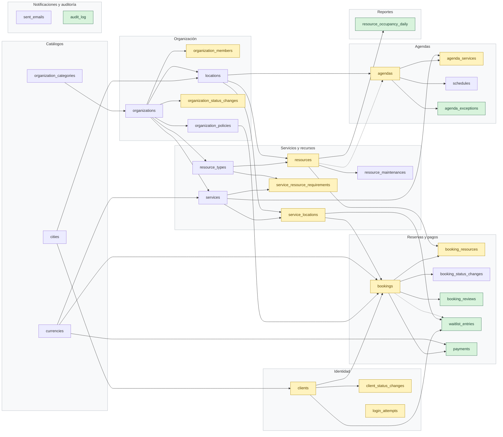
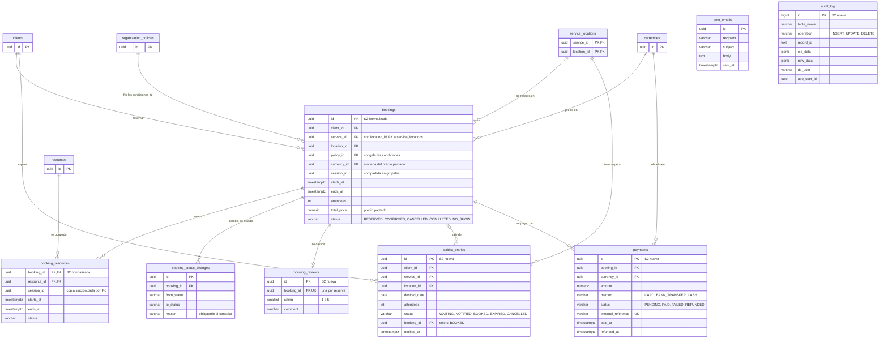

# Plataforma de Reservas de Servicios — Modelo de datos

Sprint 2 · Bases de Datos · CodeF@ctory 2026-II
Anderson Herrera Guzmán · Facultad de Ingeniería, Universidad de Antioquia

Este repositorio tiene el modelo de datos del caso *Plataforma de Reservas de Servicios*. El backend
del equipo está en [`CodeFactoryBookingApp/bookingplatform`](https://github.com/CodeFactoryBookingApp/bookingplatform).

La entrega del Sprint 1 está intacta en [`sprint-1/`](sprint-1/) y en la etiqueta
[`sprint-1`](https://github.com/andersonhg19/bookingplatform-BDs/tree/sprint-1) del repositorio.

| Archivo | Qué es |
|---|---|
| [`schema.sql`](schema.sql) | Modelo físico completo: 30 tablas normalizadas, restricciones, índices, triggers, roles y RLS |
| [`seed.sql`](seed.sql) | Datos de prueba, pensados para que todas las consultas devuelvan filas |
| [`consultas.sql`](consultas.sql) | Las 24 preguntas clave: 14 del Sprint 1 y 10 del Sprint 2 |
| [`pruebas-integridad.sql`](pruebas-integridad.sql) | 34 violaciones de datos y de permisos que la base rechaza |
| [`docs/analisis-almacenamiento.md`](docs/analisis-almacenamiento.md) | Almacenamiento, índices, costo de una consulta y su optimización |
| [`docs/generar-volumen.sql`](docs/generar-volumen.sql) | Carga 1,58 millones de reservas para comprobar el análisis |
| [`docker-compose.yml`](docker-compose.yml) | PostgreSQL 16 y pgAdmin con todo cargado |

**Contenido:** [Qué cambió](#qué-cambió-frente-al-sprint-1) ·
[MER](#1-mer-refinado) · [Modelo físico](#2-modelo-físico) · [Normalización](#normalización) ·
[schema.sql](#3-schemasql) · [Consultas](#4-consultas) · [Volumen](#5-estimación-de-volumen) ·
[Seguridad](#6-roles-y-seguridad) · [Análisis](#7-análisis-de-almacenamiento-costo-y-optimización) ·
[Rúbrica](#dónde-está-cada-criterio-de-la-rúbrica)

## Cómo probarlo

```bash
docker compose up -d
```

Levanta PostgreSQL 16 en `localhost:5432` con `schema.sql` y `seed.sql` ya cargados, y pgAdmin en
<http://localhost:8080>. Las credenciales del `docker-compose.yml` son de desarrollo local. El
contenedor sólo queda `healthy` si existen las 30 tablas.

```bash
docker compose cp consultas.sql postgres:/tmp/
docker compose cp pruebas-integridad.sql postgres:/tmp/
docker compose exec postgres psql -U postgres -d reservas -f /tmp/consultas.sql
docker compose exec postgres psql -U postgres -d reservas -f /tmp/pruebas-integridad.sql
```

Para empezar de cero: `docker compose down -v && docker compose up -d`.

## Qué cambió frente al Sprint 1

En el Sprint 1 entregué 19 tablas. En el Sprint 2 pasaron tres cosas: el equipo cambió el esquema con
sus migraciones, yo normalicé lo que había y agregué tablas nuevas. El resultado son 30 tablas.

**1. Lo que hizo el equipo.** Adoptó Flyway y, con las historias del Sprint 2, cambió el esquema en
las migraciones V3 a V9 del backend. Todo eso está incorporado aquí.

| Migración | Cambio | HU |
|---|---|---|
| V3 | Un servicio nace `INACTIVE`. La regla de reservas sólo valida lo que compromete agenda nueva y resiste reservas simultáneas por el último cupo | 004, 009, 010 |
| V4 | `organizations.nit` pasa a `identification_type` + `identification_number`, porque una persona natural también presta servicios | 002 |
| V6 | Nueva `sent_emails`: Render bloquea SMTP y el correo se guarda en una bandeja | — |
| V7 | `resources` gana capacidad y su estado pasa a `ACTIVE`/`RETIRED`. Nueva `resource_maintenances` | 009 |
| V8 | Nuevas `agendas` y `agenda_services`. `schedules` pasa a ser un bloque de una agenda | 006 |
| V9 | Función `f_sin_tildes` para buscar sin distinguir tildes | 005 |

**2. Lo que normalicé.** El esquema del Sprint 1, y lo que el equipo construyó encima, repetía
`organization_id` y `location_id` en varias tablas para poder declarar claves foráneas compuestas que
impidieran mezclar datos de dos proveedores. Funcionaba, pero esas columnas dependían de otra columna
que no era la clave y rompían 2FN o 3FN. En esta entrega las quité, y lo que garantizaban pasó a
triggers cortos. Detalle en [Normalización](#normalización).

| Tabla | Antes | Ahora |
|---|---|---|
| `service_locations`, `resources`, `service_resource_requirements`, `agendas`, `bookings` | guardaban `organization_id` | sale del servicio, la sede o el tipo de recurso |
| `agenda_services`, `booking_resources` | guardaban `location_id` | sale de la agenda o del recurso |
| `account_status_changes` | una tabla para clientes y proveedores, con un tipo y dos FK de las que siempre una era nula | `organization_status_changes` y `client_status_changes` |
| `clients` | `city` como texto libre: "Medellin" y "Medellín" eran dos ciudades | `city_id`, FK al catálogo `cities` |
| `clients`, `login_attempts` | fechas `timestamp` sin zona horaria | `timestamptz`, como el resto del esquema |
| `clients` | la mayoría de edad en un `CHECK` con `current_date`, que no es inmutable y rompe un restore | un trigger que la revisa al escribir |
| `bookings` | el precio pactado sin moneda | `currency_id`: el precio se congela con su moneda |
| `booking_resources` | la FK que sincroniza la copia no incluía `session_id` | la incluye |
| `organization_members`, `service_resource_requirements` | `id` sustituto más una `UNIQUE` con la clave real | la clave real es la PK |
| Todas | nombres de restricción mezclados (`ck_bsc_`, `<tabla>_pkey`) | un solo patrón: `pk_`, `fk_`, `uk_`, `ck_`, `ex_`, `ix_`, `ux_` + tabla |

Esto cambia el modelo frente a lo que el backend tiene en producción. **No toqué el repositorio del
equipo:** esta entrega es la propuesta de cómo debería quedar la base, y llevarla al backend sería una
migración nueva de ellos (V10 en adelante) junto con el ajuste de sus entidades JPA.

**3. Las tablas nuevas:**

| Tabla nueva | Para qué | Por qué hacía falta |
|---|---|---|
| `agenda_exceptions` | Festivos, cierres y jornadas recortadas | `schedules` sólo sabe de días de la semana |
| `booking_reviews` | Calificación de 1 a 5 de una reserva atendida | El caso pide reportes de uso, y la calidad del servicio es parte del uso |
| `waitlist_entries` | Lista de espera cuando no hay cupo | Completa el control de disponibilidad: si no había cupo, el cliente se perdía |
| `payments` | Pagos, intentos fallidos y reembolsos | `bookings.total_price` dice cuánto se pactó, pero nada decía si se pagó |
| `resource_occupancy_daily` | Ocupación diaria por recurso | Los "reportes sobre ocupación y uso" del caso, sin recorrer todas las reservas |
| `audit_log` | Quién cambió qué y cuándo | Seguridad: los cambios a clientes, proveedores, políticas, servicios, pagos y reseñas quedan registrados por trigger |

## 1. MER refinado

Son 30 tablas, así que primero va una vista general por dominios y después tres vistas de entidad
relación con las claves, los atributos principales y las cardinalidades. En las vistas de detalle, las tablas nuevas del sprint dicen
**S2 nueva** en su clave primaria y las que normalicé dicen **S2 normalizada**.

`auth.users` la gestiona Supabase Auth y no se crea aquí. Por eso `clients.id`,
`organization_members.user_id` y los `changed_by` no tienen clave foránea declarada.

### Vista general

Cada flecha va de la tabla padre (1) a la hija (N); las punteadas son relaciones opcionales. **Verde:** tabla nueva del Sprint 2. **Amarillo:** tabla que normalicé en este sprint.



### Identidad y organización


### Servicios, recursos y agendas

```mermaid
erDiagram
    organizations ||--o{ services : ofrece
    organizations ||--o{ resource_types : define
    currencies ||--o{ services : "cobra en"
    services ||--o{ service_locations : "se presta en"
    locations ||--o{ service_locations : presta
    services ||--o{ service_resource_requirements : exige
    resource_types ||--o{ service_resource_requirements : "es exigido"
    resource_types ||--o{ resources : "tiene instancias"
    locations ||--o{ resources : aloja
    resources ||--o{ resource_maintenances : "entra a mantenimiento"
    resources ||--o{ resource_occupancy_daily : "se mide"
    locations ||--o{ agendas : "tiene agendas"
    resources |o--o{ agendas : "puede tener agenda propia"
    agendas ||--o{ agenda_services : habilita
    services ||--o{ agenda_services : "es reservable en"
    agendas ||--o{ schedules : "tiene bloques"
    agendas ||--o{ agenda_exceptions : "tiene excepciones"

    organizations {
        uuid id PK
    }
    locations {
        uuid id PK
        uuid organization_id FK
    }
    currencies {
        uuid id PK
        char code UK "ISO 4217"
        varchar name UK
        boolean active
    }
    services {
        uuid id PK
        uuid organization_id FK
        uuid currency_id FK
        varchar name UK "único por proveedor"
        int duration_minutes
        numeric price
        int customer_capacity "1 individual, mayor que 1 grupal"
        varchar status "nace INACTIVE"
    }
    service_locations {
        uuid service_id PK, FK "S2 normalizada"
        uuid location_id PK, FK
    }
    resource_types {
        uuid id PK
        uuid organization_id FK
        varchar name UK "único por proveedor"
    }
    service_resource_requirements {
        uuid service_id PK, FK "S2 normalizada"
        uuid resource_type_id PK, FK
        int quantity_required
    }
    resources {
        uuid id PK "S2 normalizada"
        uuid resource_type_id FK
        uuid location_id FK
        varchar name UK "único por sede"
        int capacity
        varchar status "ACTIVE, RETIRED"
    }
    resource_maintenances {
        uuid id PK
        uuid resource_id FK
        timestamptz starts_at "no se solapan"
        timestamptz ends_at
        varchar reason
    }
    agendas {
        uuid id PK "S2 normalizada"
        uuid location_id FK
        uuid resource_id FK "nulo = toda la sede"
        varchar name UK "única por sede"
        smallint slot_minutes "15, 30 o 60"
        date valid_from
        date valid_until "nulo = sin fin"
    }
    agenda_services {
        uuid agenda_id PK, FK "S2 normalizada"
        uuid service_id PK, FK
    }
    schedules {
        uuid id PK
        uuid agenda_id FK
        smallint day_of_week "1 lunes a 7 domingo"
        time start_time "no se solapan"
        time end_time
        boolean active
    }
    agenda_exceptions {
        uuid id PK "S2 nueva"
        uuid agenda_id FK
        date exception_date
        time start_time "nulo = todo el día"
        time end_time
        varchar reason
    }
    resource_occupancy_daily {
        uuid resource_id PK, FK "S2 nueva"
        date occupancy_date PK
        int available_minutes
        int booked_minutes
        int bookings_count
    }
```



### Reservas, pagos y auditoría



`sent_emails` y `audit_log` no tienen claves foráneas a propósito. Un correo puede ir a una dirección
que no es de ningún cliente, y una fila de auditoría tiene que sobrevivir al registro que describe.

## 2. Modelo físico

Esta sección la generé desde el catálogo de PostgreSQL después de correr `schema.sql`, así que
corresponde a lo que crea el script. Sólo le quité los casts que PostgreSQL agrega al reescribir las
restricciones (`::text`, `= ANY (ARRAY[...])`) para que se lean como en el `schema.sql`. Cada tabla
trae sus columnas con tipo, nulo, default y clave, y debajo las restricciones que abarcan varias
columnas, los `CHECK` y los `EXCLUDE`.

Todas las restricciones e índices siguen el mismo patrón: `pk_`, `fk_`, `uk_`, `ck_`, `ex_`
(exclusión), `ix_` y `ux_` (índice único), seguidos del nombre de la tabla y de lo que controlan.

<details>
<summary><b>Catálogos</b> · cities, organization_categories, currencies</summary>


#### `cities`

Catálogo de ciudades, con departamento.

| Columna | Tipo | Nulo | Default | Clave |
|---|---|---|---|---|
| `id` | `uuid` | no | `gen_random_uuid()` | PK |
| `name` | `varchar(120)` | no |  |  |
| `region` | `varchar(120)` | no |  |  |

- UNIQUE `uk_cities_name_region`: `UNIQUE (name, region)`
- CHECK `ck_cities_name`: `CHECK ((length(btrim(name)) > 0))`
- CHECK `ck_cities_region`: `CHECK ((length(btrim(region)) > 0))`


#### `organization_categories`

Catálogo de categorías de negocio.

| Columna | Tipo | Nulo | Default | Clave |
|---|---|---|---|---|
| `id` | `uuid` | no | `gen_random_uuid()` | PK |
| `name` | `varchar(80)` | no |  | UNIQUE |

- CHECK `ck_organization_categories_name`: `CHECK ((length(btrim(name)) > 0))`


#### `currencies`

Monedas ISO 4217. La baja es lógica (active).

| Columna | Tipo | Nulo | Default | Clave |
|---|---|---|---|---|
| `id` | `uuid` | no | `gen_random_uuid()` | PK |
| `code` | `char(3)` | no |  | UNIQUE |
| `name` | `varchar(60)` | no |  | UNIQUE |
| `active` | `boolean` | no | `true` |  |

- CHECK `ck_currencies_code`: `CHECK ((code ~ '^[A-Z]{3}$'))`

</details>

<details>
<summary><b>Identidad</b> · clients, login_attempts</summary>


#### `clients`

Perfil del cliente (HU-001); id = auth.users.id de Supabase.

*Sprint 2: normalizada: `city` pasa a `city_id`, fechas con zona, mayoría de edad por trigger.*

| Columna | Tipo | Nulo | Default | Clave |
|---|---|---|---|---|
| `id` | `uuid` | no |  | PK |
| `full_name` | `varchar(120)` | no |  |  |
| `document` | `varchar(30)` | no |  | UNIQUE |
| `birth_date` | `date` | no |  |  |
| `email` | `varchar(160)` | no |  | UNIQUE |
| `phone` | `varchar(20)` | no |  |  |
| `city_id` | `uuid` | no |  | FK → `cities` |
| `notification_channel` | `varchar(20)` | no |  |  |
| `status` | `varchar(30)` | no | `'PENDING_VERIFICATION'` |  |
| `created_at` | `timestamptz` | no | `now()` |  |
| `updated_at` | `timestamptz` | no | `now()` |  |

- CHECK `ck_clients_document`: `CHECK ((length(btrim(document)) > 0))`
- CHECK `ck_clients_email`: `CHECK ((email ~* '^[^@[:space:]]+@[^@[:space:]]+\.[a-z]{2,}$'))`
- CHECK `ck_clients_full_name`: `CHECK ((length(btrim(full_name)) > 0))`
- CHECK `ck_clients_notification_channel`: `CHECK ((notification_channel IN ('EMAIL', 'SMS', 'WHATSAPP')))`
- CHECK `ck_clients_phone`: `CHECK ((phone ~ '^\+?[0-9]{7,15}$'))`
- CHECK `ck_clients_status`: `CHECK ((status IN ('PENDING_VERIFICATION', 'ACTIVE', 'SUSPENDED')))`
- UNIQUE (índice) `ux_clients_email_lower`: `USING btree (lower(email))`


#### `login_attempts`

Intentos de ingreso para el bloqueo por cuenta (HU-021).

*Sprint 2: fecha con zona horaria.*

| Columna | Tipo | Nulo | Default | Clave |
|---|---|---|---|---|
| `id` | `bigint` | no | `generated by default as identity` | PK |
| `email` | `varchar(160)` | no |  |  |
| `success` | `boolean` | no |  |  |
| `attempted_at` | `timestamptz` | no | `now()` |  |

- CHECK `ck_login_attempts_email`: `CHECK ((length(btrim(email)) > 0))`

</details>

<details>
<summary><b>Organización</b> · organizations, organization_members, organization_policies, locations, organization_status_changes, client_status_changes</summary>


#### `organizations`

Negocio proveedor (HU-002). PENDING_APPROVAL hasta que un administrador lo apruebe.

*Sprint 2: V4 del equipo: tipo y número de identificación.*

| Columna | Tipo | Nulo | Default | Clave |
|---|---|---|---|---|
| `id` | `uuid` | no | `gen_random_uuid()` | PK |
| `category_id` | `uuid` | no |  | FK → `organization_categories` |
| `name` | `varchar(160)` | no |  |  |
| `identification_type` | `varchar(20)` | no | `'NIT'` |  |
| `identification_number` | `varchar(20)` | no |  |  |
| `contact_email` | `varchar(160)` | no |  |  |
| `contact_phone` | `varchar(20)` | no |  |  |
| `timezone` | `varchar(60)` | no | `'America/Bogota'` |  |
| `status` | `varchar(30)` | no | `'PENDING_APPROVAL'` |  |
| `approved_at` | `timestamptz` | sí |  |  |
| `created_at` | `timestamptz` | no | `now()` |  |
| `updated_at` | `timestamptz` | no | `now()` |  |

- UNIQUE `uk_organizations_identification`: `UNIQUE (identification_type, identification_number)`
- CHECK `ck_organizations_approved`: `CHECK ((((status = 'ACTIVE') AND (approved_at IS NOT NULL)) OR ((status IN ('PENDING_APPROVAL', 'REJECTED')) AND (approved_at IS NULL)) OR (status = 'SUSPENDED')))`
- CHECK `ck_organizations_email`: `CHECK ((contact_email ~* '^[^@[:space:]]+@[^@[:space:]]+\.[a-z]{2,}$'))`
- CHECK `ck_organizations_identification_number`: `CHECK ((length(btrim(identification_number)) > 0))`
- CHECK `ck_organizations_identification_type`: `CHECK ((identification_type IN ('NIT', 'CC', 'CE', 'PASAPORTE')))`
- CHECK `ck_organizations_name`: `CHECK ((length(btrim(name)) > 0))`
- CHECK `ck_organizations_phone`: `CHECK ((contact_phone ~ '^\+?[0-9]{7,15}$'))`
- CHECK `ck_organizations_status`: `CHECK ((status IN ('PENDING_APPROVAL', 'ACTIVE', 'SUSPENDED', 'REJECTED')))`


#### `organization_members`

Quién trabaja en qué proveedor y con qué rol (ADR-0008).

*Sprint 2: normalizada: PK natural `(organization_id, user_id)`.*

| Columna | Tipo | Nulo | Default | Clave |
|---|---|---|---|---|
| `organization_id` | `uuid` | no |  | PK, FK → `organizations` |
| `user_id` | `uuid` | no |  | PK |
| `role` | `varchar(30)` | no |  |  |
| `created_at` | `timestamptz` | no | `now()` |  |

- PK `pk_organization_members`: `PRIMARY KEY (organization_id, user_id)`
- CHECK `ck_organization_members_role`: `CHECK ((role IN ('OWNER', 'MANAGER', 'STAFF')))`


#### `organization_policies`

Reglas de anticipación y cancelación, versionadas (HU-002).

| Columna | Tipo | Nulo | Default | Clave |
|---|---|---|---|---|
| `id` | `uuid` | no | `gen_random_uuid()` | PK |
| `organization_id` | `uuid` | no |  | FK → `organizations` |
| `version` | `integer` | no |  |  |
| `booking_notice_minutes_min` | `integer` | no |  |  |
| `booking_notice_minutes_max` | `integer` | no |  |  |
| `free_cancellation_window_minutes` | `integer` | no |  |  |
| `effective_from` | `timestamptz` | no | `now()` |  |
| `replaced_at` | `timestamptz` | sí |  |  |

- EXCLUDE `ex_organization_policies_solape`: `EXCLUDE USING gist (organization_id WITH =, tstzrange(effective_from, replaced_at) WITH &&)`
- UNIQUE `uk_organization_policies_version`: `UNIQUE (organization_id, version)`
- CHECK `ck_organization_policies_cancel`: `CHECK ((free_cancellation_window_minutes >= 0))`
- CHECK `ck_organization_policies_notice`: `CHECK (((booking_notice_minutes_min >= 0) AND (booking_notice_minutes_min <= booking_notice_minutes_max)))`
- CHECK `ck_organization_policies_version`: `CHECK ((version > 0))`
- CHECK `ck_organization_policies_vigencia`: `CHECK (((replaced_at IS NULL) OR (replaced_at > effective_from)))`
- UNIQUE (índice) `ux_organization_policies_vigente`: `USING btree (organization_id) WHERE (replaced_at IS NULL)`


#### `locations`

Sedes de un proveedor.

| Columna | Tipo | Nulo | Default | Clave |
|---|---|---|---|---|
| `id` | `uuid` | no | `gen_random_uuid()` | PK |
| `organization_id` | `uuid` | no |  | FK → `organizations` |
| `name` | `varchar(120)` | no |  |  |
| `address` | `varchar(200)` | no |  |  |
| `city_id` | `uuid` | no |  | FK → `cities` |
| `timezone` | `varchar(60)` | sí |  |  |
| `status` | `varchar(20)` | no | `'ACTIVE'` |  |
| `created_at` | `timestamptz` | no | `now()` |  |
| `updated_at` | `timestamptz` | no | `now()` |  |

- UNIQUE `uk_locations_org_name`: `UNIQUE (organization_id, name)`
- CHECK `ck_locations_address`: `CHECK ((length(btrim(address)) > 0))`
- CHECK `ck_locations_name`: `CHECK ((length(btrim(name)) > 0))`
- CHECK `ck_locations_status`: `CHECK ((status IN ('ACTIVE', 'INACTIVE')))`


#### `organization_status_changes`

Historia de estados de un proveedor, con motivo obligatorio (HU-003).

*Sprint 2: normalizada: sale de `account_status_changes`.*

| Columna | Tipo | Nulo | Default | Clave |
|---|---|---|---|---|
| `id` | `uuid` | no | `gen_random_uuid()` | PK |
| `organization_id` | `uuid` | no |  | FK → `organizations` |
| `from_status` | `varchar(30)` | sí |  |  |
| `to_status` | `varchar(30)` | no |  |  |
| `reason` | `varchar(500)` | no |  |  |
| `affected_bookings` | `integer` | no | `0` |  |
| `changed_by` | `uuid` | sí |  |  |
| `changed_at` | `timestamptz` | no | `now()` |  |

- CHECK `ck_organization_status_changes_count`: `CHECK ((affected_bookings >= 0))`
- CHECK `ck_organization_status_changes_from`: `CHECK (((from_status IS NULL) OR (from_status IN ('PENDING_APPROVAL', 'ACTIVE', 'SUSPENDED', 'REJECTED'))))`
- CHECK `ck_organization_status_changes_reason`: `CHECK ((length(btrim(reason)) > 0))`
- CHECK `ck_organization_status_changes_to`: `CHECK ((to_status IN ('PENDING_APPROVAL', 'ACTIVE', 'SUSPENDED', 'REJECTED')))`


#### `client_status_changes`

Historia de estados de un cliente, con motivo obligatorio (HU-003).

*Sprint 2: normalizada: sale de `account_status_changes`.*

| Columna | Tipo | Nulo | Default | Clave |
|---|---|---|---|---|
| `id` | `uuid` | no | `gen_random_uuid()` | PK |
| `client_id` | `uuid` | no |  | FK → `clients` |
| `from_status` | `varchar(30)` | sí |  |  |
| `to_status` | `varchar(30)` | no |  |  |
| `reason` | `varchar(500)` | no |  |  |
| `changed_by` | `uuid` | sí |  |  |
| `changed_at` | `timestamptz` | no | `now()` |  |

- CHECK `ck_client_status_changes_from`: `CHECK (((from_status IS NULL) OR (from_status IN ('PENDING_VERIFICATION', 'ACTIVE', 'SUSPENDED'))))`
- CHECK `ck_client_status_changes_reason`: `CHECK ((length(btrim(reason)) > 0))`
- CHECK `ck_client_status_changes_to`: `CHECK ((to_status IN ('PENDING_VERIFICATION', 'ACTIVE', 'SUSPENDED')))`

</details>

<details>
<summary><b>Servicios y recursos</b> · services, service_locations, resource_types, service_resource_requirements, resources, resource_maintenances</summary>


#### `services`

Servicios ofertados (HU-004). customer_capacity 1 = individual, > 1 = grupal.

*Sprint 2: V3 del equipo: nace `INACTIVE`.*

| Columna | Tipo | Nulo | Default | Clave |
|---|---|---|---|---|
| `id` | `uuid` | no | `gen_random_uuid()` | PK |
| `organization_id` | `uuid` | no |  | FK → `organizations` |
| `name` | `varchar(120)` | no |  |  |
| `description` | `varchar(500)` | sí |  |  |
| `duration_minutes` | `integer` | no |  |  |
| `preparation_minutes` | `integer` | no | `0` |  |
| `cleanup_minutes` | `integer` | no | `0` |  |
| `price` | `numeric(12,2)` | no |  |  |
| `currency_id` | `uuid` | no |  | FK → `currencies` |
| `customer_capacity` | `integer` | no | `1` |  |
| `status` | `varchar(20)` | no | `'INACTIVE'` |  |
| `created_at` | `timestamptz` | no | `now()` |  |
| `updated_at` | `timestamptz` | no | `now()` |  |

- UNIQUE `uk_services_org_name`: `UNIQUE (organization_id, name)`
- CHECK `ck_services_capacity`: `CHECK ((customer_capacity >= 1))`
- CHECK `ck_services_duration`: `CHECK ((duration_minutes > 0))`
- CHECK `ck_services_name`: `CHECK ((length(btrim(name)) > 0))`
- CHECK `ck_services_prep`: `CHECK (((preparation_minutes >= 0) AND (cleanup_minutes >= 0)))`
- CHECK `ck_services_price`: `CHECK ((price >= (0)))`
- CHECK `ck_services_status`: `CHECK ((status IN ('ACTIVE', 'INACTIVE')))`


#### `service_locations`

En qué sedes se presta cada servicio (HU-004).

*Sprint 2: normalizada: sin `organization_id`.*

| Columna | Tipo | Nulo | Default | Clave |
|---|---|---|---|---|
| `service_id` | `uuid` | no |  | PK, FK → `services` |
| `location_id` | `uuid` | no |  | PK, FK → `locations` |

- PK `pk_service_locations`: `PRIMARY KEY (service_id, location_id)`


#### `resource_types`

Tipos de recurso no consumible: sala, silla, especialista.

| Columna | Tipo | Nulo | Default | Clave |
|---|---|---|---|---|
| `id` | `uuid` | no | `gen_random_uuid()` | PK |
| `organization_id` | `uuid` | no |  | FK → `organizations` |
| `name` | `varchar(80)` | no |  |  |
| `description` | `varchar(300)` | sí |  |  |
| `created_at` | `timestamptz` | no | `now()` |  |

- UNIQUE `uk_resource_types_org_name`: `UNIQUE (organization_id, name)`
- CHECK `ck_resource_types_name`: `CHECK ((length(btrim(name)) > 0))`


#### `service_resource_requirements`

Cuántos recursos de cada tipo exige un servicio.

*Sprint 2: normalizada: sin `id` ni `organization_id`, PK natural.*

| Columna | Tipo | Nulo | Default | Clave |
|---|---|---|---|---|
| `service_id` | `uuid` | no |  | PK, FK → `services` |
| `resource_type_id` | `uuid` | no |  | PK, FK → `resource_types` |
| `quantity_required` | `integer` | no | `1` |  |

- PK `pk_service_resource_requirements`: `PRIMARY KEY (service_id, resource_type_id)`
- CHECK `ck_service_resource_requirements_qty`: `CHECK ((quantity_required > 0))`


#### `resources`

Recurso concreto en una sede, con capacidad y estado (HU-009).

*Sprint 2: V7 del equipo: capacidad y estado; normalizada: sin `organization_id`.*

| Columna | Tipo | Nulo | Default | Clave |
|---|---|---|---|---|
| `id` | `uuid` | no | `gen_random_uuid()` | PK |
| `resource_type_id` | `uuid` | no |  | FK → `resource_types` |
| `location_id` | `uuid` | no |  | FK → `locations` |
| `name` | `varchar(120)` | no |  |  |
| `capacity` | `integer` | no | `1` |  |
| `status` | `varchar(20)` | no | `'ACTIVE'` |  |
| `created_at` | `timestamptz` | no | `now()` |  |
| `updated_at` | `timestamptz` | no | `now()` |  |

- UNIQUE `uk_resources_id_location`: `UNIQUE (id, location_id)`
- UNIQUE `uk_resources_location_name`: `UNIQUE (location_id, name)`
- CHECK `ck_resources_capacity`: `CHECK ((capacity >= 1))`
- CHECK `ck_resources_name`: `CHECK ((length(btrim(name)) > 0))`
- CHECK `ck_resources_status`: `CHECK ((status IN ('ACTIVE', 'RETIRED')))`


#### `resource_maintenances`

Periodos de mantenimiento: el recurso no genera disponibilidad (HU-009).

*Sprint 2: V7 del equipo.*

| Columna | Tipo | Nulo | Default | Clave |
|---|---|---|---|---|
| `id` | `uuid` | no | `gen_random_uuid()` | PK |
| `resource_id` | `uuid` | no |  | FK → `resources` |
| `starts_at` | `timestamptz` | no |  |  |
| `ends_at` | `timestamptz` | no |  |  |
| `reason` | `varchar(300)` | sí |  |  |
| `created_at` | `timestamptz` | no | `now()` |  |

- EXCLUDE `ex_resource_maintenances_solape`: `EXCLUDE USING gist (resource_id WITH =, tstzrange(starts_at, ends_at) WITH &&)`
- CHECK `ck_resource_maintenances_rango`: `CHECK ((ends_at > starts_at))`

</details>

<details>
<summary><b>Agendas</b> · agendas, agenda_services, schedules, agenda_exceptions</summary>


#### `agendas`

Agenda de una sede o de un recurso: granularidad, vigencia y servicios (HU-006).

*Sprint 2: V8 del equipo; normalizada: sin `organization_id`.*

| Columna | Tipo | Nulo | Default | Clave |
|---|---|---|---|---|
| `id` | `uuid` | no | `gen_random_uuid()` | PK |
| `location_id` | `uuid` | no |  | FK → `locations`, FK compuesta → `resources` |
| `resource_id` | `uuid` | sí |  | FK compuesta → `resources` |
| `name` | `varchar(120)` | no |  |  |
| `slot_minutes` | `smallint` | no |  |  |
| `valid_from` | `date` | no |  |  |
| `valid_until` | `date` | sí |  |  |
| `created_at` | `timestamptz` | no | `now()` |  |
| `updated_at` | `timestamptz` | no | `now()` |  |

- EXCLUDE `ex_agendas_solape`: `EXCLUDE USING gist (location_id WITH =, COALESCE(resource_id, '00000000-0000-0000-0000-000000000000') WITH =, daterange(valid_from, valid_until, '[]') WITH &&)`
- UNIQUE `uk_agendas_location_name`: `UNIQUE (location_id, name)`
- FK `fk_agendas_resource`: `FOREIGN KEY (resource_id, location_id) REFERENCES resources(id, location_id) ON DELETE RESTRICT`
- CHECK `ck_agendas_name`: `CHECK ((length(btrim(name)) > 0))`
- CHECK `ck_agendas_slot`: `CHECK ((slot_minutes IN (15, 30, 60)))`
- CHECK `ck_agendas_vigencia`: `CHECK (((valid_until IS NULL) OR (valid_until >= valid_from)))`


#### `agenda_services`

Servicios reservables en una agenda (HU-006).

*Sprint 2: V8 del equipo; normalizada: sin `location_id`.*

| Columna | Tipo | Nulo | Default | Clave |
|---|---|---|---|---|
| `agenda_id` | `uuid` | no |  | PK, FK → `agendas` |
| `service_id` | `uuid` | no |  | PK, FK → `services` |

- PK `pk_agenda_services`: `PRIMARY KEY (agenda_id, service_id)`


#### `schedules`

Bloques horarios semanales de una agenda (HU-006).

*Sprint 2: V8 del equipo: bloques de una agenda.*

| Columna | Tipo | Nulo | Default | Clave |
|---|---|---|---|---|
| `id` | `uuid` | no | `gen_random_uuid()` | PK |
| `agenda_id` | `uuid` | no |  | FK → `agendas` |
| `day_of_week` | `smallint` | no |  |  |
| `start_time` | `time` | no |  |  |
| `end_time` | `time` | no |  |  |
| `active` | `boolean` | no | `true` |  |
| `created_at` | `timestamptz` | no | `now()` |  |

- EXCLUDE `ex_schedules_solape`: `EXCLUDE USING gist (agenda_id WITH =, day_of_week WITH =, timerange(start_time, end_time) WITH &&) WHERE (active)`
- CHECK `ck_schedules_dow`: `CHECK (((day_of_week >= 1) AND (day_of_week <= 7)))`
- CHECK `ck_schedules_rango`: `CHECK ((end_time > start_time))`


#### `agenda_exceptions` · **[S2 nueva]**

Festivos, cierres y jornadas recortadas de una agenda.

| Columna | Tipo | Nulo | Default | Clave |
|---|---|---|---|---|
| `id` | `uuid` | no | `gen_random_uuid()` | PK |
| `agenda_id` | `uuid` | no |  | FK → `agendas` |
| `exception_date` | `date` | no |  |  |
| `start_time` | `time` | sí |  |  |
| `end_time` | `time` | sí |  |  |
| `reason` | `varchar(300)` | no |  |  |
| `created_at` | `timestamptz` | no | `now()` |  |

- EXCLUDE `ex_agenda_exceptions_solape`: `EXCLUDE USING gist (agenda_id WITH =, exception_date WITH =, timerange(COALESCE(start_time, '00:00:00'), COALESCE(end_time, '24:00:00')) WITH &&)`
- CHECK `ck_agenda_exceptions_franja`: `CHECK ((((start_time IS NULL) AND (end_time IS NULL)) OR ((start_time IS NOT NULL) AND (end_time IS NOT NULL) AND (end_time > start_time))))`
- CHECK `ck_agenda_exceptions_reason`: `CHECK ((length(btrim(reason)) > 0))`

</details>

<details>
<summary><b>Reservas y pagos</b> · bookings, booking_resources, booking_status_changes, booking_reviews, waitlist_entries, payments</summary>


#### `bookings`

Reserva. policy_id y currency_id congelan las condiciones y la moneda al crearla.

*Sprint 2: normalizada: sin `organization_id`, con `currency_id`.*

| Columna | Tipo | Nulo | Default | Clave |
|---|---|---|---|---|
| `id` | `uuid` | no | `gen_random_uuid()` | PK |
| `client_id` | `uuid` | no |  | FK → `clients` |
| `service_id` | `uuid` | no |  | FK compuesta → `service_locations` |
| `location_id` | `uuid` | no |  | FK compuesta → `service_locations` |
| `policy_id` | `uuid` | no |  | FK → `organization_policies` |
| `session_id` | `uuid` | no |  |  |
| `starts_at` | `timestamptz` | no |  |  |
| `ends_at` | `timestamptz` | no |  |  |
| `attendees` | `integer` | no | `1` |  |
| `total_price` | `numeric(12,2)` | no |  |  |
| `currency_id` | `uuid` | no |  | FK → `currencies` |
| `status` | `varchar(20)` | no | `'RESERVED'` |  |
| `cancelled_at` | `timestamptz` | sí |  |  |
| `created_at` | `timestamptz` | no | `now()` |  |
| `updated_at` | `timestamptz` | no | `now()` |  |

- UNIQUE `uk_bookings_snapshot`: `UNIQUE (id, session_id, starts_at, ends_at, status)`
- FK `fk_bookings_service_location`: `FOREIGN KEY (service_id, location_id) REFERENCES service_locations(service_id, location_id) ON DELETE RESTRICT`
- CHECK `ck_bookings_attendees`: `CHECK ((attendees > 0))`
- CHECK `ck_bookings_cancel`: `CHECK (((status = 'CANCELLED') = (cancelled_at IS NOT NULL)))`
- CHECK `ck_bookings_price`: `CHECK ((total_price >= (0)))`
- CHECK `ck_bookings_rango`: `CHECK ((ends_at > starts_at))`
- CHECK `ck_bookings_status`: `CHECK ((status IN ('RESERVED', 'CONFIRMED', 'CANCELLED', 'COMPLETED', 'NO_SHOW')))`


#### `booking_resources`

Recursos ocupados por una reserva; el EXCLUDE impide la sobreocupación.

*Sprint 2: normalizada: sin `location_id`; la FK también sincroniza `session_id`.*

| Columna | Tipo | Nulo | Default | Clave |
|---|---|---|---|---|
| `booking_id` | `uuid` | no |  | PK, FK compuesta → `bookings` |
| `resource_id` | `uuid` | no |  | PK, FK → `resources` |
| `session_id` | `uuid` | no |  | FK compuesta → `bookings` |
| `starts_at` | `timestamptz` | no |  | FK compuesta → `bookings` |
| `ends_at` | `timestamptz` | no |  | FK compuesta → `bookings` |
| `status` | `varchar(20)` | no |  | FK compuesta → `bookings` |

- EXCLUDE `ex_booking_resources_solape`: `EXCLUDE USING gist (resource_id WITH =, session_id WITH <>, tstzrange(starts_at, ends_at) WITH &&) WHERE ((status IN ('RESERVED', 'CONFIRMED')))`
- PK `pk_booking_resources`: `PRIMARY KEY (booking_id, resource_id)`
- FK `fk_booking_resources_booking`: `FOREIGN KEY (booking_id, session_id, starts_at, ends_at, status) REFERENCES bookings(id, session_id, starts_at, ends_at, status) ON UPDATE CASCADE ON DELETE CASCADE`


#### `booking_status_changes`

Historia de estados de una reserva.

| Columna | Tipo | Nulo | Default | Clave |
|---|---|---|---|---|
| `id` | `uuid` | no | `gen_random_uuid()` | PK |
| `booking_id` | `uuid` | no |  | FK → `bookings` |
| `from_status` | `varchar(20)` | sí |  |  |
| `to_status` | `varchar(20)` | no |  |  |
| `reason` | `varchar(300)` | sí |  |  |
| `changed_by` | `uuid` | sí |  |  |
| `changed_at` | `timestamptz` | no | `now()` |  |

- CHECK `ck_booking_status_changes_cambio`: `CHECK ((from_status IS DISTINCT FROM (to_status)))`
- CHECK `ck_booking_status_changes_from`: `CHECK (((from_status IS NULL) OR (from_status IN ('RESERVED', 'CONFIRMED', 'CANCELLED', 'COMPLETED', 'NO_SHOW'))))`
- CHECK `ck_booking_status_changes_reason`: `CHECK (((to_status <> 'CANCELLED') OR (length(btrim((COALESCE(reason, '')))) > 0)))`
- CHECK `ck_booking_status_changes_to`: `CHECK ((to_status IN ('RESERVED', 'CONFIRMED', 'CANCELLED', 'COMPLETED', 'NO_SHOW')))`


#### `booking_reviews` · **[S2 nueva]**

Calificación de 1 a 5 de una reserva completada.

| Columna | Tipo | Nulo | Default | Clave |
|---|---|---|---|---|
| `id` | `uuid` | no | `gen_random_uuid()` | PK |
| `booking_id` | `uuid` | no |  | FK → `bookings`, UNIQUE |
| `rating` | `smallint` | no |  |  |
| `comment` | `varchar(1000)` | sí |  |  |
| `created_at` | `timestamptz` | no | `now()` |  |
| `updated_at` | `timestamptz` | no | `now()` |  |

- CHECK `ck_booking_reviews_comment`: `CHECK (((comment IS NULL) OR (length(btrim(comment)) > 0)))`
- CHECK `ck_booking_reviews_rating`: `CHECK (((rating >= 1) AND (rating <= 5)))`


#### `waitlist_entries` · **[S2 nueva]**

Lista de espera por servicio, sede y día.

| Columna | Tipo | Nulo | Default | Clave |
|---|---|---|---|---|
| `id` | `uuid` | no | `gen_random_uuid()` | PK |
| `client_id` | `uuid` | no |  | FK → `clients` |
| `service_id` | `uuid` | no |  | FK compuesta → `service_locations` |
| `location_id` | `uuid` | no |  | FK compuesta → `service_locations` |
| `desired_date` | `date` | no |  |  |
| `attendees` | `integer` | no | `1` |  |
| `status` | `varchar(20)` | no | `'WAITING'` |  |
| `booking_id` | `uuid` | sí |  | FK → `bookings` |
| `notified_at` | `timestamptz` | sí |  |  |
| `created_at` | `timestamptz` | no | `now()` |  |
| `updated_at` | `timestamptz` | no | `now()` |  |

- FK `fk_waitlist_entries_service_location`: `FOREIGN KEY (service_id, location_id) REFERENCES service_locations(service_id, location_id) ON DELETE CASCADE`
- CHECK `ck_waitlist_entries_attendees`: `CHECK ((attendees > 0))`
- CHECK `ck_waitlist_entries_booked`: `CHECK (((status = 'BOOKED') = (booking_id IS NOT NULL)))`
- CHECK `ck_waitlist_entries_notified`: `CHECK (((status <> ALL ((ARRAY['NOTIFIED', 'BOOKED', 'EXPIRED']))) OR (notified_at IS NOT NULL)))`
- CHECK `ck_waitlist_entries_status`: `CHECK ((status IN ('WAITING', 'NOTIFIED', 'BOOKED', 'EXPIRED', 'CANCELLED')))`
- UNIQUE (índice) `ux_waitlist_entries_activa`: `USING btree (client_id, service_id, location_id, desired_date) WHERE (status IN ('WAITING', 'NOTIFIED'))`


#### `payments` · **[S2 nueva]**

Pagos y reembolsos de una reserva.

| Columna | Tipo | Nulo | Default | Clave |
|---|---|---|---|---|
| `id` | `uuid` | no | `gen_random_uuid()` | PK |
| `booking_id` | `uuid` | no |  | FK → `bookings` |
| `amount` | `numeric(12,2)` | no |  |  |
| `currency_id` | `uuid` | no |  | FK → `currencies` |
| `method` | `varchar(20)` | no |  |  |
| `status` | `varchar(20)` | no | `'PENDING'` |  |
| `external_reference` | `varchar(100)` | sí |  | UNIQUE |
| `paid_at` | `timestamptz` | sí |  |  |
| `refunded_at` | `timestamptz` | sí |  |  |
| `created_at` | `timestamptz` | no | `now()` |  |
| `updated_at` | `timestamptz` | no | `now()` |  |

- CHECK `ck_payments_amount`: `CHECK ((amount > (0)))`
- CHECK `ck_payments_external_reference`: `CHECK (((external_reference IS NULL) OR (length(btrim(external_reference)) > 0)))`
- CHECK `ck_payments_fechas`: `CHECK ((((status IN ('PENDING', 'FAILED')) AND (paid_at IS NULL) AND (refunded_at IS NULL)) OR ((status = 'PAID') AND (paid_at IS NOT NULL) AND (refunded_at IS NULL)) OR ((status = 'REFUNDED') AND (paid_at IS NOT NULL) AND (refunded_at IS NOT NULL) AND (refunded_at >= paid_at))))`
- CHECK `ck_payments_method`: `CHECK ((method IN ('CARD', 'BANK_TRANSFER', 'CASH')))`
- CHECK `ck_payments_status`: `CHECK ((status IN ('PENDING', 'PAID', 'FAILED', 'REFUNDED')))`
- UNIQUE (índice) `ux_payments_vigente`: `USING btree (booking_id) WHERE (status IN ('PENDING', 'PAID'))`

</details>

<details>
<summary><b>Notificaciones, reportes y auditoría</b> · sent_emails, resource_occupancy_daily, audit_log</summary>


#### `sent_emails`

Correos guardados en vez de enviados por SMTP (ADR-0007).

*Sprint 2: V6 del equipo.*

| Columna | Tipo | Nulo | Default | Clave |
|---|---|---|---|---|
| `id` | `uuid` | no | `gen_random_uuid()` | PK |
| `recipient` | `varchar(160)` | no |  |  |
| `subject` | `varchar(200)` | no |  |  |
| `body` | `text` | no |  |  |
| `sent_at` | `timestamptz` | no | `now()` |  |

- CHECK `ck_sent_emails_recipient`: `CHECK ((recipient ~* '^[^@[:space:]]+@[^@[:space:]]+\.[a-z]{2,}$'))`
- CHECK `ck_sent_emails_subject`: `CHECK ((length(btrim(subject)) > 0))`


#### `resource_occupancy_daily` · **[S2 nueva]**

Ocupación diaria por recurso, calculada por fn_calcular_ocupacion.

| Columna | Tipo | Nulo | Default | Clave |
|---|---|---|---|---|
| `resource_id` | `uuid` | no |  | PK, FK → `resources` |
| `occupancy_date` | `date` | no |  | PK |
| `available_minutes` | `integer` | no |  |  |
| `booked_minutes` | `integer` | no |  |  |
| `bookings_count` | `integer` | no |  |  |
| `calculated_at` | `timestamptz` | no | `now()` |  |

- PK `pk_resource_occupancy_daily`: `PRIMARY KEY (resource_id, occupancy_date)`
- CHECK `ck_resource_occupancy_daily_minutos`: `CHECK (((available_minutes >= 0) AND (booked_minutes >= 0) AND (bookings_count >= 0)))`


#### `audit_log` · **[S2 nueva]**

Auditoría de cambios en tablas sensibles, escrita por trigger.

| Columna | Tipo | Nulo | Default | Clave |
|---|---|---|---|---|
| `id` | `bigint` | no | `generated always as identity` | PK |
| `table_name` | `varchar(63)` | no |  |  |
| `operation` | `varchar(6)` | no |  |  |
| `record_id` | `text` | sí |  |  |
| `old_data` | `jsonb` | sí |  |  |
| `new_data` | `jsonb` | sí |  |  |
| `db_user` | `varchar(63)` | no | `SESSION_USER` |  |
| `app_user_id` | `uuid` | sí |  |  |
| `changed_at` | `timestamptz` | no | `now()` |  |

- CHECK `ck_audit_log_datos`: `CHECK ((((operation = 'INSERT') AND (old_data IS NULL) AND (new_data IS NOT NULL)) OR ((operation = 'UPDATE') AND (old_data IS NOT NULL) AND (new_data IS NOT NULL)) OR ((operation = 'DELETE') AND (old_data IS NOT NULL) AND (new_data IS NULL))))`
- CHECK `ck_audit_log_operation`: `CHECK ((operation IN ('INSERT', 'UPDATE', 'DELETE')))`
- CHECK `ck_audit_log_table`: `CHECK ((length(btrim(table_name)) > 0))`

</details>

### Normalización

**28 de las 30 tablas están en BCNF.** Las otras dos se quedan por debajo a propósito, y por la
misma razón: un `EXCLUDE` de PostgreSQL sólo compara columnas de la misma fila, así que el dato que
necesita tiene que estar ahí.

| Tabla | Dependencia que queda | Por qué se deja |
|---|---|---|
| `booking_resources` | `booking_id → session_id, starts_at, ends_at, status`: parcial respecto a la PK `(booking_id, resource_id)`, rompe 2FN | El `EXCLUDE` que impide que un recurso atienda dos sesiones a la vez necesita el rango en la fila. La FK compuesta contra `uk_bookings_snapshot`, con `on update cascade`, hace que la copia no pueda desviarse del original |
| `agendas` | `resource_id → location_id`, cuando la agenda es de un recurso. `resource_id` no es superclave, así que rompe BCNF; sigue en 3FN porque `location_id` es parte de la clave candidata `(location_id, name)` | El `EXCLUDE` que impide dos agendas vigentes en la misma sede necesita `location_id`. La FK compuesta `(resource_id, location_id)` contra `resources` impide que no coincida |

Así que `agendas` queda en 3FN y `booking_resources` en 1FN. La segunda es una desnormalización
controlada: la redundancia existe, pero el motor no deja que produzca una anomalía de actualización.
Es la misma decisión del Sprint 1, ahora reducida al mínimo: antes la tabla también repetía
`location_id`.

**Lo que quité y cómo se garantiza ahora.** En el Sprint 1 había cinco redundancias más. Todas
existían para lo mismo, impedir que se mezclaran datos de dos proveedores, y las quité:

| Tabla | Dependencia que rompía la forma normal | La regla ahora la cumple |
|---|---|---|
| `service_locations` | `service_id → organization_id`: parcial, 2FN | `tg_service_locations_mismo_proveedor` |
| `service_resource_requirements` | `service_id → organization_id`: parcial, 2FN | `tg_service_resource_requirements_mismo_proveedor` |
| `agenda_services` | `agenda_id → location_id`: parcial, 2FN | `tg_agenda_services_en_sede` |
| `resources` | `location_id → organization_id`: transitiva, 3FN | `tg_resources_mismo_proveedor` |
| `agendas` | `location_id → organization_id`: transitiva, 3FN | sale de la sede; no hace falta regla |
| `bookings` | `service_id → organization_id`: transitiva, 3FN | `tg_bookings_coherencia` (la política es del proveedor del servicio) |
| `booking_resources` | `resource_id → location_id`: parcial, 2FN | `tg_booking_resources_en_sede` |

Es un intercambio y lo hice a conciencia. Una FK compuesta es declarativa y no se puede saltar; un
trigger es código. A cambio, el modelo queda en la forma que pide el curso, cada dato vive en un solo
lugar, y cada trigger es una consulta de una línea. Las pruebas 18 a 24 de
[`pruebas-integridad.sql`](pruebas-integridad.sql) intentan romper cada regla, y la base las rechaza
todas.

**Las tablas nuevas:**

| Tabla | Dependencias funcionales | Forma | Por qué |
|---|---|---|---|
| `agenda_exceptions` | `id → agenda_id, exception_date, start_time, end_time, reason` | BCNF | El único determinante es la clave |
| `booking_reviews` | `id → todo`; `booking_id → todo` | BCNF | Las dos son claves candidatas. No guarda cliente ni servicio: saldrían de `booking_id` y serían transitivas |
| `waitlist_entries` | `id → todo` | BCNF | No guarda `organization_id`: `service_id → organization_id` la haría transitiva |
| `payments` | `id → todo`; `external_reference → todo` | BCNF | `amount` y `currency_id` no se derivan de la reserva: son lo que cobró la pasarela, y una tarjeta internacional se cobra en otra moneda |
| `resource_occupancy_daily` | `(resource_id, occupancy_date) → minutos, reservas` | BCNF | Todo depende de la clave completa |
| `audit_log` | `id → todo` | no está en 1FN, a propósito | Ver abajo |

Dos decisiones más:

- `resource_occupancy_daily` es un dato derivado: se podría calcular desde las reservas y las agendas.
  La guardo igual, como en un data mart, porque el reporte de un mes por recurso pasa de recorrer
  todas las reservas a leer 30 filas. La llena `fn_calcular_ocupacion`, que reescribe el día
  completo, y rol_app sólo tiene permiso de leerla.
- `audit_log.old_data` y `new_data` son `jsonb`, que no es atómico. Guardan la foto de una fila de
  cualquier tabla, y una columna por cada columna de cada tabla auditada no tendría sentido. Nadie
  consulta el negocio desde ahí, sólo quién cambió qué.

Los estados (`status`, `role`, `method`) son `varchar` con `CHECK` y no tablas de catálogo. Son listas
cerradas que cambian con el código y no con los datos, así que una tabla aparte sólo agregaría un join.

## 3. schema.sql

Está ordenado por dependencias: catálogos, identidad, organización, servicios y recursos, agendas,
reservas, notificaciones, reportes y auditoría. Después vienen las funciones, los triggers, los
índices, los comentarios y, al final, la seguridad. Cada tabla nueva dice `[S2 nueva]` y cada
decisión de normalización está comentada donde se toma.

Lo probé así:

- Contra un PostgreSQL 16 vacío corre sin errores y crea 30 tablas, 38 FK, 78 CHECK, 6 EXCLUDE,
  84 índices y 28 triggers, con RLS activo en todas.
- Ninguna restricción ni índice se sale de la convención de nombres. Lo verifiqué contra el catálogo.
- Contra una base con los roles de Supabase (`anon`, `authenticated` y `auth.uid()`) crea además las
  políticas del Data API.
- `seed.sql`, las 24 consultas y las 34 pruebas de integridad corren encima. Cada prueba falla por la
  regla que le corresponde, y la parte de lo permitido pasa sin errores.
- `docker compose up` deja el contenedor `healthy` con todo cargado.

Al final del archivo hay una lista de lo que el esquema **no** garantiza. Por ejemplo, que una reserva
caiga dentro de un bloque de agenda: eso lo valida el backend al ofrecer franjas.

## 4. Consultas

Todas están en [`consultas.sql`](consultas.sql), cada una con la pregunta que responde, y todas
devuelven filas con `seed.sql`. El archivo usa `\echo` para titular cada resultado, así que se corre
con `psql -f` y no en el editor SQL de Supabase. Las del Sprint 1 son las mismas de esa entrega,
ajustadas al modelo actual.

| # | Pregunta | Cómo | HU |
|---|---|---|---|
| **Sprint 1** | | | |
| 1 | ¿Qué servicios puede reservar un cliente en Medellín, en qué sede y a qué precio? | join de 6 tablas, filtros | 002, 004 |
| 2 | ¿Cuál es la ocupación por sede y semana: reservas, asistentes e ingresos? | agregación, `date_trunc` | caso |
| 3 | ¿Qué servicios no puede prestar una sede por falta de recursos? | `left join`, `having` | 004 |
| 4 | ¿Cuáles son los servicios más reservados de cada organización, con empates? | `rank()` | caso |
| 5 | Si se suspende un proveedor, ¿qué reservas futuras quedan afectadas? | join, subconsulta | 003 |
| 6 | ¿Qué agenda tiene cada recurso pasado mañana y cuánta carga lleva? | `left join`, agregación | 006 |
| 7 | ¿Qué proveedores llevan más tiempo esperando aprobación? | filtro, antigüedad | 003 |
| 8 | ¿Está bloqueada una cuenta por intentos fallidos? | agregación con ventana de tiempo | 021 |
| 9 | ¿Qué clientes llevan más de 24 h sin verificar el correo? | join, filtro de tiempo | 001 |
| 10 | ¿Qué condiciones de cancelación rigen para cada reserva? | join, `case` | 002 |
| 11 | ¿El correo, el documento o el NIT ya están registrados? | `exists` | 001, 002 |
| 12 | ¿Qué clientes se registraron y nunca han reservado? | `not exists` correlacionado | 001 |
| 13 | ¿Qué servicios se prestan en una sede y no en otra? | diferencia, `except` | 004 |
| 14 | ¿Qué sedes ofrecen todos los servicios activos de su organización? | división, doble negación | 004 |
| **Sprint 2** | | | |
| 15 | ¿Qué porcentaje de su horario estuvo ocupado cada recurso en los últimos 30 días? | join, agregación, `having` | caso |
| 16 | ¿Qué servicios tienen mejor calificación y con cuántas reseñas? | join de 4 tablas, `avg` | caso |
| 17 | ¿Quién sigue en lista de espera para cada servicio y día, y en qué turno? | join, `row_number()` | — |
| 18 | ¿Cuánto cobró, cuánto devolvió y cuánto le quedó a cada proveedor por mes? | `with`, `union all`, agregación | — |
| 19 | ¿Qué agendas cierran o recortan su horario en las próximas dos semanas? | `left join`, filtro de fechas | 006 |
| 20 | ¿Qué reservas vivas chocan con un mantenimiento programado? | join por solapamiento de rangos `&&` | 009 |
| 21 | ¿Qué servicios encuentra quien busca "clasico", sin tilde? | `f_sin_tildes`, `like` | 005 |
| 22 | ¿Qué reservas atendidas en los últimos 30 días no tienen reseña? | antijoin, `not exists` | — |
| 23 | ¿Quién cambió datos sensibles en la última semana y qué cambió? | `jsonb_each`, `lateral` | — |
| 24 | ¿Cuántas reservas e ingresos dejó cada servicio de un proveedor en el mes? | join, agregación | caso |

La 24 es la que analizo en el documento de almacenamiento. La 20 muestra para qué sirve tener los
mantenimientos en su propia tabla: cruza rangos de tiempo con `&&` y encuentra la reserva que hay que
mover antes de que llegue el cliente.

```sql
select r.name       as recurso,
       m.starts_at  as mantenimiento_desde,
       m.ends_at    as mantenimiento_hasta,
       m.reason     as motivo,
       c.full_name  as cliente,
       br.starts_at as reserva
from resource_maintenances m
    inner join resources         r  on r.id = m.resource_id
    inner join booking_resources br on br.resource_id = m.resource_id
                                   and tstzrange(br.starts_at, br.ends_at) && tstzrange(m.starts_at, m.ends_at)
                                   and br.status in ('RESERVED', 'CONFIRMED')
    inner join bookings          b  on b.id = br.booking_id
    inner join clients           c  on c.id = b.client_id
order by br.starts_at;
```

La 15 lee el resumen diario en vez de las reservas:

```sql
select l.name                    as sede,
       r.name                    as recurso,
       sum(o.available_minutes)  as minutos_disponibles,
       sum(o.booked_minutes)     as minutos_ocupados,
       round(100.0 * sum(o.booked_minutes) / nullif(sum(o.available_minutes), 0), 1) as porcentaje
from resource_occupancy_daily o
    inner join resources r on r.id = o.resource_id
    inner join locations l on l.id = r.location_id
where o.occupancy_date between current_date - 30 and current_date - 1
group by l.name, r.name
having sum(o.available_minutes) > 0
order by porcentaje desc, sede, recurso;
```

## 5. Estimación de volumen

**Supuestos.** La plataforma arranca en el Valle de Aburrá con 200 proveedores y suma 40 por mes, así
que termina el primer año con 680. En el año hay en promedio (200 + 680) / 2 = **440 proveedores
activos**. Cada proveedor tiene en promedio 1,5 sedes, 8 servicios y 6 recursos por sede, y atiende
10 reservas por día (300 al mes). Los clientes arrancan en 20 000 y suman 3 000 por mes.

| Tabla | Al lanzar | Crece por mes (mes 12) | Fin del año 1 | De dónde sale |
|---|---|---|---|---|
| `organizations` | 200 | 40 | 680 | supuesto de adopción |
| `locations` | 300 | 60 | 1 020 | 1,5 por proveedor |
| `services` | 1 600 | 320 | 5 440 | 8 por proveedor |
| `resources` | 1 800 | 360 | 6 120 | 6 por sede |
| `agendas` | 1 800 | 360 | 6 120 | una agenda por recurso |
| `schedules` | 10 800 | 2 160 | 36 720 | 6 bloques por semana en cada agenda |
| `agenda_exceptions` | — | 9 180 | 71 280 | 18 festivos al año: 1,5 por agenda al mes; en el año, 18 × 3 960 agendas en promedio |
| `clients` | 20 000 | 3 000 | 56 000 | supuesto de adopción |
| **`bookings`** | — | 204 000 | **1 584 000** | 440 proveedores × 300 reservas × 12 meses |
| `booking_resources` | — | 244 800 | 1 900 800 | 1,2 recursos por reserva |
| `booking_status_changes` | — | 408 000 | 3 168 000 | 2 cambios por reserva: confirmar y cerrar |
| `payments` | — | 214 200 | 1 663 200 | 1 por reserva y un 5 % de reintentos |
| `booking_reviews` | — | 30 600 | 237 600 | califica 1 de cada 4 reservas completadas (60 %) |
| `waitlist_entries` | — | 6 120 | 47 520 | 3 % de las reservas |
| `resource_occupancy_daily` | — | 183 600 | 1 445 400 | una fila por recurso por día: 3 960 recursos en promedio × 365 |
| `login_attempts` | — | 224 000 | 1 824 000 | 4 ingresos por cliente al mes, 38 000 clientes en promedio |
| `sent_emails` | — | 408 000 | 3 168 000 | 2 correos por reserva: confirmación y recordatorio |
| `audit_log` | — | 465 920 | 3 691 640 | ver el desglose abajo |

`audit_log` suma los eventos de las tablas auditadas. En el año: pagos 2 × 1 663 200 = 3 326 400
(alta y cambio de estado), clientes 2 × 56 000 = 112 000 (alta y verificación), servicios
2 × 5 440 = 10 880 (alta y activación), miembros 3 × 680 = 2 040, proveedores 2 × 680 = 1 360
(alta y aprobación), políticas 2 × 680 = 1 360 (versión inicial y un cambio) y reseñas 237 600 (una
alta cada una). En total 3 691 640. En el mes 12: 2 × 214 200 + 2 × 3 000 + 2 × 320 + 3 × 40 +
2 × 40 + 2 × 40 + 30 600 = 465 920.

Las historias de estado de cuentas (`organization_status_changes`, `client_status_changes`) y los
catálogos (`cities`, `organization_categories`, `currencies`) quedan por debajo de unos pocos miles de
filas al año.

`bookings` termina el año con 1,58 millones de filas y unos 288 MB según la fórmula del curso. Medido
en PostgreSQL son 309 MB. Lo crucé generando ese volumen con
[`docs/generar-volumen.sql`](docs/generar-volumen.sql); el detalle está en el
[análisis de almacenamiento](docs/analisis-almacenamiento.md).

## 6. Roles y seguridad

### Los roles

Separo tres funciones del sistema. Cada una es un rol de grupo sin login: las personas y los servicios
entran con un usuario propio que hereda de uno de ellos. Así ninguna contraseña queda en el
repositorio.

| Rol | Quién lo usa | Qué necesita |
|---|---|---|
| `rol_admin` | administración de la base y soporte | todo |
| `rol_app` | el backend Spring Boot | sólo lo que el código hace |
| `rol_lectura` | reportes, analítica, BI | leer, pero no datos personales, de contacto ni de seguridad |

Además, en Supabase existen `anon` y `authenticated`, los roles del Data API. Ahí todo está cerrado
salvo lo que abren las políticas RLS.

### Matriz de permisos

S = select, I = insert, U = update, D = delete.

| Tablas | rol_admin | rol_app | rol_lectura | authenticated | anon |
|---|---|---|---|---|---|
| Catálogos: `cities`, `organization_categories`, `currencies` | todo | S | S | S | S |
| `clients` | todo | S I U | — | — | — |
| `organizations` | todo | S I U | S, sin documento ni contacto | — | — |
| Operación: `organization_members`, `organization_policies`, `locations`, `service_locations`, `resource_types`, `service_resource_requirements`, `resources`, `resource_maintenances`, `agendas`, `agenda_services` | todo | S I U | S | — | — |
| `services`, `schedules`, `agenda_exceptions` | todo | S I U **D** | S | — | — |
| `bookings`, `waitlist_entries` | todo | S I U | S | S, sólo las propias | — |
| `booking_reviews` | todo | S I U | S, sin el comentario | S, sólo las propias | — |
| `booking_resources`, `payments` | todo | S I U | S | — | — |
| Historiales: `booking_status_changes`, `organization_status_changes` | todo | S I | S | — | — |
| `client_status_changes`, `login_attempts`, `sent_emails` | todo | S I | — | — | — |
| `resource_occupancy_daily` | todo | S | S | — | — |
| `audit_log` | todo | — | — | — | — |

Por qué está así:

- **rol_app no borra**, salvo en tres tablas. Revisé el código del backend: `ManageServiceUseCase`
  borra un servicio que nunca se reservó y `AgendaRepositoryAdapter` reescribe los bloques de una
  agenda con `delete` + `insert`. Una excepción de agenda mal puesta también tiene que poder quitarse.
  Fuera de eso, nada se borra: una reserva se cancela, un recurso se retira y un servicio se
  desactiva.
- **Los historiales sólo crecen.** rol_app les agrega filas pero no las edita. Si los pudiera editar,
  dejarían de servir como evidencia de lo que pasó.
- **Los catálogos se cargan por migración** (V5 del equipo). La aplicación sólo los lee.
- **audit_log no la toca nadie más que el administrador.** La escribe el trigger `fn_auditar`, que es
  `security definer`. Así rol_app deja rastro de sus cambios sin poder leer ni borrar ese rastro.
- **rol_lectura no ve datos personales.** No lee `clients`, su historia de estados, `sent_emails` ni
  `login_attempts`. De `organizations` no ve el documento, el correo ni el teléfono, porque desde V4
  un proveedor puede ser una persona natural con cédula. De `booking_reviews` no ve el comentario, que
  es texto libre del cliente. Eso se hace con permisos por columna. Para un reporte basta con contar
  `bookings.client_id`.
- **Nadie crea objetos en `public`** salvo rol_admin.

### RLS

Activo RLS en las 30 tablas, siguiendo el ADR-0002 del equipo. Con RLS activo y sin políticas nadie
distinto del dueño ve filas, así que cada rol propio recibe su política. Las políticas abren filas y lo
que cada rol puede *hacer* lo siguen limitando los `GRANT`. El control de qué proveedor ve qué datos
lo hace el backend con `OrganizationAccess` (ADR-0008); la base no lo repite.

En Supabase las políticas son estas:

```sql
-- Cualquiera puede leer los catálogos
create policy cities_publico on cities for select to anon, authenticated using (true);

-- Cada cliente autenticado ve sólo sus reservas, su lista de espera y sus reseñas
create policy reservas_propias on bookings for select to authenticated
    using (client_id = (select auth.uid()));
create policy espera_propia on waitlist_entries for select to authenticated
    using (client_id = (select auth.uid()));
create policy resenas_propias on booking_reviews for select to authenticated
    using (exists (select 1 from bookings b where b.id = booking_id and b.client_id = (select auth.uid())));
```

El bloque que las crea sólo corre si existen los roles de Supabase, así que el mismo `schema.sql`
funciona en un PostgreSQL local.

### Qué rol usa la aplicación

**Hoy el backend se conecta como `postgres`**, el dueño de las tablas. Lo dice el propio V2 del equipo:
así la aplicación ignora RLS. Eso le da al backend mucho más de lo que necesita: una inyección SQL
tendría permiso de borrar cualquier tabla.

Lo que propongo, y que este esquema ya deja listo:

```sql
create role app_bookingplatform login password '...' in role rol_app;   -- el backend
create role reportes login password '...' in role rol_lectura;           -- BI
```

Flyway seguiría migrando con el usuario dueño (`spring.flyway.user`) y la aplicación usaría
`app_bookingplatform`. Es un cambio de configuración del equipo, no de código, y queda como propuesta.

### Comprobado

Las pruebas 27 a 34 de [`pruebas-integridad.sql`](pruebas-integridad.sql) intentan lo que cada rol
*no* debe poder hacer, y todas terminan en `permission denied`. La parte 3 hace con rol_app lo que hace
el backend (reservar, asignar un recurso, confirmar, pagar, editar un servicio y reescribir una
agenda) y todo pasa, triggers incluidos. También corre con rol_lectura un reporte de calificaciones.
Las políticas de Supabase las probé con un `auth.uid()` simulado: un cliente ve sólo sus reservas y no
puede leer `clients` ni crear pagos.

## 7. Análisis de almacenamiento, costo y optimización

Está en [`docs/analisis-almacenamiento.md`](docs/analisis-almacenamiento.md). En resumen:

- **Tabla analizada:** `bookings`. L = 183 bytes, FR = 43, BR = 36 838 páginas (288 MB). El índice
  `pk_bookings` tiene orden d = 186, altura 3 y como máximo 8 564 nodos (67 MB). PostgreSQL mide
  39 600 páginas y un índice de altura 3 con 8 263 páginas.
- **Costo:** para la consulta 24, el ciclo anidado con índice cuesta 2 370 páginas frente a 36 848 del
  hash join y 184 589 del ordenamiento y mezcla. El plan real lee 2 338.
- **Optimización:** de E₀, con un producto de 8 600 millones de tuplas, a E₁, que filtra y proyecta
  antes de la reunión con las leyes 2, 4/5, 9, 3, 8 y 11, y sólo combina 8 servicios con 99 000
  reservas para quedarse con 146.

## Dónde está cada criterio de la rúbrica

| # | Criterio | Dónde |
|---|---|---|
| 1 | MER refinado | [Sección 1](#1-mer-refinado) y [qué cambió](#qué-cambió-frente-al-sprint-1) |
| 2 | Modelo físico completo | [Sección 2](#2-modelo-físico), con [normalización](#normalización) |
| 3 | schema.sql | [`schema.sql`](schema.sql) y [sección 3](#3-schemasql) |
| 4 | Consultas de los dos sprints | [Sección 4](#4-consultas) y [`consultas.sql`](consultas.sql) |
| 5 | Estimación de volumen | [Sección 5](#5-estimación-de-volumen) |
| 6 | Roles y seguridad | [Sección 6](#6-roles-y-seguridad) y el final de `schema.sql` |
| 7 | Almacenamiento e índices | [Análisis, secciones 2 y 3](docs/analisis-almacenamiento.md#2-organización-del-archivo-e-índices) |
| 8 | Costo de una consulta | [Análisis, sección 4](docs/analisis-almacenamiento.md#4-costo-de-una-consulta-con-reunión) |
| 9 | Optimización algebraica | [Análisis, sección 5](docs/analisis-almacenamiento.md#5-optimización-algebraica) |
